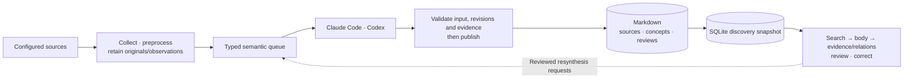
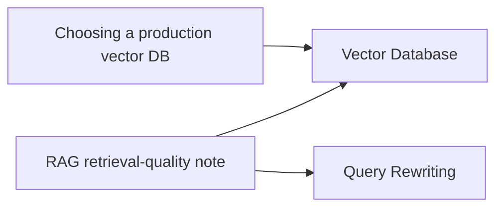
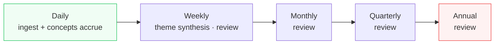

# Lorekeeper

[](https://www.rust-lang.org)
[](LICENSE)
[](https://deepwiki.com/junyeong-ai/lorekeeper)

> **English** | **[한국어](README.md)**

**Turn your scattered daily work into a knowledge wiki that grows itself.**
Lorekeeper collects Gmail, Slack, Jira, Calendar, RSS and notes into source-linked Markdown knowledge, using links rather than embeddings. Rust owns collection, search and publication checks; a configured LLM host judges summaries, concepts and relationships.

---

## Why Lorekeeper?

Growing knowledge needs continuing checks of cross-references, categories, duplicate candidates and competing claims. Lorekeeper automates reproducible checks and leaves evidence-based semantic judgments to explicit LLM work.

> 📖 **New to the terms?** — **vault**: a folder of markdown files (i.e. your knowledge store) · **concept**: one page per topic · **link**: a `[Display](relative/path.md)` markdown link between pages (resolves in Obsidian, GitHub, and any OKF consumer).

| | |
|---|---|
| 📥 **Scheduled collection** | Select sources and an agent, then register OS jobs for recurring runs |
| 🧹 **Cuts the noise** | Dedup, filters irrelevant items, splits *your* work into a work-log automatically |
| 🧩 **Concept accumulation** | Reuse an existing subject after checking scope; preserve its names, aliases and evidence |
| 🔗 **A connected knowledge graph** | Markdown links, backlinks, and clusters connect concepts |
| ✅ **Completed work → knowledge** | Preserve completed tasks and notes; configured tasks collection and semantic processing feed daily pages, concepts and personal reviews |
| 📈 **Compounding** | Weekly / monthly / quarterly / annual synthesis — value grows over time |
| 🔑 **Reuse CLI login** | Uses existing Claude Code or Codex authentication; Lore needs no separate LLM API client |

> Inspired by [Andrej Karpathy's LLM Wiki](https://gist.github.com/karpathy/442a6bf555914893e9891c11519de94f): separate sources, derived wiki and writing conventions, then repeat ingest/query/lint. Lorekeeper uses `config.yaml` for collection/execution and the vault's `AGENTS.md` for page and evidence contracts.

---

## At a glance



`lore` owns collection, execution ordering and guarded publication. Claude Code or Codex follows the shared `lore-process` skill to judge summaries, concepts and relationships. Markdown is authoritative; SQLite is a rebuildable search and navigation index.

---

## Core ideas

| Storage or stage | Responsibility |
|---|---|
| Originals and source pages | Preserve manual originals/dependencies and collected RSS text separately; refetch is not historical restoration |
| `daily/`, `wiki/documents/` | Source observations and documents; the pipeline owns structure and queues semantic work |
| `wiki/concepts/` | Durable retrieval subjects with resolved names, aliases, evidence and supported relationships |
| `wiki/explorations/` | Comparisons, judgments and open reviews with exact evidence revisions and retained prior decisions |
| `me/`, period synthesis | Optional personal work-log/reviews, separate from weekly knowledge themes |
| SQLite and `index.md` | Rebuildable discovery and a small entry guide; Markdown remains authoritative |

Structure and semantic results have different owners. A matching input hash and
completion marker permit reuse; filled prose alone does not prove completion.
Future dates do not materialize. `vault.locale` controls generated prose, while
source text and source-written concept names retain their language. Established
concept prose follows the [per-kind language policy](skills/lore-process/references/processing-kinds.md#output-language-all-kinds).

Exact source identities deduplicate repeated observations. Similar documents from
different sources are not automatically merged. The model judges meaning; Rust
validates input identity, revisions, evidence and publication. Passing structural
checks does not establish complete semantic consistency or factual truth.

## Reading path

[First setup](#quick-start) → [Example output](#what-do-you-actually-get) → [Sources](#sources) → [Execution profiles](#agent-skills-and-execution-profiles) → [Scheduling](#scheduling).
Use the [task references](#commands) for detailed command and evidence contracts.

## Quick start

> **Before you start, you'll need** — nothing exotic:
> - 💻 **macOS or Linux** (Windows ships a PowerShell installer)
> - 🤖 **Claude Code or Codex** — uses existing CLI authentication for summaries, concepts and relationships
> - 🔑 **Credentials only for the sources you enable** — e.g. Google sign-in for Gmail/Drive/Calendar, a token for Slack
> - 🗂️ **(optional) Obsidian** — for pretty graph browsing. Without it, the output is still plain markdown
>
> 💡 The starter enables **one local note inbox without provider credentials**. Add RSS, work sources or personal tracking when needed. Summaries and concepts require an authenticated agent CLI. Set `execution.profiles.primary.engine` in the copied `config.yaml` to `claude-code` or `codex`.

```bash
# 1) Install — binary + templates + skills for both hosts
curl -fsSL https://raw.githubusercontent.com/junyeong-ai/lorekeeper/main/scripts/install.sh | bash

# 2) First setup — preserve an existing config.yaml and edit it
LORE_CONFIG_DIR="${XDG_CONFIG_HOME:-$HOME/.config}/lorekeeper"
cp -n "$LORE_CONFIG_DIR/config.starter.yaml" "$LORE_CONFIG_DIR/config.yaml"
${EDITOR:-vi} "$LORE_CONFIG_DIR/config.yaml"  # set vault.root, timezone, locale and identity

# 3) Validate locally and generate the knowledge-writing contract
lore validate
lore schema
mkdir -p "$(lore config vault-root)/inbox"
```

Put one note in the vault's `inbox/`, then collect it. `inbox_dir: inbox` follows
your selected `vault.root`. The starter does not need the provider credential wizard.

```bash
# 4) Check input access, then collect for real
lore ingest --dry-run
lore run daily
```

`lore run daily` collects sources, runs the selected agent and verifies semantic
publication. Collection alone does not complete knowledge processing. Then verify:

```bash
lore queue check
lore wiki reviews --check
lore wiki search "your note's topic" --json

# 5) Optional automation: generate definitions, then register with the OS
lore schedule > lorekeeper.cron
#    review and merge with crontab -e; on macOS see "Scheduling" below
```

`config.example.yaml` is the full option catalog, with every source disabled.
Copy only the blocks you need into your real `config.yaml`, fill in their scope and
account values, then enable them. `/lore-setup` helps with those choices and ID discovery.
For an authenticated source, run `lore init credentials` and then
`lore ingest --dry-run <source-id>`. Definition generation, OS registration and an
actual run are separate steps; follow [Scheduling](#scheduling).

### Binary documents and large inputs

For DOCX, XLSX and PDF, run `lore input install DIRECTORY` and merge its printed
configuration. On Apple Silicon with macOS 14 or later,
`lore input install-vision VISION_DIRECTORY --python python3.12` installs PaddleOCR-VL 1.6.
With `vision` configured, PDFs retain native text and visual recognition of every page
by default. Choose `pdf: {mode: native}` or explicit physical pages to control cost.
Tesseract literal-text OCR is also available. Recognition is not semantic approval.

Check installation with `lore input check` and projections with `lore input inspect FILE.pdf`.
Original entries default to 32 MiB; explicitly raise `ingest.originals` limits for larger files.
Projection size, page count and execution time have separate bounds. Retries reuse
verified derived caches; `inspect` and `--dry-run` never write them. See
[preprocessing configuration and scope](skills/lore-setup/references/config.md#document-preprocessing)
for memory limits and preservation of tables, formulas, pages and sheets.

---

## What do you actually get?

Let's walk through a hypothetical. **Sumin**, an AI engineer, drops a RAG troubleshooting note into the vault's `inbox/`.

> The page examples below show **key fields only** — real files also carry housekeeping frontmatter such as `updated`.

### 📝 Input — `inbox/rag-retrieval-quality.md`

```markdown
# RAG pipeline: fixing low-recall retrieval

Problem: ~30% of queries retrieved irrelevant chunks, so the generator hallucinated.
Cause: (1) 2000-token chunks were too coarse — a chunk's embedding averaged several
       topics. (2) We embedded the raw conversational question.
Design: a vector database (Vector DB) stores embeddings and retrieves records similar to a query vector.
Fix: re-chunk to ~400 tokens, use query rewriting to make a standalone question, switch
     similarity L2 → cosine. Recall@5: 0.62 → 0.91.
```

### ▶️ Run

```console
$ lore ingest
▸ notes (manual)
  extracted: 1 items
  ✓ wrote: wiki/documents/rag-pipeline-fixing-low-recall-retrieval.md (document)

Done. 1 pages written, 0 personal items tracked.
```

The page exists, but its `## Summary` / `## Related Concepts` are still empty — `lore ingest` queued the LLM work:

```console
$ lore queue status
  [current] sum-… (summarize)        → wiki/documents/rag-pipeline-…
  [current] ext-… (extract-concepts) → wiki/documents/rag-pipeline-…
queue: 2 current, 0 done, 0 stale, 0 missing-target, 0 unreadable across 2 task(s)
```

Run **`lore run process`**. The configured Claude Code or Codex host follows the shared skill, while Rust checks source and target revisions before publication. After successful completion, `lore queue status` reports `0 current` and the page is filled:

### ✅ Result ① — the document page (summary + concept links filled in)

```markdown
---
id: rag-pipeline-fixing-low-recall-retrieval
type: document
title: "RAG pipeline: fixing low-recall retrieval"
created: 2026-06-13
tags: ["document"]
---

## Summary
Re-chunking from 2000→400 tokens, rewriting conversational questions into standalone
queries, and switching similarity from L2 to cosine lifted Recall@5 from 0.62 → 0.91.
This note reports a joint intervention; it does not isolate the effect of each
change or establish a ranking across other environments.

## Content
… (normalized, preserved from the original) …

## Related Concepts
- [Vector Database](../../wiki/concepts/vector-database.md)
- [Query Rewriting](../../wiki/concepts/query-rewriting.md)
```

### ✅ Result ② — concept pages **converge** (the key payoff)

Days later Sumin drops another note, *"Choosing a vector database for production."* "Vector database" appears in both notes — but instead of forking a new page, it **joins the existing concept**:

```markdown
---
id: vector-database
type: concept
title: "Vector Database"
aliases: ["Vector DB"]
category: ai-ml
source_count: 2          # ← two documents cite this one concept
---

## Synthesis
A vector database stores embeddings and retrieves records similar to a query vector. The second note chose pgvector in an existing
PostgreSQL environment to reduce the cost of operating a separate system. Keep the
conditions of that decision separate from the first note's retrieval-quality observation.

## Sources
<!-- lorekeeper:concept-sources:v1 -->

Run `lore wiki prepare` for a snapshot ID, then `lore wiki citations EXACT_CONCEPT_PATH --snapshot ID` for complete source citations.
```

> This example assumes both notes support the same subject and scope. The registered `Vector DB` alias resolves to that owner; similar names alone never authorize merging. Extracting no concepts is also valid.

Each source's `concept_policy` controls admission. `disabled` collects documents and
summaries without extracting concepts; `existing-only` links published owners;
`supported-new` also permits supported new subjects. Omission means `disabled`.
`focus` separately limits subject scope. The policy enters task identity and is
enforced by native publication, rather than by prompts alone.

### ✅ Result ③ — disclose detail as needed

```bash
lore wiki prepare                              # verify current originals and return a snapshot ID
lore wiki search "Vector DB" --snapshot <id> --limit 10 --json
lore wiki context wiki/concepts/vector-database.md --snapshot <id> --limit 10
lore wiki read wiki/concepts/vector-database.md  # outline → selected --section ID
lore wiki citations wiki/concepts/vector-database.md --snapshot <id> --limit 20
lore wiki reviews                              # related judgments and unresolved reviews
```

Narrow candidates by names, aliases and text, then expand selected sections,
relationships and direct evidence. Use `wiki search --body` for literal body text,
`--spacing` for whitespace differences, and `wiki browse --category ... --tag ...`
for metadata filters. Candidates, ordinary links and citations have different
meanings; ranking and citation counts are not confidence scores.

`index.md` is a small entry guide; `.lorekeeper/search.sqlite` holds discovery.
Reuse a snapshot and `next_offset` for a session, then verify evidence with returned
revisions. Replacing the one current snapshot makes its old ID unavailable.
Omitting `--snapshot` reads live Markdown. `wiki prepare` verifies the complete
current corpus, so it need not run before every query.

See [query, relationship and original lookup](skills/lore-wiki/references/query.md)
and [conflict review](skills/lore-wiki/references/audit.md) for detailed procedures.
Recency or citation frequency cannot settle a conflict; preserve unresolved
judgments and reassess evidence that changes.

### ✅ Result ④ — a knowledge graph forms

These are the concept citations supported by the example documents.
Clusters and `suggest-links` supply candidates; meaningful relationships require evidence review.



### 📈 Over time — compounding



Collection connects sources and concepts; period synthesis uses ready daily records or child periods. Changed inputs can require renewed synthesis. Weekly knowledge themes and personal performance reviews remain separate outputs.

---

## Sources

| Type | Use for | Auth |
|---|---|---|
| `gmail` | Email digest (filter by label / sender) | Google OAuth |
| `slack-channel` | Whole channel = team activity (threads, bot filter, watch_users) | Slack token |
| `slack-search` | Keyword-trend search | Slack user token |
| `jira` | Current issues selected by JQL (updated time/current assignee, ADF→Markdown) | Jira API |
| `confluence` | Spaces and pages selected by CQL (storage format→Markdown) | Atlassian OAuth or API token |
| `google-calendar` | Schedule + meeting notes (auto-extracted from Drive links) | Google OAuth |
| `google-drive` | Curated docs in a Drive folder | Google OAuth |
| `rss` | Vendor blogs / news → concepts (no auth, multi-feed) | none |
| `nodex` | A project repository's own decision and learning records → concepts (needs `nodex.toml` and nodex `>=0.60,<0.61`; see [binary selection and evidence versions](skills/lore-setup/references/config.md#nodex-binary-selection)) | none |
| `manual` | Inbox Markdown, text and HTML; optional DOCX, XLSX, PDF and image recognition | No source credentials; binary decoding needs an optional runtime |
| `tasks` | Your own finished tasks — what `lore task` closed becomes the day's page | none |

Define several sources of the same type when needed (e.g. `team-slack`, `ai-news`).
Daily aggregates use `<daily>/<source-key>/DATE.md`; document-unit manual, nodex and
Drive sources share `<wiki>/documents/` with stable document identities.
Full reference: [`config.example.yaml`](config.example.yaml).

To add external knowledge, copy the catalog's `ai-news` or `tech-news` block into your actual config and enable it. The selected feeds cover official announcements, model methods, AI implementation, product evaluation and Korean engineering accounts; additional labs, newsletters and aggregators are optional. `fetch_full_text` retrieves articles from short feeds, but access failures retain only the feed text. `focus` guides summaries and concept extraction without filtering raw collection. Current feed listings and query caps guarantee neither complete history nor factual accuracy.

New sources register adapter types, configuration, document identity, observation scope
and partial-failure contracts. Adding a configuration name alone does not install an
adapter. There is no dedicated YouTube source; see [configuration](skills/lore-setup/references/config.md)
for Drive/web format and historical-scope limits.

## Commands

```bash
lore validate                    # validate configuration
lore run daily                   # collect → process → reconcile/discover → resume ready periods
lore run process                 # process already collected semantic work
lore run knowledge               # one configured semantic audit batch
lore ingest <source-id>          # collect one source; does not rebuild the cross-source work-log
lore status                     # subsystem status and follow-up commands
lore health --json              # source collection times and overdue state
lore queue check                # unfinished work, staged results and interrupted publication
lore wiki reviews --check       # invalid reviews/evidence drift; open judgments are separate
lore graph lint                 # structural violations and observations
lore maintenance --dry-run      # preview retention-based cleanup
```

The command/flag authority is `lore --help` and `lore <command> --help`.
Continue with the reference for your task:

| Task | Detailed procedure |
|---|---|
| Search, body text, relationships, citations and originals | [Query](skills/lore-wiki/references/query.md) |
| Add files/URLs and migrate imported document identity | [Add](skills/lore-wiki/references/add.md) |
| Collection, original preservation, retries and date recovery | [Ingestion](skills/lore-ingest/references/ingestion.md) |
| Correct names, tags, categories/lifecycle or resynthesize concepts | [Curation](skills/lore-wiki/references/curation.md) |
| Review relationships, contradictions and duplicate meanings | [Audit](skills/lore-wiki/references/audit.md) |
| Recurring semantic review, progress and resumption | [Maintenance](skills/lore-wiki/references/maintenance.md) |
| Partition and reduce large evidence | [Bounded work](skills/lore-process/references/bounded-work.md) |
| Retain originals, repository captures and working caches | [Source retention](skills/lore-extract/references/manifest.md#source-retention) |

## Agent skills and execution profiles

Canonical skill bodies and references live under `skills/`. Claude metadata lives
in `agents/claude.json`; Codex invocation policy uses `agents/openai.yaml` where
needed. Deployment generates host entry files from those shared procedures.
Following the [official skill authoring guide](https://platform.claude.com/docs/en/agents-and-tools/agent-skills/best-practices),
entry files describe responsibilities and routing; detailed contracts are directly linked references.

| Skill | Responsibility |
|---|---|
| `lore-process` | Queue summaries, concepts, synthesis and reviews; guarded publication |
| `lore-setup` | Sources, configuration, authentication, first processing and scheduling |
| `lore-wiki` | `query`, `add`, `capture`, `audit`, `curate`, `maintain`, `status` |
| `lore-extract` | Repository knowledge extraction: scan → run → audit |
| `lore-ingest` | Collection, period synthesis, status, scheduling and maintenance |
| `lore-day` | Agenda, knowledge briefing, tasks, reminders and day closing |

In Claude Code use `/lore-wiki query ...`; in Codex use `$lore-wiki`.
`lore self deploy --skills user --agent codex` deploys interactive skills to Codex.
`--agent both` selects both hosts, and `--skills project` selects the current project.
Claude discovers `.claude/skills`; Codex discovers `.agents/skills`.
Unattended jobs use verified copies under `<data>/skills/<engine>/` independently
of interactive deployment. Missing or modified required files refuse execution.

Supported CLI contracts are Claude Code `>=2.1.303,<3` and Codex `>=0.163.0,<1`.
Shared skills and typed results stay independent of host-specific authentication,
tools and sandbox adapters. Publication checks do not replace OS access controls.

For example, select Claude for daily processing and Codex for semantic review:

```yaml
llm:
  provider: queue
execution:
  default_profile: primary
  work:
    max_input_bytes: 262144
    max_result_bytes: 32768
    max_calls: 64
  profiles:
    primary:
      engine: claude-code
      timeout_seconds: 3600
    reviewer:
      engine: codex
      timeout_seconds: 3600
  operations:
    knowledge: reviewer
```

Selection is explicit `--profile`, then operation profile, then default profile;
an unavailable host never switches automatically. Set optional `executable`, `model`,
Claude `config_directory` or Codex `profile` only where needed. `execution.work` bounds
request/result JSON bytes and calls per run; large evidence uses fresh inspection
and reduction sessions. These are not token or billing caps. Unfinished work is
preserved and reported as failure. See [execution configuration](skills/lore-setup/references/config.md#execution-profiles)
for profile-specific limits and manual selection, and [bounded work](skills/lore-process/references/bounded-work.md)
for result contracts.

`llm.provider: queue` retains semantic requests separately from host selection.
`noop` creates no LLM work. Search, navigation and deterministic collection need no agent.

---

## Install · build

```bash
# Windows (PowerShell)
irm https://raw.githubusercontent.com/junyeong-ai/lorekeeper/main/scripts/install.ps1 | iex

# Build from source
cargo build --release && ./target/release/lore --help
```

Install flags: `--version`, `--install-dir`, `--data-dir`, `--skill {user,project,none}`, `--agent {claude-code,codex,both}`, `--from-source`, `--force`, `--yes`, `--dry-run` (`--help` lists them all).

The installer deploys `config.starter.yaml` and `config.example.yaml` in the config
directory and preserves your `config.yaml`. Beside them, `data-dir` records the
installation path and `deployed-skills` records deployed skills. These automatic
records support updates and removal; they contain no credentials.

## Tasks and personal reviews

```bash
lore agenda                       # today: what is committed, what woke, what is due
lore task add "review the spec" --state today
lore task add "answer the index question" --link https://acme.slack.com/archives/C123/p1755600000 --label thread
lore task done 7k2p --note "refresh tokens rotate; retrying after a committed rotation kills the grant"
lore task sync                    # record what you changed in Obsidian
```

The board is `<personal>/tasks.md` — ordinary markdown checkboxes under
`Today / Proposed / Next / Waiting / Someday`. Tick one on your phone or drag a line
to another section; the next `lore task sync` or task mutation command records that change.
The heading is its state, and `Proposed` means it has not been accepted yet.

`lore task done` stores the completion and `--note` in the transition log. Ingesting
the configured tasks source over a window containing that completion date creates
that day's daily page; `/lore-process`
handles the queued summary and concept extraction. Full-source ingestion also
updates the work-log, and the scheduled daily pipeline runs ingestion and semantic
processing together. **What you did becomes evidence alongside what you read.**

Personal reviews verify each published work-log against its actual personal
contribution inputs. Changed inputs after filtered collection, or known work
without a log, block synthesis. Full-source `lore ingest --date YYYY-MM-DD` can
refresh that binding only when it actually publishes that day's log. Empty or
unavailable historical input does not authorize deleting or adopting a retained
log. History outside the observed query remains unverified.

## Updates and removal

```bash
lore self status      # is every deployed copy still the one this binary carries (non-zero if not)
lore self update      # replace the binary with a release, then redeploy interactive/runtime skills, templates and AGENTS.md
lore self deploy      # redeploy only — the repair `self status` reports
lore self uninstall   # remove what was installed; the vault is never touched
```

The interactive/runtime skills, templates and both config examples are **compiled into the binary**, and deployed copies can drift; `lore self status` checks them, while `lore self deploy` writes the copies. `lore self update` uses the same settlement check as `lore queue check`: pending work, unreadable or unparseable input, staged results and interrupted publication all block replacement. `--force` permits inspectable unfinished work but never bypasses configuration or storage inspection errors. Older releases are refused unless explicitly selected with `--version`.

---

## Credentials

Environment variables or `<vault>/.lorekeeper/credentials.json` (0600). Env vars take precedence over the file.
On macOS and Linux, credential and lock files granting group or other-user permissions
are refused. Restrict manually created or restored files with `chmod 600` before use.
Writes always use `0600`; the setup wizard refuses an unreadable or malformed existing
store rather than initializing it with empty credentials.
For vaults using the same accounts, optional `credentials.file` selects one shared
store; relative paths resolve against the config file. Cooperating processes lock
OAuth refresh and successor persistence together. Do not copy rotating refresh
tokens into independent files; other applications should use their own OAuth app.

```bash
lore init credentials   # interactive wizard — Google tokens minted via browser OAuth
```

- **Google**: `LORE_GOOGLE_CLIENT_ID/SECRET/REFRESH_TOKEN` — Gmail/Drive/Calendar **read-only** scopes. Needs a "Desktop app" OAuth client.
- **Slack**: `LORE_SLACK_TOKEN` (bot `xoxb-`) or `LORE_SLACK_USER_TOKEN` (`xoxp-`). `slack-search` requires the user token.
- **Atlassian** (Jira/Confluence): `LORE_ATLASSIAN_SITE_URL` + `LORE_ATLASSIAN_PAT` (Data Center), or `+ LORE_ATLASSIAN_EMAIL` + `LORE_ATLASSIAN_API_TOKEN` (a Cloud CLASSIC token, addressed at the site). Add `LORE_ATLASSIAN_CLOUD_ID` for a SCOPED token — that value is what selects the gateway route, and without it the token is treated as classic and sent to the site. OAuth is deliberately not env-supplied — its refresh token rotates and must be persisted, so mint it with `lore init credentials`.

> The default credential file is excluded from Git. Keep explicitly selected shared stores out of commits and synchronization too.

---


## Scheduling

```bash
lore schedule > lorekeeper.cron   # Linux: review, then merge with crontab -e
lore schedule --format launchd --bin "$(command -v lore)"   # macOS
```

`lore schedule` prints definitions; it does not register OS jobs. Preserve existing
cron entries. On macOS, save each plist at its named LaunchAgents path, create the
log directory, then run `launchctl bootstrap gui/$(id -u) <absolute-plist-path>`.
Inspect registration and an actual execution. After changes, boot out existing
jobs before registering replacements; unload disabled jobs too. `self uninstall`
does not unregister OS jobs.

If the vault is in a protected macOS folder such as Documents, Desktop or Downloads,
the scheduled `lore` process needs permission to access that folder. Approval for a
terminal app does not establish permission for launchd execution. Start the actual
job, approve any macOS permission prompt, then inspect its logs and exit status.
A binary update that changes its signing identity may require approval again.
File mode `0600` does not replace this OS consent. See
[Apple's folder-access documentation](https://developer.apple.com/documentation/bundleresources/information-property-list/nsdocumentsfolderusagedescription).

Scheduled jobs execute native Rust commands:

| Schedule | Command |
|---|---|
| `ingest.schedule` | `lore run daily --wait` |
| `graph.audit.schedule` | `lore run knowledge --wait` |
| Weekly/monthly/quarterly/annual | `lore synthesis <period> --previous --defer --wait-for-vault` |
| Maintenance | `lore maintenance --prune-queue --wait-for-vault` |
| Reminders | `lore task remind notify` |

Daily jobs collect, process semantic work, reconcile relationships/discovery and
resume ready periods. Collection failures and semantic failures remain distinct;
unfinished work is not reported as success. JSON results use stdout, child logs stderr.

A cooperative Unix workflow lease and exact revision guards coordinate semantic
sessions. Start manual work before reading evidence with `lore workflow -- claude`
or `lore workflow -- codex`. Configuration edits stop the remaining job. Regenerate
OS definitions after changing host authentication directories, PATH or proxy environment.
Native agent jobs/workflow are unsupported on Windows. See [scheduling](skills/lore-ingest/references/scheduling.md)
for registration, contention and captured-environment details.

### Recover after interruptions

Launchd coalesces missed runs after sleep; cron skips them. Neither restores every
missed date. Triggers use host local time; document dates use the vault timezone.
Opt in with explicit activation boundaries and budgets:

```yaml
ingest:
  recovery: {start_date: "2026-10-01", max_days_per_source_per_run: 3}
synthesis:
  recovery: {start_date: "2026-10-01", max_periods_per_run: 8}
```

The first requeries [missing collection dates](skills/lore-ingest/references/ingestion.md#missing-date-recovery).
The second registers closed periods starting on or after its activation date.
Its budget counts examined slots, including existing requests, and resumes a
persisted cursor. Neither setting invents historical originals or semantic completion.
Inspect `lore ingest --recover --dry-run` and `lore synthesis pending --status --json`
for selected reach and blockers.

### Recurring semantic review

```yaml
graph:
  audit:
    schedule: "0 7 * * 0"
    batch_size: 5
    max_input_bytes: 262144
```

Review changed and first-time concepts/documents independently of collection and
period synthesis. Ready subjects get a turn; `audit_deferred` exposes blockers.
Progress can coexist with unrelated queue backlog while the overall job remains
incomplete. Judgments and evidence revisions stay in Markdown reviews; one source
or a high citation count alone never authorizes merging or deletion.

For an initial backlog, select a registered profile and execution budget:
`lore run knowledge --profile reviewer --batches 20 --json`. `batch-limit` means
the budget was reached; `settled` means the current eligible plan has no pending
subjects. Neither proves universal truth or review of every external original.
Size the initial campaign from `lore wiki audit-plan`
and a small run's actual completions, calls and duration; then check that recurring
capacity keeps up with new and changed subjects. `batch_size` caps selected subjects,
not completions or cost when work is deferred, partitioned or fails.
See [semantic maintenance](skills/lore-wiki/references/maintenance.md)
for discovery scope, complete evidence reads, repair and reassessment.

Reminders retire after the OS accepts them, not after proof that a person read
them. A crash before retirement can cause redelivery; failed submissions stay pending.

---

### Versioning the vault with Git (optional)

Keep a backup or a reviewed Git commit before substantial rewrites or merges. Pipelines never stage or commit automatically because they cannot distinguish concurrent user edits from their own output. A mutation journal resumes interrupted changes; it is not a historical backup.

Exclude `.lorekeeper/`, credentials and any private local state from Git. Review `git status` and `git diff`, then stage only the intended files. The small generated `index.md` entry guide can be excluded under the configured wiki directory. Check the sharing scope before using a remote repository.

### Backup, restore and moving devices

Back up the **entire vault, including hidden files**, separately from Git history.
Original/evidence archives, observations, review receipts, work state and unfinished
queues/journals under `.lorekeeper/` cannot be reconstructed from Markdown alone.
Stop scheduled and interactive writers and external editors, wait for foreground
work to finish, then take a consistent copy or filesystem snapshot. Include the
selected configuration and custom templates. Protect credential backups separately
or authenticate again on the new device; do not add all private state to public Git.

Restore to a separate location with the same CLI version. Adjust the copied config's
`vault.root` and external paths, reinstall optional document processing, and retain
credential permissions `0600`. Inspect `lore status`, `lore queue check` and
`lore wiki reviews` before resuming writes. Resolve unfinished work/conflicts through
the existing recovery protocol rather than deleting state to appear healthy. Then
rebuild derived SQLite with `lore wiki prepare`, run `lore graph lint` and inspect
retained originals. SQLite and lock files cannot restore originals or work state.

---

## Learn more

- **Full config reference** — [`config.example.yaml`](config.example.yaml) (every source and option, commented)
- **Page-format schema** — `lore schema` generates `wiki/AGENTS.md` in your vault
- **Architecture deep-dive** — [DeepWiki](https://deepwiki.com/junyeong-ai/lorekeeper)

## Built with

Rust 2024 edition · build toolchain 1.99.1 · MSRV 1.97. `tokio`/`reqwest` (async sources), `jiff` (timezone-correct dates), `serde-saphyr` (YAML), `minijinja` (templates), `feed-rs` (feeds), `petgraph` (link graph), `blake3` (event/cache hashing). License: MIT.
