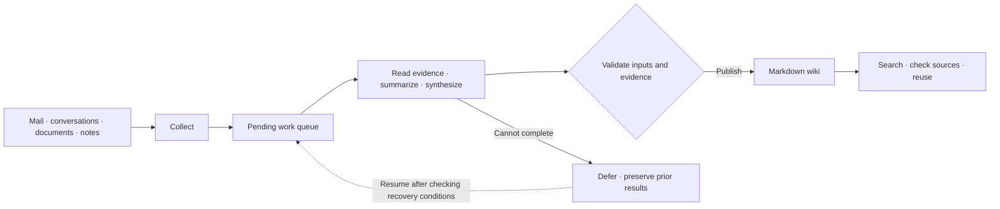

# Lorekeeper

[](https://www.rust-lang.org)
[](LICENSE)
[](https://deepwiki.com/junyeong-ai/lorekeeper)

> **[한국어](README.md)** | **English**

**Turn scattered work records into reusable knowledge with traceable sources.**

Collect mail, conversations, documents and notes into a connected Markdown wiki.
Claude Code or Codex interprets summaries, concepts and relationships; the Rust CLI checks input and evidence changes before publication.
Read it in Obsidian, ask an agent for supporting evidence, or use the Markdown files directly.

[Quick start](#quick-start) · [Using knowledge](#find-and-use-knowledge) · [Sources](#sources) · [Execution](#agents-and-execution-settings) · [Operations](#operations-and-completion)



Collection, publication and semantic review are different completion states. Passing structural checks does not establish factual truth or complete corpus review.
Markdown is authoritative; SQLite is a rebuildable search index.

## Quick start

Start with one local note. No external source credentials are needed.
Use macOS Apple Silicon or Linux x86_64/ARM64 with an authenticated **Claude Code or Codex** CLI.
Obsidian is optional. A Windows CLI is available, but native agent jobs and `workflow` require Unix.

### 1. Install

```bash
curl -fsSL https://raw.githubusercontent.com/junyeong-ai/lorekeeper/main/scripts/install.sh | bash
```

This installs the binary, templates and skills. Existing users should use `lore self update`.
See [installation](skills/lore-ingest/references/installation.md) for Windows, custom paths and repair.

### 2. Choose the vault and agent

```bash
LORE_CONFIG_DIR="${XDG_CONFIG_HOME:-$HOME/.config}/lorekeeper"
cp -n "$LORE_CONFIG_DIR/config.starter.yaml" "$LORE_CONFIG_DIR/config.yaml"
${EDITOR:-vi} "$LORE_CONFIG_DIR/config.yaml"
```

Existing configuration is preserved. Set `vault.root`, `vault.timezone`, `vault.locale`, `identity`
and `execution.profiles.primary.engine` (`claude-code` or `codex`).

```bash
lore validate
lore schema
mkdir -p "$(lore config vault-root)/inbox"
```

`validate` checks local configuration; `schema` generates the vault's writing rules in `AGENTS.md`.
Follow [initial setup](skills/lore-setup/references/config.md#initial-setup) for configuration and authentication details.

### 3. Add a note and run

Put one Markdown note in the vault's `inbox/`, then run:

```bash
lore ingest --dry-run   # Check inputs without writing pages
lore run daily         # Collect → interpret → publish and run final checks
```

Use `lore ingest` for collection alone or `lore run process` for pending work on collected records.
Large tasks may span multiple calls and runs.

### 4. Check results and evidence

```bash
lore queue check
lore wiki reviews --check
lore wiki search "your note's main topic" --json
```

Read the returned pages together with their linked sources. Default locations are
`daily/`, `wiki/documents/`, `wiki/concepts/` and `wiki/explorations/`; these are configurable.
Use relative Markdown links in Obsidian. `lore validate` checks the relevant settings.

## Find and use knowledge

In Claude Code, ask `/lore-wiki query What evidence led to the retry policy?`; in Codex, select `$lore-wiki` and ask your question.

| Goal | Skill |
|---|---|
| Find evidence, examine relationships, capture learning from current work | `lore-wiki` (`query`, `capture`) |
| Extract knowledge from repository documents and code | `lore-extract` (`scan → run → audit`) |
| Configure sources / collect and schedule / process pending semantic work | `lore-setup` / `lore-ingest` / `lore-process` |
| Daily tasks, knowledge brief and completion notes | `lore-day` — the personal board is optional |

You can also search through the CLI. Replace the example path with an actual search result.

```bash
lore wiki search "retry" --json
lore wiki read wiki/concepts/retry-policy.md
```

See [querying](skills/lore-wiki/references/query.md) for relationships, citations and originals.
Similar names alone do not justify merging concepts. Source conditions, attribution and open questions remain distinct.
An empty concept result is valid when nothing should be extracted.

## Sources

| Type | Records | Authentication or preparation |
|---|---|---|
| `gmail` | Selected mail | Google OAuth |
| `slack-channel` | Channel messages and threads | Slack token |
| `slack-search` | Messages matching a search | Slack user token |
| `jira` | Issues selected by JQL | Jira API authentication |
| `confluence` | Pages selected by CQL | Atlassian OAuth or API token |
| `google-calendar` | Events and supported Drive meeting notes | Google OAuth |
| `google-drive` | Documents in selected folders | Google OAuth |
| `rss` | Feeds and optional article bodies | No authentication |
| `nodex` | Repository decisions and learning | `nodex.toml`, nodex `>=0.66` |
| `manual` | Local text and supported binary documents | Basic input needs no authentication |
| `tasks` | Completed tasks and notes | No authentication |

Copy and enable only the sources you need from the [full configuration example](config.example.yaml). Multiple sources can share a type.
Use `lore init credentials` for authentication and `lore ingest --dry-run SOURCE_ID` to check access.
DOCX, XLSX, PDF and images may require [preprocessing configuration](skills/lore-setup/references/config.md#document-preprocessing).
Concept extraction is enabled by the source's `concept_policy`; omission disables it.

## Agents and execution settings

Use the [starter](config.starter.yaml) for minimal configuration. Profile precedence is
`--profile` → operation-specific `execution.operations` → `execution.default_profile`.
[Stage profiles](skills/lore-setup/references/config.md#optional-stage-profiles) are optional: map only the stages you need,
and omitted stages inherit the selected base profile. Failure never selects another host automatically.
Supported CLIs are Claude Code `>=2.1.303,<3` and Codex `>=0.163.0,<1`.

Default per-batch budgets are **64 calls, concurrency 1, input 262144B and result 32768B**.
Configure `execution.work` with optional per-profile overrides; stages share the originating job's budgets.
These are not token, billing or quality guarantees. See [execution profiles](skills/lore-setup/references/config.md#execution-profiles).

New reading plans assign **at most 80000 Unicode scalars per node**, separately from transmission bytes.
An original reading node may explicitly request smaller units, allowing one split within the same budgets.
Existing paid plans, observations and ordinary holds are preserved; children do not split automatically again.
Reduction and finalization keep their separate size limits. Smaller units do not guarantee faithful reading or final completion.
See [bounded work](skills/lore-process/references/bounded-work.md) for status and explicit recovery procedures.
Bounded finalizers can reread necessary retained-source ranges when observations omit required evidence.
These reads revalidate current inputs and leave existing observations and completion records unchanged.

## Operations and completion

| Goal | Command |
|---|---|
| Collect, process and publish | `lore run daily` |
| Process the queue for collected records | `lore run process` |
| Audit one ready knowledge batch, then process dependent queue work | `lore run knowledge` |
| Check pending work, staged results and interrupted publication | `lore queue status --json`, `lore queue check` |
| Check links / review reassessment / audit readiness | `lore graph lint`, `lore wiki reviews --check`, `lore wiki audit-plan --ready` |

`process --batches N` and `knowledge --batches N` are explicit batch ceilings.
`process` continues after call-budget exhaustion with newly retained progress.
`knowledge` continues after verified audit completion; intermediate observations alone do not ensure continuation.
Fatal or unknown errors, cancellation and holds without qualifying progress stop the campaign.
Some publication can succeed while the overall job remains incomplete. Check results and remaining state;
do not repeat an unchanged hold without diagnosing it or adopt an old answer by replacing its revisions.

If review creation or repair changes a bounded audit's inputs, it replans and rereads once within the same call budget.
Further changes defer that subject. Predecessor observations remain intact; an old assessment cannot complete new inputs.

Generate schedule definitions with `lore schedule`, then register them with the OS using the [scheduling procedure](skills/lore-ingest/references/scheduling.md).
Start manual writing agents **before reading evidence** with `lore workflow -- claude` or `lore workflow -- codex`.
Native jobs own the same protection themselves; configuration and vault selection stay pinned during execution.
An execution admitted while waiting with `--wait` gets the lease after the current batch, ahead of a new batch.

Use `lore self update` to update and `lore self status` to check installation coherence.
Back up the entire vault, including hidden state. Paid observations, queues and review history are not caches.
On Unix, `lore self snapshot -- BACKUP_COMMAND ARGS...` excludes cooperating writers during backup.
Do not invoke Lore inside the backup command. Stop external editors and verify the backup contents too.
See [installation, backup and restore](skills/lore-ingest/references/installation.md), [queue recovery](skills/lore-process/references/recovery.md)
and [semantic maintenance](skills/lore-wiki/references/maintenance.md) for state-specific procedures.

## Further reading and development

Use `lore --help` and `lore COMMAND --help` for commands, the [configuration example](config.example.yaml) for all options,
and [AGENTS.md](AGENTS.md) for code ownership and contribution rules.
The project uses Rust 2024 edition and build toolchain/MSRV **1.99.1**.

```bash
cargo build --release --locked
./target/release/lore --help
./scripts/check.sh                 # Full CI gate; start changes with focused checks
```

Inspired by the [LLM Wiki concept](https://gist.github.com/karpathy/442a6bf555914893e9891c11519de94f). License: [MIT](LICENSE).
