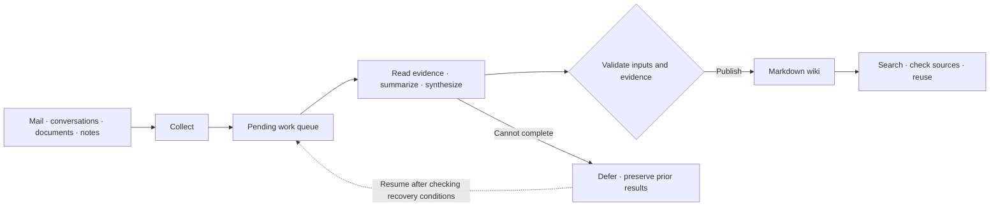

# Lorekeeper

[](https://www.rust-lang.org)
[](LICENSE)
[](https://deepwiki.com/junyeong-ai/lorekeeper)

> **[한국어](README.md)** | **English**

**Turn scattered work records into reusable knowledge with traceable sources.**

Collect mail, conversations, documents and notes into a connected Markdown wiki.
Claude Code or Codex interprets summaries, concepts and relationships; the Rust CLI checks input and evidence changes before publication.
Read it in Obsidian, ask an agent for supporting evidence, or use the Markdown files directly.

[Quick start](#quick-start) · [Using knowledge](#find-and-use-knowledge) · [Sources](#sources) · [Execution](#agents-and-execution-settings) · [Operations](#operations-and-completion)



Collection, publication and semantic review are different completion states. Passing structural checks does not establish factual truth or complete corpus review.
Markdown is authoritative; SQLite is a rebuildable search index.

## Quick start

Start with one local note. No external source credentials are needed.
Use macOS Apple Silicon or Linux x86_64/ARM64 with an authenticated **Claude Code** (`>=2.1.303,<3`) **or Codex** (`>=0.163.0,<1`) CLI.
Obsidian is optional. A Windows CLI is available, but native agent jobs and `workflow` require Unix.

### 1. Install

```bash
curl -fsSL https://raw.githubusercontent.com/junyeong-ai/lorekeeper/main/scripts/install.sh | bash
```

This installs the binary, templates and skills. Existing users should use `lore self update`.
See [installation](skills/lore-ingest/references/installation.md) for Windows, custom paths and repair.

### 2. Choose the vault and agent

```bash
LORE_CONFIG_DIR="${XDG_CONFIG_HOME:-$HOME/.config}/lorekeeper"
cp -n "$LORE_CONFIG_DIR/config.starter.yaml" "$LORE_CONFIG_DIR/config.yaml"
${EDITOR:-vi} "$LORE_CONFIG_DIR/config.yaml"
```

Existing configuration is preserved. Set `vault.root`, `vault.timezone`, `vault.locale` (`ko` or `en`; the starter uses `ko`),
`identity` and `execution.profiles.primary.engine` (`claude-code` or `codex`).
Lore reads `./config.yaml` in the working directory before this file; select another with `--config` or `LORE_CONFIG`.

```bash
lore validate
lore schema
mkdir -p "$(lore config vault-root)/inbox"
```

`validate` checks local configuration; `schema` writes the vault's page rules to `wiki/AGENTS.md`.
Follow [initial setup](skills/lore-setup/references/config.md#initial-setup) for configuration and authentication details.

### 3. Add a note and run

Put one Markdown note in the vault's `inbox/`, then run:

```bash
lore ingest --dry-run   # Check inputs without writing pages
lore run daily         # Collect → interpret → publish and run final checks
```

After publication the starter's inbox moves the note to `inbox/archived/`.
Use `lore ingest` for collection alone or `lore run process` for pending work on collected records.
Each `lore run` performs one batch unless `--batches N` allows more, so large tasks may span several runs.

### 4. Check results and evidence

```bash
lore queue check
lore wiki reviews --check
lore wiki search "your note's main topic"
```

Read the returned pages together with their linked sources. Default locations are
`daily/`, `wiki/documents/`, `wiki/concepts/` and `wiki/explorations/`; `vault.dirs` can rename the `daily/` and `wiki/` roots.
In Obsidian, open Settings → Files and links, turn off Use [[Wikilinks]] and set New link format to Relative path to file.
`lore validate` warns when the vault's Obsidian settings differ.

## Find and use knowledge

In Claude Code, ask `/lore-wiki query What evidence led to the retry policy?`; in Codex, select `$lore-wiki` and ask your question.
Start a session that will write to the vault (capture, add, extract, process) with `lore workflow -- claude` or `lore workflow -- codex`;
the skills ask you to restart a session started otherwise.

| Goal | Skill |
|---|---|
| Find evidence, add sources, capture learning from current work, audit relationships | `lore-wiki` (`query`, `add`, `capture`, `audit`) |
| Extract knowledge from repository documents and code | `lore-extract` (`scan → run → audit`) |
| Configure sources / collect and schedule / process pending semantic work | `lore-setup` / `lore-ingest` / `lore-process` |
| Daily tasks, knowledge brief and completion notes | `lore-day` — the personal board is optional |

`lore wiki search --body` matches the literal Markdown lines of pages.
Replace the example path with an actual search result.

```bash
lore wiki search "retry"
lore wiki read wiki/concepts/retry-policy.md
```

See [querying](skills/lore-wiki/references/query.md) for relationships, citations and originals.
Similar names alone do not justify merging concepts. Source conditions, attribution and open questions remain distinct.
An empty concept result is valid when nothing should be extracted.

## Sources

| Type | Records | Authentication or preparation |
|---|---|---|
| `gmail` | Selected mail | Google OAuth |
| `slack-channel` | Channel messages and threads | Slack token |
| `slack-search` | Messages matching a search | Slack user token |
| `jira` | Issues selected by JQL | Jira API authentication |
| `confluence` | Pages selected by CQL | Atlassian OAuth or API token |
| `google-calendar` | Events and supported Drive meeting notes | Google OAuth |
| `google-drive` | Documents in selected folders | Google OAuth |
| `rss` | Feeds and optional article bodies | No authentication |
| `nodex` | Repository decisions and learning | `nodex.toml`, nodex `>=0.69` |
| `manual` | Local text and supported binary documents | Basic input needs no authentication |
| `tasks` | Completed tasks and notes | No authentication |

Copy and enable only the sources you need from the installed `config.example.yaml` in `$LORE_CONFIG_DIR`, which matches your binary
([repository copy](config.example.yaml)). Multiple sources can share a type.
Use `lore init credentials` for authentication and `lore ingest --dry-run SOURCE_ID` to check access.
Credentials are stored in `<vault>/.lorekeeper/credentials.json` unless `credentials.file` names another path; keep `.lorekeeper/` out of Git and shared sync.
DOCX, XLSX, PDF and images may require [preprocessing configuration](skills/lore-setup/references/config.md#document-preprocessing).
Concept extraction is enabled by the source's `concept_policy`; omission disables it.

## Agents and execution settings

Agents work in two ways. Skills run inside the Claude Code or Codex sessions you start, for questions, capture and extraction.
`lore run` and scheduled jobs launch the configured `claude` or `codex` CLI themselves, as `execution.profiles` selects;
those calls use that CLI account's allowance and are budgeted as agent calls, not tokens.

Use the [starter](config.starter.yaml) for minimal configuration. Profile precedence is
`--profile` → operation-specific `execution.operations` → `execution.default_profile`.
[Stage profiles](skills/lore-setup/references/config.md#optional-stage-profiles) are optional: map only the stages you need,
and omitted stages inherit the selected base profile. Failure never selects another host automatically.

Default per-batch budgets are **64 calls, concurrency 1, input 262144B and result 32768B**.
Configure `execution.work` with optional per-profile overrides; stages share the originating job's budgets.
These are not token, billing or quality guarantees. See [execution profiles](skills/lore-setup/references/config.md#execution-profiles).

Large inputs are read in bounded pieces, and each completed call's result is saved as it returns,
so a run that stops at its budget resumes without repeating finished calls; see [bounded work](skills/lore-process/references/bounded-work.md).
Concept extraction compares each source with at most `execution.work.max_query_candidates` (default 50) best-ranked
existing pages per query, plus every exact title or alias match. Concept synthesis reads every citing page and
directly linked concept, and of its discovery matches the best 50 per query plus exact title or alias matches; see [discovery](skills/lore-process/references/discovery.md).

Automatic audits plan only the kinds in `graph.audit.subjects` (concepts by default). They alternate between changed and
never-assessed subjects and take each group in order of scoped review obligations, a recorded follow-up, citing pages and
discovery already started. The `audit` row of `lore status` shows the share of subjects with a current assessment;
lower-risk subjects can wait, and full coverage is not promised.

## Operations and completion

| Goal | Command |
|---|---|
| Overall state, paused operations and the next command | `lore status` |
| Collect, process and publish | `lore run daily` |
| Process the queue for collected records | `lore run process` |
| Audit one ready knowledge batch, then process dependent queue work | `lore run knowledge` |
| Check pending work, staged results and interrupted publication | `lore queue status --json`, `lore queue check` |
| Check links / review reassessment / audit readiness | `lore graph lint`, `lore wiki reviews --check`, `lore wiki audit-plan --ready` |
| Distinguish last collection success from recent partial reach or failure | `lore health --json` |
| Check discovery changes / verify retained extraction inputs | `lore extract status --json`, `lore extract verify --json` |

A job can publish some results and still end incomplete. Check `lore status` and the job's report before running it again.

Generate schedule definitions with `lore schedule`, then register them with the OS using the [scheduling procedure](skills/lore-ingest/references/scheduling.md).
launchd jobs write to `~/Library/Logs/lorekeeper` (create it before loading them); cron output follows your crontab's mail or redirection.
With `execution.automation`, queue processing gets its own schedule and every scheduled job shares one UTC-day call allowance
and per-run duration limit. It requires `process_schedule`, `max_run_seconds` and `max_calls_per_day` (`null` for no daily cap).

When an agent call fails in a way that cannot be confined to one input, such as a signal exit or an unknown host error,
scheduled runs of that operation pause. `lore status` names the stage that stopped it, and `lore status --json`
adds its recorded detail when there is one; fix that cause and continue only that operation with
`lore run OPERATION --scheduled --resume`. An upgrade clears no pause: a stage name alone cannot tell a host failure
from an integrity failure.
A call that keeps timing out or exits with an error on one input holds only that input:
completed results stay saved, independent work continues, and the held input is not called again until you release it or it changes.
Likewise, a concept page the backlink sweep cannot update and a `lore graph lint` violation name the pages to fix:
the job stays incomplete while other work continues. A page that cannot be read still pauses the operation.
Ask `/lore-process` to diagnose and release it, or follow [plan and resume](skills/lore-process/references/bounded-work.md#plan-and-resume)
for the exact `lore work retry` commands, each previewable with `--dry-run`.

Use `lore self update` to update and `lore self status` to check installation coherence. Updates refuse while queue work
or interrupted publication is outstanding; [installation](skills/lore-ingest/references/installation.md#update-and-repair) explains `--force`.
On macOS, launchd jobs may need registering again after an update; follow [registration and verification](skills/lore-ingest/references/scheduling.md#registration-and-verification).
Back up the entire vault, including hidden state, and your `config.yaml`. Agent results, queues and review history are not caches.
Protect the backup: it contains your credentials.
On Unix, `lore self snapshot -- BACKUP_COMMAND ARGS...` excludes cooperating writers during backup.
Do not invoke Lore inside the backup command. Stop external editors and verify the backup contents too.
See [installation, backup and restore](skills/lore-ingest/references/installation.md), [queue recovery](skills/lore-process/references/recovery.md)
and [semantic maintenance](skills/lore-wiki/references/maintenance.md) for state-specific procedures.

## Further reading and development

Use `lore --help` and `lore COMMAND --help` for commands, the [configuration example](config.example.yaml) for all options,
and [AGENTS.md](AGENTS.md) for code ownership and contribution rules.
The project uses Rust 2024 edition and build toolchain/MSRV **1.100.0**.

```bash
cargo build --release --locked
./target/release/lore --help
./scripts/check.sh                 # Full CI gate; start changes with focused checks
```

Inspired by the [LLM Wiki concept](https://gist.github.com/karpathy/442a6bf555914893e9891c11519de94f). License: [MIT](LICENSE).
