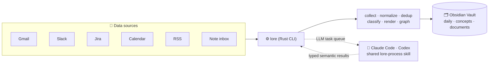
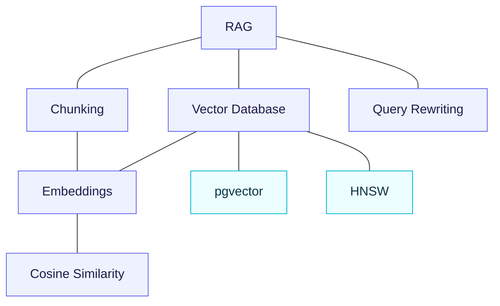
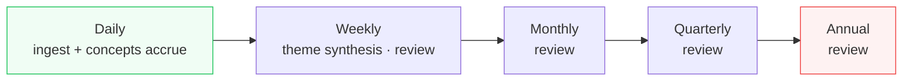

# Lorekeeper

[](https://www.rust-lang.org)
[](LICENSE)
[](https://deepwiki.com/junyeong-ai/lorekeeper)

> **English** | **[한국어](README.md)**

**Turn your scattered daily work into a knowledge wiki that grows itself.**
Lorekeeper collects from Gmail, Slack, Jira, Calendar, RSS, and dropped notes every day, deduplicates them, extracts concepts, and writes structured Obsidian markdown. The LLM does the *bookkeeping*, so your knowledge **compounds** instead of rotting.

---

## Why Lorekeeper?

Notes and wikis fail not because reading or thinking is hard, but because of the **bookkeeping** — updating cross-references, deduping, classifying, flagging contradictions. People can't keep up, so the wiki gets abandoned. Lorekeeper hands that bookkeeping to an LLM.

> 📖 **New to the terms?** — **vault**: a folder of markdown files (i.e. your knowledge store) · **concept**: one page per topic · **link**: a `[Display](relative/path.md)` markdown link between pages (resolves in Obsidian, GitHub, and any OKF consumer) · **bookkeeping**: the chore of updating links, dedup, and categories by hand.

| | |
|---|---|
| 📥 **Configure once → runs daily** | Collects yesterday's activity and knowledge from email, chat, issues, calendar, feeds, and notes |
| 🧹 **Cuts the noise** | Dedup, filters irrelevant items, splits *your* work into a work-log automatically |
| 🧩 **Concepts as assets** | The same concept converges to one page (`Vector DB` = `vector-database`), categorized and related |
| 🔗 **A connected knowledge graph** | Markdown links, backlinks, and clusters connect concepts |
| 📈 **Compounding** | Weekly / monthly / quarterly / annual synthesis — value grows over time |
| 🔑 **Reuse CLI login** | Uses existing Claude Code or Codex authentication; Lore needs no separate LLM API client |

> 💡 Inspired by Andrej Karpathy's *"LLM-maintained wiki"*: **source material stays distinct from generated knowledge**, **the LLM writes and maintains the wiki**, and **the schema (config) defines the workflow**. You curate sources and ask questions; the LLM does the bookkeeping.

---

## At a glance



`lore` owns collection, execution ordering and guarded publication. Claude Code or Codex follows the shared `lore-process` skill to judge summaries, concepts and relationships. Markdown is authoritative; SQLite is a rebuildable search and navigation index.

---

## Quick start

> **Before you start, you'll need** — nothing exotic:
> - 💻 **macOS or Linux** (Windows ships a PowerShell installer)
> - 🤖 **Claude Code or Codex** — uses existing CLI authentication for summaries, concepts and relationships
> - 🔑 **Credentials only for the sources you enable** — e.g. Google sign-in for Gmail/Drive/Calendar, a token for Slack
> - 🗂️ **(optional) Obsidian** — for pretty graph browsing. Without it, the output is still plain markdown
>
> 💡 The starter enables **one local note inbox without provider credentials**. Add RSS, work sources or personal tracking when needed. Summaries and concepts require an authenticated agent CLI. Set `execution.profiles.primary.engine` in the copied `config.yaml` to `claude-code` or `codex`.

```bash
# 1) Install — binary + templates + skills for both hosts
curl -fsSL https://raw.githubusercontent.com/junyeong-ai/lorekeeper/main/scripts/install.sh | bash

# 2) First setup — preserve an existing config.yaml and edit it
LORE_CONFIG_DIR="${XDG_CONFIG_HOME:-$HOME/.config}/lorekeeper"
cp -n "$LORE_CONFIG_DIR/config.starter.yaml" "$LORE_CONFIG_DIR/config.yaml"
${EDITOR:-vi} "$LORE_CONFIG_DIR/config.yaml"  # set vault.root, timezone, locale and identity

# 3) Validate locally and generate the knowledge-writing contract
lore validate
lore schema
mkdir -p "$(lore config vault-root)/inbox"
```

Put one note in the vault's `inbox/`, then collect it. `inbox_dir: inbox` follows
your selected `vault.root`. The starter does not need the provider credential wizard.

```bash
# 4) Check input access, then collect for real
lore ingest --dry-run
lore run daily
```

`lore run daily` collects sources, runs the selected agent and verifies semantic
publication. Collection alone does not complete knowledge processing. Then verify:

```bash
lore queue check
lore wiki reviews --check
lore wiki search "your note's topic" --json

# 5) Optional automation: generate definitions, then register with the OS
lore schedule > lorekeeper.cron
#    review and merge with crontab -e; on macOS see "Scheduling" below
```

`config.example.yaml` is the full option catalog, with every source disabled.
Copy only the blocks you need into your real `config.yaml`, fill in their scope and
account values, then enable them. `/lore-setup` helps with those choices and ID discovery.
For an authenticated source, run `lore init credentials` and then
`lore ingest --dry-run <source-id>`. Definition generation, OS registration and an
actual run are separate steps; follow [Scheduling](#scheduling).

> You don't need Obsidian — the output is plain markdown + folders, readable as text. Obsidian just makes the graph nicer to browse.

---

## What do you actually get?

Let's walk through a hypothetical. **Sumin**, an AI engineer, drops a RAG troubleshooting note into the vault's `inbox/`.

> The page examples below show **key fields only** — real files also carry housekeeping frontmatter such as `updated`.

### 📝 Input — `inbox/rag-retrieval-quality.md`

```markdown
# RAG pipeline: fixing low-recall retrieval

Problem: ~30% of queries retrieved irrelevant chunks, so the generator hallucinated.
Cause: (1) 2000-token chunks were too coarse — a chunk's embedding averaged several
       topics. (2) We embedded the raw conversational question.
Fix: re-chunk to ~400 tokens, rewrite the question into a standalone query, switch
     similarity L2 → cosine. Recall@5: 0.62 → 0.91.
```

### ▶️ Run

```console
$ lore ingest
▸ notes (manual)
  extracted: 1 items
  ✓ wrote: wiki/documents/rag-pipeline-fixing-low-recall-retrieval.md (document)

Done. 1 pages written, 0 personal items tracked.
```

The page exists, but its `## Summary` / `## Related Concepts` are still empty — `lore ingest` queued the LLM work:

```console
$ lore queue status
  [current] sum-… (summarize)        → wiki/documents/rag-pipeline-…
  [current] ext-… (extract-concepts) → wiki/documents/rag-pipeline-…
queue: 2 current, 0 done, 0 stale, 0 missing-target, 0 unreadable across 2 task(s)
```

Run **`lore run process`**. The configured Claude Code or Codex host follows the shared skill, while Rust checks source and target revisions before publication. After successful completion, `lore queue status` reports `0 current` and the page is filled:

### ✅ Result ① — the document page (summary + concept links filled in)

```markdown
---
id: rag-pipeline-fixing-low-recall-retrieval
type: document
title: "RAG pipeline: fixing low-recall retrieval"
created: 2026-06-13
tags: ["document"]
---

## Summary
Re-chunking from 2000→400 tokens, rewriting conversational questions into standalone
queries, and switching similarity from L2 to cosine lifted Recall@5 from 0.62 → 0.91.
This note reports a joint intervention; it does not isolate the effect of each
change or establish a ranking across other environments.

## Content
… (normalized, preserved from the original) …

## Related Concepts
- [Retrieval-Augmented Generation](../../wiki/concepts/retrieval-augmented-generation.md)
- [Vector Database](../../wiki/concepts/vector-database.md)
- [Chunking](../../wiki/concepts/chunking.md)
- [Query Rewriting](../../wiki/concepts/query-rewriting.md)
```

### ✅ Result ② — concept pages **converge** (the key payoff)

Days later Sumin drops another note, *"Choosing a vector database for production."* "Vector database" appears in both notes — but instead of forking a new page, it **joins the existing concept**:

```markdown
---
id: vector-database
type: concept
title: "Vector Database"
aliases: ["Vector Database", "Vector DB"]
category: ai-ml
source_count: 2          # ← two documents cite this one concept
---

## Synthesis
A vector database stores high-dimensional embeddings and serves approximate
nearest-neighbor (ANN) search over them. The second note chose pgvector in an existing
PostgreSQL environment to reduce the cost of operating a separate system. Keep the
conditions of that decision separate from the first note's retrieval-quality observation.

## Sources
- [Choosing a Vector Database for Production](../../wiki/documents/choosing-a-vector-database-for-production.md)
- [RAG Pipeline: Fixing Low-Recall Retrieval](../../wiki/documents/rag-pipeline-fixing-low-recall-retrieval.md)
```

> Whether you write `Vector DB` or `Vector Database`, it lands on **one page** (registered as an alias). Knowledge not fragmenting — that *is* the "compounds over time" promise.

### ✅ Result ③ — disclose detail as needed

```bash
lore wiki prepare                           # create a reusable SQLite snapshot
lore wiki search "Vector DB" --snapshot <id> --limit 10 --json
lore wiki browse --type concept --category ai-ml --limit 20 --json
lore wiki read wiki/concepts/vector-database.md # outline/revision → select a section
lore wiki links wiki/concepts/vector-database.md --limit 20
lore wiki reviews        # inspect unresolved judgments separately
```

Markdown is authoritative; `.lorekeeper/search.sqlite` is a rebuildable navigation layer.
Start with names, aliases, excerpts and source identifiers, then read selected sections,
relationships, evidence and preserved originals. `wiki search --body` supports literal
text and `--regex` searches. Ranking and citation counts are not confidence scores.

A snapshot contains captured content. Prepare again after changes and verify evidence
using the returned revision. Follow `next_offset` for page/link inventories. Snapshot
link pagination keeps the same snapshot; do not combine it with live `--revision`.

`index.md` is a small entry guide. Page inventories, creation-date browsing and
links/backlinks are queried through SQLite snapshots. Omitting `--snapshot` reads
current Markdown. Declared creation dates are distinct from collection history.
Obsidian follows the original knowledge-page links.

A conflict requires incompatible claims under comparable conditions. A newer date
or more citations cannot resolve it automatically. `wiki reviews` exposes current
judgments; evidence changes require reassessment while preserving prior decisions.
Scheduled `queue check` and `wiki reviews --check` detect unfinished work and evidence
drift, not universal semantic truth.

Before reassessment, archive the prior judgment with
`lore wiki evidence --archive <review-path>`. Read and archive new evidence, explicitly
replace `review.evidence`, and record a dated judgment with the prior archive path.
Never update revision labels without reassessing the judgment.

### ✅ Result ④ — a knowledge graph forms

`lore graph cluster` groups concepts; `suggest-links` proposes link candidates ranked by an Adamic-Adar score that down-weights hub co-citations. Semantic relationships require review of source evidence:



### 📈 Over time — compounding



Each day's ingest grows the concept graph; synthesis summarizes it at ever-higher altitudes. Daily → weekly → quarterly → annual each build **on top of** what's already there, never re-deriving it.

---

## Sources

| Type | Use for | Auth |
|---|---|---|
| `gmail` | Email digest (filter by label / sender) | Google OAuth |
| `slack-channel` | Whole channel = team activity (threads, bot filter, watch_users) | Slack token |
| `slack-search` | Keyword-trend search | Slack user token |
| `jira` | Issues you worked on that day (ADF→Markdown) | Jira API |
| `confluence` | Spaces and pages selected by CQL (storage format→Markdown) | Atlassian OAuth or API token |
| `google-calendar` | Schedule + meeting notes (auto-extracted from Drive links) | Google OAuth |
| `google-drive` | Curated docs in a Drive folder | Google OAuth |
| `rss` | Vendor blogs / news → concepts (no auth, multi-feed) | none |
| `nodex` | A project repository's own decision and learning records → concepts (needs `nodex.toml` and nodex `>=0.60,<0.61`; see [binary selection and evidence versions](skills/lore-setup/references/config.md#nodex-binary-selection)) | none |
| `manual` | Markdown, text, and HTML files dropped in `inbox/` | none |
| `tasks` | Your own finished tasks — what `lore task` closed becomes the day's page | none |

The source key becomes the vault subfolder name. You can define several of the same type (e.g. `team-slack`, `ai-news`). Full reference: [`config.example.yaml`](config.example.yaml).

To add external knowledge, copy the catalog's `ai-news` or `tech-news` block into your actual config and enable it. The selected feeds cover official announcements, model methods, AI implementation, product evaluation and Korean engineering accounts; additional labs, newsletters and aggregators are optional. `fetch_full_text` retrieves articles from short feeds, but access failures retain only the feed text. `focus` guides summaries and concept extraction without filtering raw collection. Current feed listings and query caps guarantee neither complete history nor factual accuracy.

---

## Core ideas

- **Output is plain markdown** — `daily/{source}/` (raw timeline), `wiki/concepts/` (concepts), `wiki/documents/` (documents), `me/` (work-log & reviews), `synthesis/` (weekly themes).
- **Materialized views** — a page has two layers. The **structural layer** (frontmatter, raw items, headings) re-renders every ingest; the **semantic layer** (summary, concepts, synthesis) is LLM-owned and preserved across re-renders. Unchanged input with matching completion markers enqueues zero LLM work (a BLAKE3 hash decides).
- **Inputs and replay** — unchanged input hashes reuse completed LLM results. Refetching can observe remote edits, deletions and different query windows. RSS event logs retain collected entries after they leave the feed; exact-input regeneration requires a retained queue task.
- **Realized-only** — a future date materializes no page (a forecast isn't knowledge yet). It becomes knowledge once the date arrives.
- **Config decides the vault's language** — `vault.locale` (ko | en) is not a label switch but **the language of every sentence Lorekeeper adds**: summaries, weekly themes, concept definitions, explorations. A concept's NAME is the form its own source writes, so a term a source writes in another language keeps its spelling. Source content is never translated.
- **The graph does the bookkeeping** — `backlinks-sync` (re-derive each concept's citations, count and synthesis input, queueing a rewrite when the evidence moves), `lint` (orphans, broken links, duplicate concepts), `merge` (fold duplicate concepts), `cluster` / `suggest-links` (communities and link candidates).

---

## Commands

```bash
lore validate                 # check config (no network)
lore ingest [source]          # ingest (all sources, or a single one)
lore ingest --dry-run         # preview without writing to the vault
lore ingest --date 2026-06-01 # re-materialize a specific day (backfill / repair)
lore synthesis weekly         # weekly synthesis + personal review (monthly/quarterly/annual too)
lore status                   # one line per subsystem (per-source times: lore health)
lore health                   # warn when a source is overdue vs ingest.schedule
lore health --json            # the same verdict as a contract, for a skill rather than an eye
lore schedule                 # print definitions; OS registration is separate
lore brief --date yesterday   # a day's knowledge — what was learned (a line each), what was seen again (names)
lore fetch <url>              # read a link into the inbox, carrying its address
lore wiki search <query>      # the pages a query reaches, and whether they NAME it or merely mention it
lore wiki browse --category ai-ml --type concept --limit 20 --json # Browse metadata; follow next_offset
lore graph --json neighbors wiki/concepts/example.md # Follow incoming/outgoing links, including evidence
lore graph --json neighbors wiki/concepts/example.md --type concept # Browse linked concepts; --type document selects documents
lore wiki prepare             # Capture once; use --snapshot <id> for repeated searches
lore wiki search "exact text" --body --json # Raw evidence lines/context/revision; opt into --regex
lore wiki document-identity plan --source ID --manifest /tmp/identity.json # Verify legacy copy identity migration
lore wiki read wiki/concepts/example.md # Outline → --section ID; pin subsequent reads with --revision
lore wiki original wiki/documents/example.md # Verified manual original/member roster; select with --member
lore wiki original daily/tech-news/2026-10-18.md # RSS collection inventory, authority and revision
lore wiki original daily/tech-news/2026-10-18.md --revision REV --event EVENT_ID --text-offset 0 --text-limit 4096
lore wiki links wiki/concepts/example.md --limit 20 # Inspect link source lines, context and revision
lore wiki provenance wiki/documents/example.md # Follow declared relations by exact repository + document ID
lore wiki concepts            # list concepts
lore resolve <name>           # which concept page owns a name (0 owned / 1 absent / 2 ambiguous)
lore graph lint               # structural health (orphans, broken links, duplicate concepts, …)
lore graph suggest-links      # concept-relationship candidates (Adamic-Adar)
lore graph cluster            # topic communities (Louvain)
lore graph backlinks-sync     # re-derive each concept's ## Sources, citation count and synthesis input
lore graph merge <from> <into># fold a duplicate concept into the canonical one
lore graph retract-citation <origin.md> <concept.md> --revision <file_revision> --dry-run # Preview a reviewed citation correction
lore graph normalize --fix    # normalize link spelling across the vault
lore doctor                   # page contracts: text cleanliness, unanswered sections, credentials
lore extract status           # how far each project's knowledge extraction trails its repository
lore maintenance              # prune ingest logs and drained queue files past retention
lore queue status / prune     # LLM task queue status / clear dead tasks
lore queue apply              # validate and publish all staged section/concept results
lore queue check              # JSON completion check: outstanding work, results and mutations
lore wiki reviews --check     # fail on evidence drift or invalid reviews; open reviews pass
lore queue packet --task-id ID # revision-checked evidence (bodies: --include-content)
lore queue regenerate --task-id ID --dry-run # preview retained-input regeneration
lore queue count              # current task count as a bare integer (for scripts)
lore config vault-root        # the vault's absolute path, and nothing else (for scripts)
lore schema                   # generate wiki/AGENTS.md (the page-format schema)
```

`lore wiki refresh` refreshes the SQLite navigation snapshot and a small `index.md` entry guide. Use `wiki browse/search/links` for page inventories, date ordering and relationship traversal. An existing entry file without a generation marker is preserved and reported as a collision. For each retrieval session, prepare once and repeat `wiki browse/search/links --snapshot ID` (links supports `--direction incoming|both`), then verify originals with `wiki read --revision REV`. Refresh prints the prepared ID too.

For date-based discovery, use `lore wiki browse --snapshot ID --sort created --from 2026-01-01 --to 2026-12-31 --json`. `created` may be the original authoring date rather than the ingestion date. Missing or invalid dates retain an explicit status and are excluded by date filters. Date order is newest first, with unknown dates last when no date filter is applied.

For project documents, `source_record.attributes` preserves attributes from the verified public nodex response. Knowledge authored outside the body, such as a routine’s `prompt`, reaches summary and extraction inputs. Imported instructions are source content, not instructions for the current worker.

New RSS ingests retain pre-classification collection text at immutable hash addresses under `.lorekeeper/evidence/rss/`, referenced by daily `source_record.rss_original`. These are adapter-acquired bodies, not provider HTTP/XML bytes. `event_timestamp` is the adapter’s published-or-updated timestamp, separate from unknown acquisition time (`captured_at: null`). `wiki original` returns metadata first; select an exact `event_id` with the returned `revision`, then paginate the title, blank line and body. New captures report `page_bound_collection`; read-only discovery of historical event logs reports `legacy_unbound`, which does not establish that a current daily was derived from those historical bytes. A summary is an interpretation, and omission does not prove absence from the collected text. Refetching a provider URL does not reproduce the collection. New bound RSS extraction may explicitly select event IDs and immutable payload revisions in `concept_evidence`. Only these selected article dependencies avoid resynthesis after unrelated daily edits; legacy pages and unbound links retain page guards. Use `wiki original ORIGIN --evidence-concept CONCEPT` to discover selections, then `--event ID --revision PAYLOAD_REV` to read that historical article even after its current manifest changes. A retained observation does not establish current truth or independent verification. Extraction omission never retracts a selection; `graph retract-citation --event ID --event-revision PAYLOAD_REV` explicitly removes it. `source_count` continues to count originating pages. Failed original publication prevents its page reference; dry-run stores nothing.

These are the ones you reach for day to day. `lore --help` lists the full surface;
`lore <command> --help` has each command's flags.

---

## Agent skills and execution profiles

Canonical skill bodies and references live under `skills/`. Claude metadata lives
in `agents/claude.json`; Codex invocation policy uses `agents/openai.yaml` where
needed. Deployment generates host entry files from those shared procedures.

| Skill | Responsibility |
|---|---|
| `lore-process` | Queue summaries, concepts, synthesis and reviews; guarded publication |
| `lore-setup` | Sources, configuration, authentication, first processing and scheduling |
| `lore-wiki` | `query`, `add`, `capture`, `audit`, `curate`, `maintain`, `status` |
| `lore-extract` | Repository knowledge extraction: scan → run → audit |
| `lore-ingest` | Collection, period synthesis, status, scheduling and maintenance |
| `lore-day` | Agenda, knowledge briefing, tasks, reminders and day closing |

In Claude Code use `/lore-wiki query ...`; in Codex use `$lore-wiki`.
`lore self deploy --skills user --agent codex` deploys interactive skills to Codex.
`--agent both` selects both hosts, and `--skills project` selects the current project.
Claude discovers `.claude/skills`; Codex discovers `.agents/skills`.
Unattended jobs use verified copies under `<data>/skills/<engine>/` independently
of interactive deployment. Missing or modified required files refuse execution.

The supported CLI contracts are Claude Code `>=2.1.259,<3` and Codex
`>=0.163.0,<1`. Hosts use their existing authentication and policies. Their permission
and sandbox models differ; Rust publication guards are not OS access controls.

```yaml
llm:
  provider: queue
execution:
  default_profile: primary
  profiles:
    primary:
      engine: claude-code
      timeout_seconds: 3600
    reviewer:
      engine: codex
      timeout_seconds: 3600
  operations:
    knowledge: reviewer
```

This selects `primary` for daily and queue processing, and `reviewer` for semantic
audits. Selection is explicit `--profile`, operation profile, then default profile.
An unavailable host never switches to another host. `timeout_seconds` is a session
budget; unfinished work is preserved and reported as failure. Optional `executable`
and `model` select the CLI and model. Relative executable paths and Claude
`config_directory` resolve against the configuration file. Codex `profile` names a
profile in that CLI. Changing models does not rewrite existing knowledge.

`llm.provider: queue` retains typed semantic requests separately from host selection.
`noop` creates no LLM work. Search, navigation and deterministic collection do not
require an installed agent.

---

## Install · build

```bash
# One-line install (macOS / Linux) — binary, templates, skills, SHA256-verified
curl -fsSL https://raw.githubusercontent.com/junyeong-ai/lorekeeper/main/scripts/install.sh | bash

# Windows (PowerShell)
irm https://raw.githubusercontent.com/junyeong-ai/lorekeeper/main/scripts/install.ps1 | iex

# Build from source
cargo build --release && ./target/release/lore --help
```

Install flags: `--version`, `--install-dir`, `--data-dir`, `--skill {user,project,none}`, `--agent {claude-code,codex,both}`, `--from-source`, `--force`, `--yes`, `--dry-run` (`--help` lists them all).

The installer deploys `config.starter.yaml` and `config.example.yaml` in the config
directory and preserves your `config.yaml`. Beside them, `data-dir` records the
installation path and `deployed-skills` records deployed skills. These automatic
records support updates and removal; they contain no credentials.

### Tasks

```bash
lore agenda                       # today: what is committed, what woke, what is due
lore task add "review the spec" --state today
lore task add "answer the index question" --link https://acme.slack.com/archives/C123/p1755600000 --label thread
lore task done 7k2p --note "refresh tokens rotate; retrying after a committed rotation kills the grant"
lore task sync                    # record what you changed in Obsidian
```

The board is `<personal>/tasks.md` — ordinary markdown checkboxes under
`Today / Proposed / Next / Waiting / Someday`. Tick one on your phone or drag a line
to another section; the next `lore task sync` or task mutation command records that change.
The heading is its state, and `Proposed` means it has not been accepted yet.

`lore task done` stores the completion and `--note` in the transition log. Ingesting
the configured tasks source over a window containing that completion date creates
that day's daily page; `/lore-process`
handles the queued summary and concept extraction. Full-source ingestion also
updates the work-log, and the scheduled daily pipeline runs ingestion and semantic
processing together. **What you did becomes evidence alongside what you read.**

### Update, status, removal

```bash
lore self status      # is every deployed copy still the one this binary carries (non-zero if not)
lore self update      # replace the binary with a release, then redeploy interactive/runtime skills, templates and AGENTS.md
lore self deploy      # redeploy only — the repair `self status` reports
lore self uninstall   # remove what was installed; the vault is never touched
```

The interactive/runtime skills, templates and both config examples are **compiled into the binary**, and deployed copies can drift; `lore self status` checks them, while `lore self deploy` writes the copies. `lore self update` uses the same settlement check as `lore queue check`: pending work, unreadable or unparseable input, staged results and interrupted publication all block replacement. `--force` permits inspectable unfinished work but never bypasses configuration or storage inspection errors. Older releases are refused unless explicitly selected with `--version`.

---

## Credentials

Environment variables or `<vault>/.lorekeeper/credentials.json` (0600). Env vars take precedence over the file.
On macOS and Linux, credential and lock files granting group or other-user permissions
are refused. Restrict manually created or restored files with `chmod 600` before use.
Writes always use `0600`; the setup wizard refuses an unreadable or malformed existing
store rather than initializing it with empty credentials.
For vaults using the same accounts, optional `credentials.file` selects one shared
store; relative paths resolve against the config file. Cooperating processes lock
OAuth refresh and successor persistence together. Do not copy rotating refresh
tokens into independent files; other applications should use their own OAuth app.

```bash
lore init credentials   # interactive wizard — Google tokens minted via browser OAuth
```

- **Google**: `LORE_GOOGLE_CLIENT_ID/SECRET/REFRESH_TOKEN` — Gmail/Drive/Calendar **read-only** scopes. Needs a "Desktop app" OAuth client.
- **Slack**: `LORE_SLACK_TOKEN` (bot `xoxb-`) or `LORE_SLACK_USER_TOKEN` (`xoxp-`). `slack-search` requires the user token.
- **Atlassian** (Jira/Confluence): `LORE_ATLASSIAN_SITE_URL` + `LORE_ATLASSIAN_PAT` (Data Center), or `+ LORE_ATLASSIAN_EMAIL` + `LORE_ATLASSIAN_API_TOKEN` (a Cloud CLASSIC token, addressed at the site). Add `LORE_ATLASSIAN_CLOUD_ID` for a SCOPED token — that value is what selects the gateway route, and without it the token is treated as classic and sent to the site. OAuth is deliberately not env-supplied — its refresh token rotates and must be persisted, so mint it with `lore init credentials`.

> The default credential file is excluded from Git. Keep explicitly selected shared stores out of commits and synchronization too.

---


Identity migration also accepts repeatable `--history-ref <full-commit-id>` on
`lore wiki document-identity plan` to verify historical source copies. The plan seals
Git blobs, authored IDs and exact projected bodies; `check` and `apply` revalidate them.
`apply --allow-blocked` migrates the verified subset and leaves unresolved pages untouched.

To deliberately rewrite one concept from its current citations, preview
`lore graph resynthesize wiki/concepts/example.md --dry-run`, then omit `--dry-run`
and process the queued task. This works after the historical task has expired;
`queue regenerate --task-id` still requires retained original input.

## Scheduling

```bash
lore schedule > lorekeeper.cron   # Linux: review, then merge with crontab -e
lore schedule --format launchd --bin "$(command -v lore)"   # macOS
```

`lore schedule` prints definitions; it does not register OS jobs. Preserve existing
cron entries. On macOS, save each plist at its named LaunchAgents path, create the
log directory, then run `launchctl bootstrap gui/$(id -u) <absolute-plist-path>`.
Inspect registration and an actual execution. After changes, boot out existing
jobs before registering replacements; unload disabled jobs too. `self uninstall`
does not unregister OS jobs.

Scheduled jobs execute native Rust commands:

| Schedule | Command |
|---|---|
| `ingest.schedule` | `lore run daily --wait` |
| `graph.audit.schedule` | `lore run knowledge --wait` |
| Weekly/monthly/quarterly/annual | `lore synthesis <period> --previous --defer --wait-for-vault` |
| Maintenance | `lore maintenance --prune-queue --wait-for-vault` |
| Reminders | `lore task remind notify` |

The daily job collects all sources, reconciles the queue, backlinks and search
index, then resumes base periods, quarters and years in order. A partial source
failure still permits independent recovery. A failed dependent stage stops later
periods. Collection and semantic completion have distinct outcomes. `--json`
reserves stdout for the job report and sends child output to stderr.
Jobs pin the selected configuration path and file revision. An edit stops the job
as incomplete instead of redirecting remaining work to another vault. Start a new
workflow with the intended configuration.

Rust holds the vault's cooperative Unix workflow lease through semantic reads and
publication. Busy jobs refuse unless `--wait` is explicit. Cancellation and session
deadlines terminate the foreground process group and preserve unfinished work.
Short writer locks and target revision guards remain separate. Start a manual
session before reading evidence with `lore workflow -- claude` or
`lore workflow -- codex`. Do not reacquire inside a guarded session. Programs that
close inherited descriptors or detach are outside the manual exec lease's lifetime
guarantee. Workflow leases and native agent jobs require Unix.

Definitions capture absolute configuration/data paths, anchored PATH entries and
relevant existing `CLAUDE_CONFIG_DIR` or `CODEX_HOME` directories. Standard proxy
variables preserve casing and empty values. Credentials and API keys are not copied
into definitions. Regenerate and reload definitions after environment changes.

Calendar triggers use host local time; page dates use the vault timezone. Launchd
coalesces runs missed during sleep; cron skips them. Neither backfills every missed
date. Inspect `lore synthesis pending --status --json` for blocked evidence and
backfill source dates explicitly. Isolate tests with `--namespace org.example.lore-test`
and `--log-dir /absolute/test/logs`.

Configure weekly semantic maintenance independently from collection and synthesis:

```yaml
graph:
  audit:
    schedule: "0 7 * * 0"
    batch_size: 5
```

Changed and first-time concepts rotate fairly; unchanged inputs are not repeatedly
audited. `.lorekeeper/knowledge-audit.json` stores current assessments and pending
order; judgments and conflicting evidence remain in Markdown reviews. Single-source
status or citation count alone does not justify merging or deleting a concept.
Batch count and session deadlines do not bound total source bytes or cost. Size the
schedule against observed execution and backlog. Current receipts, clean lint and
normal termination do not establish semantic consistency of the entire corpus.

Reminders retire only after the OS notifier accepts them. Acceptance does not prove
the user saw the notification. A crash between acceptance and retirement may cause
redelivery; failed submissions remain pending.

---

### Versioning the vault with Git (optional)

Keep a backup or a reviewed Git commit before substantial rewrites or merges. Pipelines never stage or commit automatically because they cannot distinguish concurrent user edits from their own output. A mutation journal resumes interrupted changes; it is not a historical backup.

Exclude `.lorekeeper/`, credentials and any private local state from Git. Review `git status` and `git diff`, then stage only the intended files. The small generated `index.md` entry guide can be excluded under the configured wiki directory. Check the sharing scope before using a remote repository.

---

## Learn more

- **Full config reference** — [`config.example.yaml`](config.example.yaml) (every source and option, commented)
- **Page-format schema** — `lore schema` generates `wiki/AGENTS.md` in your vault
- **Architecture deep-dive** — [DeepWiki](https://deepwiki.com/junyeong-ai/lorekeeper)

## Built with

Rust 2024 edition · build toolchain 1.99.1 · MSRV 1.97. `tokio`/`reqwest` (async sources), `jiff` (timezone-correct dates), `serde-saphyr` (YAML), `minijinja` (templates), `feed-rs` (feeds), `petgraph` (link graph), `blake3` (event/cache hashing). License: MIT.
