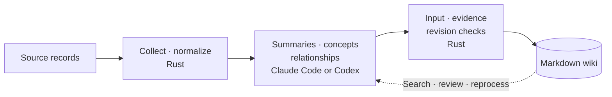
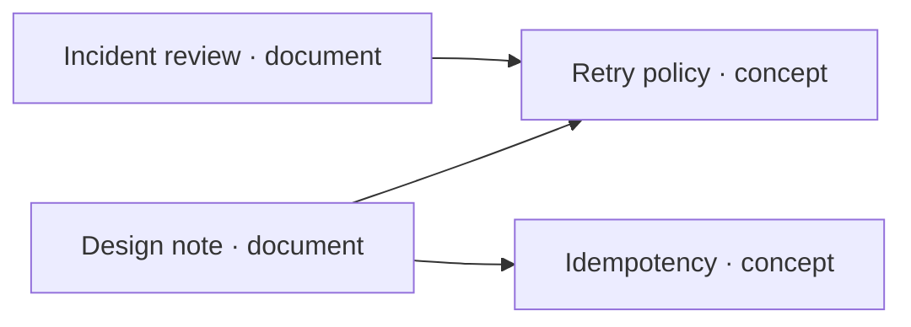

# Lorekeeper

[](https://www.rust-lang.org)
[](LICENSE)
[](https://deepwiki.com/junyeong-ai/lorekeeper)

> **English** | **[한국어](README.md)**

**Turn scattered work records into reusable knowledge you can trace to its sources.**

Lorekeeper collects email, Slack, issues, documents and personal notes into a connected Markdown wiki.
Claude Code or Codex judges summaries, concepts and relationships; the Rust CLI validates inputs, evidence and revisions before publication.
Read it in Obsidian, ask an agent a question, or use the Markdown files directly.

[Quick start](#quick-start) · [Use your knowledge](#find-and-use-your-knowledge) · [Sources](#sources) · [Execution](#agents-and-execution) · [Operations](#operations-and-completion)

## Why Lorekeeper?

| Recurring problem | What you can do with Lorekeeper |
|---|---|
| Decisions are scattered across email, chat and documents | Collect source records and follow an interpretation back to its evidence |
| Each investigation starts from scratch | Check existing names, aliases and scope, then accumulate evidence under the same concept |
| Summaries lose conditions and uncertainty | Keep observations, claims and open questions distinct; reassess when evidence changes |
| Records accumulate without helping future work | Search → read → follow sources and relationships |

Connect work sources for a team's records, or start a personal knowledge store with local notes alone.
The task board and personal work reviews are optional.

## How records become knowledge



| What is stored | What it is for |
|---|---|
| Source records and documents (`daily/`, `wiki/documents/`) | Read collected content alongside its summary |
| Concepts (`wiki/concepts/`) | Accumulate evidence, explanations and relationships for a shared subject |
| Explorations and reviews (`wiki/explorations/`) | Keep comparisons, competing claims, open questions and judgment history |

These are default paths; configuration can change them. **Markdown is authoritative**;
SQLite is a rebuildable search and navigation index. Retrieval uses names, text and explicit links rather than embeddings.
Source bodies and concept names retain their language; generated prose and headings follow the vault's language policy.

### Different records, one shared subject

For example, an incident review and a design note might support the same retry policy:



Similar names do not cause automatic merging. The agent checks existing names, aliases and actual scope before reuse.
It can propose a new concept when the evidence supports one, or return no concepts.
Competing claims remain reviewable rather than being settled by date or citation count alone.

> Collection, semantic publication and completed review are different states. Passing structural checks does not prove that every claim is true or the entire corpus has been reviewed.

## Quick start

Start with **one local note** to check collection, processing and retrieval. This path needs no source-service credentials.

- Use **macOS (Apple Silicon) or Linux (x86_64/ARM64)** and an authenticated **Claude Code or Codex** CLI. Lorekeeper uses that host's authentication.
- **Obsidian is optional**. The output is ordinary Markdown.
- A Windows installer is available; native agent jobs and `workflow` are supported on Unix.

### 1. Install

```bash
curl -fsSL https://raw.githubusercontent.com/junyeong-ai/lorekeeper/main/scripts/install.sh | bash
```

This installs the binary, templates and agent skills. See [installation](skills/lore-ingest/references/installation.md#install) for Windows and source builds.
For an existing installation, follow [the update procedure](skills/lore-ingest/references/installation.md#update-and-repair) rather than bootstrapping again.

### 2. Choose a vault and agent

```bash
LORE_CONFIG_DIR="${XDG_CONFIG_HOME:-$HOME/.config}/lorekeeper"
cp -n "$LORE_CONFIG_DIR/config.starter.yaml" "$LORE_CONFIG_DIR/config.yaml"
${EDITOR:-vi} "$LORE_CONFIG_DIR/config.yaml"
```

An existing `config.yaml` is preserved. Set these values for your environment:

| Setting | What to choose |
|---|---|
| `vault.root` | The folder that will hold your knowledge: the vault |
| `vault.timezone`, `vault.locale` | Date timezone and generated language (`ko` or `en`) |
| `identity` | Your name and email |
| `execution.profiles.primary.engine` | The authenticated `claude-code` or `codex` host |

```bash
lore validate
lore schema
mkdir -p "$(lore config vault-root)/inbox"
```

`validate` checks local configuration. `schema` generates the wiki's writing contract, `AGENTS.md`.
See [initial setup](skills/lore-setup/references/config.md#initial-setup) for config selection and authentication.

### 3. Add a note and run

Put a Markdown note in the selected vault's `inbox/`. The starter's `inbox_dir: inbox` follows `vault.root`.

```bash
lore ingest --dry-run   # check input access without writing pages
lore run daily         # collect → process → publish and verify
```

Use `lore ingest` for collection alone, or `lore run process` for pending semantic work without collection.
Large inputs may need several calls and runs; exhausted budgets and deferred work remain incomplete.

### 4. Check the result and evidence

```bash
lore queue check
lore wiki reviews --check
lore wiki search "your note's main subject" --json
```

Open the returned documents and concepts, then follow their source evidence.
Distinguish unfinished work reported by `queue check` from reassessment reported by `reviews --check`.
Retrieval follows below; [operations and completion](#operations-and-completion) explains the other status checks.

## Find and use your knowledge

### Ask an agent

In Claude Code, try `/lore-wiki query What evidence supports our retry policy?`.
In Codex, select `$lore-wiki` and ask your question.

| What you want to do | Skill |
|---|---|
| Answer from evidence, examine relationships or competing claims | `lore-wiki` |
| Capture an insight from the current work | `lore-wiki` with `capture` |
| Extract knowledge from repository documents and code | `lore-extract`: `scan → run → audit` |
| Add sources and configure the vault | `lore-setup` |
| Collect, schedule or operate | `lore-ingest` |
| Complete pending summaries, concepts and synthesis | `lore-process` |
| Read today's agenda, knowledge brief and completed work | `lore-day` |

With the personal board enabled, use `lore agenda`, `lore task add` and `lore task done --note` to record work and learning.
The configured tasks source collects completed records for semantic processing.
Weekly knowledge synthesis and personal performance reviews are separate features.

### Explore through the CLI

```bash
lore wiki search "retry" --json
lore wiki read wiki/concepts/retry-policy.md
lore wiki prepare
```

Replace the `wiki read` path with an actual search result. Use the snapshot ID returned by `wiki prepare`
to inspect relationships and citations from the same capture:

```bash
lore wiki context wiki/concepts/retry-policy.md --snapshot SNAPSHOT_ID --limit 10
lore wiki citations wiki/concepts/retry-policy.md --snapshot SNAPSHOT_ID --limit 20
```

Replace `SNAPSHOT_ID` and the path with actual values. Narrow search by body, aliases, source ownership, dates or tags.
Follow `next_offset` when you need the complete list. Reuse the snapshot, then refresh after new publication.
See [search, relationships and originals](skills/lore-wiki/references/query.md) for the complete procedure.

## Sources

| Type | Records collected | Authentication or prerequisites |
|---|---|---|
| `gmail` | Mail selected by labels, senders and other filters | Google OAuth |
| `slack-channel` | Channel messages and threads | Slack token |
| `slack-search` | Messages matching a search | Slack user token |
| `jira` | Issues selected by JQL | Jira API authentication |
| `confluence` | Spaces and pages selected by CQL | Atlassian OAuth or API token |
| `google-calendar` | Events and supported Drive meeting notes | Google OAuth |
| `google-drive` | Documents from a selected folder | Google OAuth |
| `rss` | Feeds and optional full article text | None |
| `nodex` | A project repository's decision and learning records | `nodex.toml`, nodex `>=0.63,<0.64` |
| `manual` | Local Markdown, text, HTML and supported binary documents | No authentication for basic inputs |
| `tasks` | Tasks and notes completed through Lorekeeper | None |

[`config.example.yaml`](config.example.yaml) is the full option catalog, with every source disabled.
Copy only needed blocks into your actual config, fill in scope and accounts, then enable them. Multiple sources can share a type.
Use `lore init credentials` for service authentication and `lore ingest --dry-run SOURCE_ID` to check access.

- **DOCX, XLSX, PDF and images** need optional decoding or OCR. Follow [document preprocessing](skills/lore-setup/references/config.md#document-preprocessing).
- **Concept scope** uses each source's `focus` and `concept_policy`. Omitted policy disables extraction. See the [full configuration](config.example.yaml).
- **Past dates and large inboxes** have explicit [collection and resume contracts](skills/lore-ingest/references/ingestion.md). A past-date refetch is not restoration of the original historical input.

## Agents and execution

Source collection and LLM execution have separate settings. Select profiles by operation:

```yaml
llm:
  provider: queue
execution:
  default_profile: primary
  profiles:
    primary:
      engine: claude-code
      timeout_seconds: 3600
    reviewer:
      engine: codex
      timeout_seconds: 3600
  operations:
    knowledge: reviewer
```

Selection is `--profile` → operation-specific `operations` → `default_profile`.
Failure never switches hosts automatically. Optional model and effort settings belong to each host.
Supported CLI contracts are Claude Code `>=2.1.303,<3` and Codex `>=0.163.0,<1`.

Set these budgets under `execution.work`; a profile's `work` overrides only the specified fields.

| What to adjust | Setting and meaning |
|---|---|
| Calls per run | `execution.work.max_calls` — default 64 |
| Concurrent ready evidence reads and distinct-target screening | `max_parallel` — default 1; recording, publication and finalization stay serial |
| Consecutive calls for one Work or screening phase | `max_consecutive_calls` — default 4, within the same total budget and fair order |
| Request and result size | `max_input_bytes` / `max_result_bytes` — default 262144 / 32768 JSON bytes |

Large evidence is inspected in parts and combined; verified observations are retained for resumption.
Default `progressive` extraction screens cards for the complete retrieved candidate set, then reads selected bodies.
Deferred work is incomplete, and a card-only exclusion is not a full-body assessment.

These settings are not token or billing caps, or a throughput guarantee. Start with `lore work cost --task-id ID`
and actual `lore run process --json` results to inspect scope, calls, preparation and validation time.
See [execution profiles](skills/lore-setup/references/config.md#execution-profiles),
[bounded work](skills/lore-process/references/bounded-work.md) and [measurement definitions](skills/lore-process/references/bounded-work.md#native-run-measurements)
for tuning and resume contracts.

## Operations and completion

| Work to run | Command and scope |
|---|---|
| Collect and process | `lore run daily` — collect sources, process the queue, publish and run final checks |
| Process collected work | `lore run process` — process the queue without new collection or semantic audits |
| Review knowledge | `lore run knowledge` — structural preflight, one ready audit batch, then queue processing and currentness checks for the selected assessments |

`knowledge --batches N` caps the number of audit batches. Check each batch's call budget and remaining work separately;
running the requested batches does not establish whole-corpus completion.

### Check the state you need

| What to check | Command | What it establishes |
|---|---|---|
| Next action | `lore status` | Installation, sources, queue and subsystem guidance |
| Collection age | `lore health --json` | Source collection freshness |
| Pending semantic work | `lore queue status --json` / `lore queue check` | Task state, unpublished results and interrupted publication |
| Structure | `lore graph lint` | Link and page-contract violations |
| Judgment currency | `lore wiki reviews --check` | Invalid review records and changed evidence |
| Semantic audit scope | `lore wiki audit-plan --ready` | Assessment coverage and readiness of the checked selection |

A budget-limited run can already have published some tasks. Check the full result and remaining state before continuing.
Diagnose authentication, storage or validation errors before repeating the same input.
Configuration is pinned during a run; changed input requires a fresh answer rather than new hashes on an old draft.

### Automation and recurring review

```bash
lore schedule > lorekeeper.cron                              # Linux: review, then merge with crontab
lore schedule --format launchd --bin "$(command -v lore)"     # macOS: print plist definitions
```

Printed definitions are not registered OS jobs. Review and register them, then inspect an actual run and its logs.
Protected macOS folders may require separate permission for scheduled execution.
A Unix workflow lease coordinates cooperating agent sessions; publication checks inputs again.
Start manual publishing sessions before reading evidence with `lore workflow -- claude` or `lore workflow -- codex`.
A workflow pins its configuration and physical vault. Start a new session to work on another vault.

| Operational task | Guide |
|---|---|
| Register, stop or change scheduled jobs | [Scheduling](skills/lore-ingest/references/scheduling.md) |
| Initial corpus review, recurring audits and coverage | [Semantic maintenance](skills/lore-wiki/references/maintenance.md) |
| Update, repair, back up or move devices | [Installation and data preservation](skills/lore-ingest/references/installation.md) |
| Correct mistaken evidence, concepts or relationships | [Queue recovery](skills/lore-process/references/recovery.md), [curation](skills/lore-wiki/references/curation.md) |
| Repair a broken concept link with a verified destination | [Address repair](skills/lore-wiki/references/curation.md#repair-a-broken-concept-address) — revision guards preserve prose and completion values |

Use `lore self update` for updates. Active installation users prevent replacement, and pending work blocks it by default.
Back up the entire vault, including hidden state. Originals, paid observations, queues and review history are different from rebuildable caches.

## Further reading and development

| Goal | Starting point |
|---|---|
| Minimal config / all options | [Starter](config.starter.yaml) / [configuration catalog](config.example.yaml) |
| Commands and flags | `lore --help`, `lore COMMAND --help`, [operations reference](skills/lore-ingest/references/commands.md) |
| Agent procedures | [Shared skills](skills/), [skill authoring guide](https://platform.claude.com/docs/en/agents-and-tools/agent-skills/best-practices) |
| Page and evidence contracts | The vault's `AGENTS.md`, generated by `lore schema` |
| Code structure and contribution rules | [Development rules](AGENTS.md), [DeepWiki](https://deepwiki.com/junyeong-ai/lorekeeper) |

Rust 2024 edition; build toolchain and MSRV **1.99.1**.
The stack uses Tokio/reqwest for async collection, Jiff for dates, serde-saphyr for YAML, MiniJinja for templates,
petgraph for the link graph and SQLite for discovery.

```bash
cargo build --release --locked
./target/release/lore --help
./scripts/check.sh                 # complete CI gates; use focused checks first while developing
```

Inspired by the [LLM Wiki approach](https://gist.github.com/karpathy/442a6bf555914893e9891c11519de94f) of separating sources, the derived wiki and writing conventions. License: [MIT](LICENSE).
