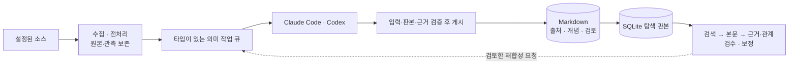
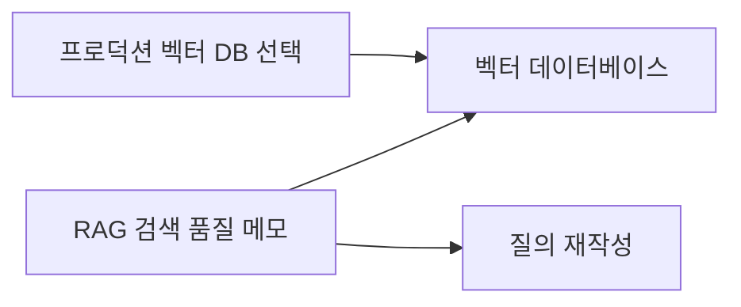

# Lorekeeper

[](https://www.rust-lang.org)
[](LICENSE)
[](https://deepwiki.com/junyeong-ai/lorekeeper)

> **[English](README.en.md)** | **한국어**

**흩어진 일상의 작업을 스스로 자라는 지식 위키로.**
Gmail·Slack·Jira·캘린더·RSS·메모를 수집하고, 출처와 연결된 요약·개념을 임베딩 없이 Markdown과 링크로 관리합니다. Rust가 수집·검색·게시 검증을, 설정한 LLM 실행기가 의미 판단을 맡습니다.

---

## 왜 Lorekeeper인가?

지식이 쌓이면 교차참조·분류·중복 후보·서로 다른 주장을 계속 확인해야 합니다. Lorekeeper는 반복 가능한 검사를 도구로 수행하고, 근거를 읽는 의미 판단을 LLM 작업으로 남깁니다.

> 📖 **처음 보는 용어들** — **vault**: 마크다운 파일이 모인 폴더(곧 당신의 지식 저장소) · **개념(concept)**: 한 주제당 한 페이지 · **링크**: 페이지를 잇는 `[표시 이름](상대/경로.md)` 마크다운 링크(Obsidian·GitHub·OKF 어디서든 해석).

| | |
|---|---|
| 📥 **예약 수집** | 선택한 소스와 실행기를 설정하고 OS 예약을 등록해 반복 실행 |
| 🧹 **노이즈 제거** | 중복 차단, 관련 없는 항목 필터, 내 일은 work-log로 자동 분리 |
| 🧩 **개념 축적** | 같은 대상·범위를 확인해 기존 페이지를 재사용하고 이름·별칭·근거를 보존 |
| 🔗 **연결되는 지식 그래프** | 마크다운 링크·역링크·클러스터로 개념이 서로 이어짐 |
| ✅ **할 일 → 기록** | 완료한 할 일과 메모를 보존하고, 설정된 tasks 소스의 수집·의미 처리를 거쳐 데일리·개념·성과 리뷰에 활용 |
| 📈 **복리** | 주간·월간·분기·연간 합성으로 시간이 갈수록 가치↑ |
| 🔑 **CLI 로그인 재사용** | Claude Code·Codex의 기존 인증 사용; Lore의 별도 LLM API 클라이언트 불필요 |

> 영감: [Andrej Karpathy의 LLM Wiki](https://gist.github.com/karpathy/442a6bf555914893e9891c11519de94f). 출처·파생 위키·작성 규약을 구분하고 수집·질의·점검을 반복합니다. Lorekeeper에서는 `config.yaml`이 수집·실행을, 볼트의 `AGENTS.md`가 페이지와 근거 규약을 정합니다.

---

## 한눈에 보기



`lore`가 수집·실행 순서·게시 검증을 맡고, 공통 `lore-process` 스킬을 실행하는 Claude Code 또는 Codex가 요약·개념·관계를 판단합니다. Markdown이 지식 원본이며 SQLite는 다시 만들 수 있는 검색·탐색 인덱스입니다.

---

## 핵심 개념

| 저장 위치·단계 | 역할과 기준 |
|---|---|
| 원본·출처 페이지 | 수동 원본과 지원하는 의존성, RSS 수집 본문을 별도 보존. 재조회는 당시 원본 복원이 아님 |
| `daily/`, `wiki/documents/` | 소스 관측과 문서. 구조는 파이프라인이 만들고 요약·추출은 큐로 처리 |
| `wiki/concepts/` | 지속적으로 조회할 주제. 이름·별칭을 확인해 재사용하고 근거·관련 관계를 축적 |
| `wiki/explorations/` | 질문에 대한 비교·판단·열린 검토. 출처와 그 판본을 명시해 이전 판단을 보존 |
| `me/`, 기간 합성 | 선택적인 개인 업무 로그·리뷰와 별도의 주간 지식 테마 |
| SQLite·`index.md` | 재생성 가능한 탐색 판본과 작은 진입 안내. Markdown 지식을 대신하는 원본 저장소가 아님 |

구조와 의미 결과의 소유권을 구분합니다. 완료 마커가 현재 입력 해시와 일치하고 담당 절이
존재해야 LLM 결과를 재사용하며, 채워진 문장만으로 완료를 판단하지 않습니다. 미래 날짜는 실체화하지 않습니다.
`vault.locale`은 생성 문장의 언어를 정하고 원문·출처가 적은 개념 이름은 번역하지 않습니다.
기존 개념 본문의 언어 보존은 [작업별 언어 규약](skills/lore-process/references/processing-kinds.md#output-language-all-kinds)을 따릅니다.

정확한 소스 식별자로 반복 관측을 정리하며, 서로 다른 출처의 유사한 문서를 자동 병합하지 않습니다.
모델이 의미를 판단하고 Rust가 입력·판본·근거·게시 형식을 검증합니다. 구조 검사 통과는 전체
지식의 의미적 일관성이나 사실의 정확성을 증명하지 않습니다.

## 읽는 순서

[처음 설치](#빠른-시작) → [결과 예시](#실제로-어떤-결과가-나오나요) → [소스 선택](#소스) → [실행기 설정](#에이전트-스킬과-실행-설정) → [예약 운영](#스케줄링).
세부 명령과 근거 처리 규약은 [작업별 안내](#명령어)에서 필요한 항목만 읽으세요.

## 빠른 시작

> **시작하기 전에 준비물** — 어렵지 않습니다:
> - 💻 **macOS 또는 Linux** (Windows는 PowerShell 설치 스크립트 제공)
> - 🤖 **Claude Code 또는 Codex** — 기존 CLI 로그인으로 요약·개념·관계를 처리합니다
> - 🔑 **쓰려는 소스의 자격증명만** — 예: Gmail/Drive/Calendar는 Google 로그인, Slack은 토큰
> - 🗂️ **(선택) Obsidian** — 그래프를 예쁘게 탐색용. 없어도 결과물은 평범한 마크다운입니다
>
> 💡 기본 시작 설정은 **인증이 필요 없는 메모 inbox 하나**입니다. RSS·업무 소스·개인 활동 추적은 필요할 때 추가합니다. 요약·개념 생성에는 선택한 CLI의 로그인이 필요합니다. 복사한 `config.yaml`의 `execution.profiles.primary.engine`을 `claude-code` 또는 `codex`로 설정하세요.

```bash
# 1) 설치 — 바이너리 + 템플릿 + 두 호스트의 스킬을 한 번에
curl -fsSL https://raw.githubusercontent.com/junyeong-ai/lorekeeper/main/scripts/install.sh | bash

# 2) 처음 설정 — 기존 config.yaml이 있으면 보존하고 편집
LORE_CONFIG_DIR="${XDG_CONFIG_HOME:-$HOME/.config}/lorekeeper"
cp -n "$LORE_CONFIG_DIR/config.starter.yaml" "$LORE_CONFIG_DIR/config.yaml"
${EDITOR:-vi} "$LORE_CONFIG_DIR/config.yaml"  # vault.root, timezone, locale, identity 확인

# 3) 로컬 검증과 지식 작성 규약 생성
lore validate
lore schema
mkdir -p "$(lore config vault-root)/inbox"
```

vault의 `inbox/`에 메모 파일 하나를 넣은 뒤 수집합니다. `inbox_dir: inbox`는 변경한
`vault.root`를 따라갑니다. 기본 설정에는 공급자 인증 마법사가 필요하지 않습니다.

```bash
# 4) 입력 접근을 확인한 뒤 실제 수집
lore ingest --dry-run
lore run daily
```

`lore run daily`는 수집 후 선택한 실행기로 요약·개념·관계를 처리하고 게시를 검증합니다.
수집만 끝난 상태는 지식화 완료가 아닙니다. 처리가 끝나면 다음을 확인합니다.

```bash
lore queue check
lore wiki reviews --check
lore wiki search "메모의 주제" --json

# 5) 자동화가 필요하면 예약 정의 생성 후 OS에 등록
lore schedule > lorekeeper.cron
# 기존 예약을 보존하며 병합하고 실제 실행 확인. macOS는 아래 스케줄링 절 참고
```

`config.example.yaml`은 전체 옵션 카탈로그이며 모든 소스가 비활성 상태입니다.
필요한 블록만 실제 `config.yaml`에 추가하고 범위·계정 값을 채운 뒤 활성화하세요.
`/lore-setup`은 이 선택과 ID 탐색을 돕습니다. 인증이 필요한 소스를 추가하면
`lore init credentials` → 해당 소스의 `lore ingest --dry-run <source-id>` 순서로 확인합니다.
예약 정의 생성·OS 등록·실제 실행은 각각 별도 단계입니다. [스케줄링](#스케줄링)을 따르세요.

### 다양한 파일과 대용량 입력

macOS·Linux에서 DOCX·XLSX·PDF는 `lore input install DIRECTORY`로 선택적 변환 환경을 설치한 뒤
출력된 설정을 병합합니다. macOS 14 이상 Apple Silicon에서는
`lore input install-vision VISION_DIRECTORY --python python3.12`로 PaddleOCR-VL 1.6을
설치할 수 있습니다. `vision`을 설정한 PDF는 기본적으로 모든 페이지의 내장 텍스트와
시각 인식을 보존하며, `pdf: {mode: native}` 또는 명시한 물리 페이지 선택으로 비용을 조절합니다.
Tesseract의 일반 텍스트 OCR도 선택할 수 있습니다. 인식 결과는 의미 검수의 승인이 아닙니다.

`lore input check`로 설치를, `lore input inspect FILE.pdf`로 결과를 확인하세요.
원본은 기본 파일당 32 MiB이며 더 큰 파일은 `ingest.originals` 한도를 명시적으로 높입니다.
`ingest.inputs`는 정규화·변환한 입력을 소스별 기본 64 MiB, 실행 전체 기본 256 MiB로
제한합니다. 수동 inbox는 `params.max_entries_per_run`(기본 2048, 범위 1..2048)만큼
시도하고 남은 입력은 다음 수집에서 이어갑니다. 원본 묶음·처리 규칙·게시 문서의 소유권이
일치하는 게시 기록으로 재처리를 생략하며, 의미 처리의 완료는 별도로 확인합니다.
한 입력의 의존성 묶음이 한도를 넘으면 해당 입력을 거부합니다.
원본·변환 결과·LLM 요청 한도는 서로 다르며, 프로세스 전체 메모리 상한을 뜻하지 않습니다.
변환 결과·페이지 수·실행 시간은 별도 제한입니다. 재시도는 검증된 파생 캐시를 재사용하고,
`inspect`와 `--dry-run`은 캐시를 기록하지 않습니다. 메모리·표·수식·페이지·시트의 보존 범위는
[전처리 설정과 지원 범위](skills/lore-setup/references/config.md#document-preprocessing)에서 확인하세요.

---

## 실제로 어떤 결과가 나오나요?

가상의 시나리오로 따라가 봅니다. AI 엔지니어 **수민**이 RAG 트러블슈팅을 정리한 메모를 vault의 `inbox/`에 떨어뜨립니다.

> 아래 페이지 예시는 **핵심 필드만 발췌**했습니다 — 실제 파일에는 `updated` 같은 관리용 frontmatter도 함께 들어갑니다.

### 📝 입력 — `inbox/rag-검색-품질.md`

```markdown
# RAG 파이프라인: 낮은 recall 검색 고치기

문제: 질의의 30%가 무관한 청크를 검색해 생성기가 환각을 일으켰다.
원인: (1) 청크가 2000토큰으로 너무 커서 임베딩이 여러 주제의 평균이 됨.
      (2) 대화형 질문("그 다른 거는?")을 그대로 임베딩.
구성: 벡터 데이터베이스(Vector DB)에 임베딩을 저장하고 질의 벡터와 유사한 레코드를 찾는다.
해결: 청크를 ~400토큰으로 줄이고, 질의 재작성(query rewriting)으로 독립 질문을 만들고,
      유사도를 L2→cosine으로 변경. Recall@5: 0.62 → 0.91.
```

### ▶️ 실행

```console
$ lore ingest
▸ notes (manual)
  extracted: 1 items
  ✓ wrote: wiki/documents/rag-파이프라인-낮은-recall-검색-고치기.md (document)

Done. 1 pages written, 0 personal items tracked.
```

이 시점에 페이지는 만들어졌지만 `## 요약`·`## 관련 개념`은 비어 있습니다 — `lore ingest`가 LLM 작업을 큐에 넣었기 때문입니다:

```console
$ lore queue status
  [current] sum-… (summarize)        → wiki/documents/rag-파이프라인-…
  [current] ext-… (extract-concepts) → wiki/documents/rag-파이프라인-…
queue: 2 current, 0 done, 0 stale, 0 missing-target, 0 unreadable across 2 task(s)
```

이제 **`lore run process`**를 실행합니다. 설정된 Claude Code·Codex 실행기가 공통 스킬로 큐를 처리하고, Rust가 출처와 판본을 검사해 게시합니다. 끝나면 `lore queue status`는 `0 current`가 되고 페이지가 채워집니다:

### ✅ 결과 ① — 문서 페이지 (요약 + 개념 링크가 채워짐)

```markdown
---
id: rag-파이프라인-낮은-recall-검색-고치기
type: document
title: "RAG 파이프라인: 낮은 recall 검색 고치기"
created: 2026-06-13
tags: ["document"]
---

## 요약
청크를 2000→400 토큰으로 줄이고, 대화형 질문을 standalone 쿼리로 재작성하고,
유사도를 L2→cosine으로 바꿔 이 메모의 Recall@5가 0.62 → 0.91로 개선되었다. 세 변경을 함께 적용한
관찰이므로 각 변경의 개별 효과나 다른 환경에서의 우열은 확인되지 않았다.

## 내용
… (원문의 내용과 코드 예제를 보존해 표시) …

## 관련 개념
- [벡터 데이터베이스](../../wiki/concepts/vector-database.md)
- [질의 재작성](../../wiki/concepts/질의-재작성.md)
```

### ✅ 결과 ② — 개념 페이지가 **수렴**합니다 (핵심 가치)

며칠 뒤 수민이 *"프로덕션 벡터 DB 선택"* 메모를 또 드롭합니다. "벡터 데이터베이스"는 두 메모 모두에 등장하지만 — **새 페이지를 만들지 않고 기존 개념에 합류**합니다:

```markdown
---
id: vector-database
type: concept
title: "벡터 데이터베이스"
aliases: ["Vector DB"]
category: ai-ml
source_count: 2          # ← 두 문서가 이 한 개념을 인용
---

## 핵심
벡터 데이터베이스는 임베딩을 저장하고 질의 벡터와 유사한 레코드를 찾는다.
두 번째 메모의 기존 PostgreSQL 환경에서는 별도 시스템의 운영 부담을 줄이기 위해
pgvector를 선택했다. 이 결정의 조건과 첫 메모의 검색 품질 관찰은 별도로 유지한다.

## 출처
<!-- lorekeeper:concept-sources:v1 -->

전체 출처는 `lore wiki prepare`로 스냅샷 ID를 받은 다음 `lore wiki citations EXACT_CONCEPT_PATH --snapshot ID`로 조회합니다.
```

> 이 예시는 두 메모가 같은 대상·범위를 설명한다고 확인한 경우입니다. 등록된 `Vector DB` 별칭은 같은 페이지를 찾게 하지만, 비슷한 이름만으로 페이지를 자동 병합하지 않습니다. 추출할 개념이 없는 결과도 정상입니다.

소스별 `concept_policy`로 개념 증가를 제어합니다. `disabled`는 원문·요약만 수집하고,
`existing-only`는 기존 개념에만 연결하며, `supported-new`는 근거가 있는 새 개념도 허용합니다.
생략하면 `disabled`입니다. `focus`는 관심 범위를 별도로 제한합니다. 예를 들어 반복 알림은
`existing-only`, 재사용할 설계 지식이 있는 문서는 `supported-new`로 설정할 수 있습니다.
이 정책은 작업 해시에 포함되고 Rust 적용 단계에서도 검사합니다.
추출을 비활성화해도 기존 인용은 유지합니다. 잘못된 인용의 철회는 별도 검수·보정 절차를 따릅니다.

### ✅ 결과 ③ — 필요한 만큼 펼쳐 보는 탐색

```bash
lore wiki prepare                              # 현재 원본을 검증하고 snapshot ID 반환
lore wiki search "Vector DB" --snapshot <id> --limit 10 --json
lore wiki context wiki/concepts/vector-database.md --snapshot <id> --limit 10
lore wiki neighbors wiki/concepts/vector-database.md --snapshot <id> --type document --limit 10
lore wiki read wiki/concepts/vector-database.md  # 목차 → 필요한 --section ID
lore wiki citations wiki/concepts/vector-database.md --snapshot <id> --limit 20
lore wiki reviews                              # 관련된 현재 판단과 미해결 검토
```

이름·별칭·본문으로 후보를 좁힌 뒤 선택한 페이지의 절, 관계, 직접 근거를 펼칩니다.
본문의 정확한 문자열은 `wiki search --body`, 띄어쓰기 차이는 `--spacing`, 분류는
`wiki browse --category ... --tag ...`로 찾습니다. 검색 후보·일반 링크·인용 근거는
서로 구분하며, 검색 순위와 출처 수를 신뢰도 점수로 사용하지 않습니다.
검색에 `--repository ID` 또는 `--provider TYPE --namespace ID`, `--path-prefix`를
조합해 문서 소유 범위를 좁힙니다. `--from`·`--to`는 선언된 작성일을 제한하며 수집일을 뜻하지
않습니다. `wiki neighbors`는 연결된 페이지를 중복 없이 펼치고 `wiki links`는 개별 링크를 보여줍니다.

검색·분류 응답의 각 분류 목록은 기본 20개 값과 전체 개수·다음 위치를 반환합니다.
`--facet-limit`과 `--facet-offset`으로 이어서 조회하며, 문서 결과의 `--offset`과는 별개입니다.
각 문서의 리뷰는 최대 3개를 미리 보여주고 전체·상태별 개수를 함께 제공합니다. 나머지 리뷰와
관계는 같은 snapshot의 `wiki context`로 펼쳐 확인합니다.

`index.md`는 작은 진입 안내이고 `.lorekeeper/search.sqlite`가 검색 판본을 보관합니다.
반복 탐색은 같은 snapshot과 `next_offset`을 사용하고, 실제 근거는 반환된 revision으로
확인합니다. 저장된 판본 하나를 교체하면 이전 ID는 조회할 수 없습니다.
`--snapshot`을 생략하면 현재 Markdown을 읽으며, `wiki prepare`는 현재 원본 전체를
검증하므로 매 질의마다 실행할 필요는 없습니다.

[검색·관계·보존 원본 조회](skills/lore-wiki/references/query.md)와
[충돌 검토](skills/lore-wiki/references/audit.md)에 세부 절차가 있습니다.
최신 날짜나 다수 출처만으로 충돌을 해결하지 않으며, 열린 판단과 재평가가 필요한 근거를 보존합니다.

### ✅ 결과 ④ — 지식 그래프가 형성됩니다

다음은 위 예시의 문서가 실제로 뒷받침하는 개념 연결입니다.
군집과 `suggest-links`의 연결 후보는 별도 근거 검토를 거쳐야 의미 관계가 됩니다.



### 📈 시간이 지나면 — 복리


수집은 출처와 개념을 연결하고, 기간 합성은 준비된 일일 기록이나 하위 기간을 사용합니다. 입력이 바뀌면 관련 합성을 다시 검토하며, 주간 지식 테마와 개인 성과 리뷰는 별도 결과물입니다.

---

## 소스

| 타입 | 용도 | 인증 |
|---|---|---|
| `gmail` | 메일 다이제스트 (라벨/발신자로 필터) | Google OAuth |
| `slack-channel` | 채널 전체 = 팀 활동 (스레드·봇필터·watch_users) | Slack 토큰 |
| `slack-search` | 키워드 트렌드 검색 | Slack user 토큰 |
| `jira` | JQL로 고른 현재 이슈 (수정일·현재 담당자, ADF→Markdown) | Jira API |
| `confluence` | CQL로 고른 스페이스·페이지 (스토리지 포맷→Markdown) | Atlassian OAuth 또는 API 토큰 |
| `google-calendar` | 일정 + 회의록(Drive 링크 자동 추출) | Google OAuth |
| `google-drive` | Drive 폴더의 큐레이션 문서 | Google OAuth |
| `rss` | 벤더 블로그·뉴스 → 개념 (인증 불필요, 다중 피드) | 없음 |
| `nodex` | 프로젝트 저장소가 직접 쓴 결정·학습 기록 → 개념 (`nodex.toml`과 nodex `>=0.63,<0.64` 필요; [실행 파일·근거 버전 설정](skills/lore-setup/references/config.md#nodex-binary-selection)) | 없음 |
| `manual` | `inbox/`의 Markdown·텍스트·HTML, 선택적 DOCX·XLSX·PDF·이미지 인식 | 소스 인증 없음; 바이너리 변환은 별도 런타임 |
| `tasks` | 내가 끝낸 작업 — `lore task`로 닫은 항목이 그날의 페이지가 됨 | 없음 |

같은 타입의 소스를 여러 개 정의할 수 있습니다(예: `team-slack`, `ai-news`). 일일 집계는
`<daily>/<소스 키>/날짜.md`에, 문서 단위인 manual·nodex·Drive는 `<wiki>/documents/`에
안정된 문서 식별자로 저장합니다. 전체 예시는 [`config.example.yaml`](config.example.yaml).

외부 지식을 추가하려면 카탈로그의 `ai-news` 또는 `tech-news` 블록을 실제 설정에 복사해 활성화하세요. 공식 발표·모델 기법·AI 구현·제품 평가와 국내 개발 사례를 기본으로 두고, 추가 연구소·뉴스레터·집계 피드는 선택하도록 나눴습니다. `fetch_full_text`는 짧은 피드의 본문을 가져오지만 접근 실패 시 피드 텍스트만 남습니다. `focus`는 요약·개념 추출의 범위이며 원본 수집을 차단하지 않습니다. 피드의 현재 목록과 조회 한도는 전체 과거 이력이나 사실의 정확성을 보장하지 않습니다.

새 소스는 어댑터의 타입·설정·문서 식별·관측 범위·부분 실패 계약을 등록해 확장합니다.
설정에 이름만 추가하는 플러그인 방식은 아니며, 현재 YouTube 전용 수집기는 없습니다.
Drive·웹 입력의 지원 형식과 이력 범위는 [설정 안내](skills/lore-setup/references/config.md)를 확인하세요.

## 명령어

```bash
lore validate                    # 설정 검증
lore run daily                   # 전체 수집 → 의미 처리 → 관계·탐색 갱신 → 준비된 기간 재개
lore run process                 # 이미 수집된 의미 작업 처리
lore run knowledge               # 설정된 예산의 의미 검수 한 배치
lore ingest <source-id>          # 한 소스 수집; 전체 업무 로그는 만들지 않음
lore status                     # 하위 시스템별 상태와 다음 확인 명령
lore health --json              # 수집 시각과 지연
lore queue check                # 미완료 작업·미게시 결과·중단된 변경
lore wiki reviews --check       # 무효 검토·변경된 근거 검사; 열린 판단은 별도 상태
lore graph lint                 # 구조적 위반과 관측 정보
lore maintenance --dry-run      # 보존 정책에 따른 정리 미리보기
```

전체 명령과 옵션의 기준은 `lore --help`, `lore <명령> --help`입니다.
작업 절차는 다음 안내에서 이어서 읽으세요.

| 하려는 일 | 상세 안내 |
|---|---|
| 검색·본문·관계·인용·보존 원본 조회 | [Query](skills/lore-wiki/references/query.md) |
| 파일·URL 입력과 기존 문서 식별자 이관 | [Add](skills/lore-wiki/references/add.md) |
| 수집·원본 보존·실패 재시도·날짜 복구 | [Ingestion](skills/lore-ingest/references/ingestion.md) |
| 이름·태그·분류·상태 보정, 개념 재합성 | [Curation](skills/lore-wiki/references/curation.md) |
| 관계·상충·중복 의미 검토 | [Audit](skills/lore-wiki/references/audit.md) |
| 정기 의미 검수·진척과 재개 | [Maintenance](skills/lore-wiki/references/maintenance.md) |
| 대용량 근거 분할·종합 | [Bounded work](skills/lore-process/references/bounded-work.md) |
| 원본·저장소 추출본·작업 캐시 보존 | [Source retention](skills/lore-extract/references/manifest.md#source-retention) |

## 에이전트 스킬과 실행 설정

스킬 본문과 참고 자료의 원본은 `skills/`입니다. Claude 전용 메타데이터는
`agents/claude.json`, Codex 호출 정책은 필요한 스킬의 `agents/openai.yaml`에 둡니다.
배포할 때 호스트별 진입 파일을 만들며, 공통 절차를 따로 편집하지 않습니다.
[공식 스킬 작성 가이드](https://platform.claude.com/docs/en/agents-and-tools/agent-skills/best-practices)에 따라
진입 파일은 역할과 선택 기준을 담고 작업별 상세 규약은 직접 연결한 참고 자료에서 읽습니다.

| 스킬 | 하는 일 |
|---|---|
| `lore-process` | 큐의 요약·개념·합성·검토 결과 처리와 게시 검증 |
| `lore-setup` | 소스·설정·인증·최초 실행·예약 등록 안내 |
| `lore-wiki` | `query`, `add`, `capture`, `audit`, `curate`, `maintain`, `status` |
| `lore-extract` | 저장소 지식 추출: scan → run → audit |
| `lore-ingest` | 수집·합성·상태·스케줄 CLI 작업 |
| `lore-day` | 할 일·브리핑·리마인더·마감 |

Claude Code에서는 `/lore-wiki query ...`, Codex에서는 `$lore-wiki`로 사용합니다.
`lore self deploy --skills user --agent codex`는 Codex에만 대화형 스킬을 설치합니다.
`--agent both`는 두 호스트에 설치하며, `--skills project`는 현재 프로젝트 범위입니다.
Claude 경로는 `.claude/skills`, Codex 경로는 `.agents/skills`입니다.
무인 실행은 `<data>/skills/<engine>/`의 검증된 배포본을 사용합니다.
누락·변조된 필수 파일은 세션 시작 전에 거부합니다.

실행기 지원 범위는 Claude Code `>=2.1.303,<3`, Codex CLI `>=0.163.0,<1`입니다.
공통 스킬과 타입이 있는 결과 계약을 사용하며, 실행기별 인증·도구·샌드박스 차이는
Rust 어댑터가 처리합니다. 게시 검증은 OS 접근 통제를 대신하지 않습니다.

다음처럼 일일 처리는 Claude, 의미 검수는 Codex로 선택할 수 있습니다.

```yaml
llm:
  provider: queue
execution:
  default_profile: primary
  work:
    extraction_context: progressive
    max_input_bytes: 262144
    max_result_bytes: 32768
    max_calls: 64
    max_consecutive_calls: 4
  profiles:
    primary:
      engine: claude-code
      timeout_seconds: 3600
    reviewer:
      engine: codex
      timeout_seconds: 3600
  operations:
    knowledge: reviewer
```

`--profile` 지정 → 작업별 설정 → 기본 프로필 순서로 선택하며 자동 전환하지 않습니다.
`executable`, `model`, Claude의 `config_directory`, Codex의 `profile`은 필요한 프로필에만
지정합니다. `execution.work`는 요청·결과 JSON의 바이트 수와 실행당 호출 수를 제한하며,
큰 근거는 새 세션에서 분할 검수·종합합니다. 모델 토큰 수나 요금 한도를 뜻하지 않습니다.
기본 `extraction_context: progressive`는 빠짐없이 찾은 후보의 제한된 미리보기를 먼저 검토하고,
선택한 후보의 본문과 필요한 검토·근거를 읽습니다. 선택하지 않은 본문까지 검사했다는 뜻은
아니며, 보류한 판단은 추출 완료를 막습니다. 원본 입력은 끝까지 읽고 후보·검토의 변경도
계속 검사합니다. 모든 검색 후보의 본문을 읽으려면 `full-context`를 선택하세요. 이 설정도
프로필의 `work`에서 재정의할 수 있습니다. 수동 처리와 재개 절차는
[개념 추출 탐색](skills/lore-process/references/discovery.md)에 있습니다.
`lore work cost --task-id ID`로 모델에 후보 본문을 보내기 전 패킷 수·검색식별 일치 수·JSON 크기와
남은 검토 범위를 확인할 수 있습니다. 선택적 `max_screening_batches`를 넘는 미완료 선별은
전체 후보를 보존하고 해당 작업만 보류하며, 완료한 선별 기록은 계속 사용합니다.
이 수치는 토큰·요금이나 후보의 의미적 적절성 판정이 아닙니다.
미완료 작업은 보존하고 실패로 보고합니다. 프로필별 예산과 수동 실행은
[실행 설정](skills/lore-setup/references/config.md#execution-profiles),
분할 결과 규약은 [Bounded work](skills/lore-process/references/bounded-work.md)를 따릅니다.
네이티브 축약에서 열린 질문은 Rust가 종류·내용·근거 그대로 보존하며, 모델은 현재 질문 번호에 대해서만
명시적인 해결을 반환합니다. 이미 해결된 이력은 다시 해결 대상으로 취급하지 않습니다. 저장된 Work와 독립 기록 형식은 유지합니다.

작은 요약·이벤트 정제·주제 추출은 원문·해당 리뷰·생성 규칙을 한 번의 구조화 요청으로
처리합니다. 분할 작업은 저장된 관측을 재개하고 최신 리뷰·근거를 별도로 결속한 뒤 같은 절 생성 규칙을 적용합니다. 전체 요청이
입력 한도를 넘으면 그 작업을 용량 보류로 남기고 독립 작업을 계속 처리합니다. 모델은 섹션 본문을
반환합니다. Rust가 작업 식별자·리비전 검증과 결과 저장·게시를 담당합니다. 추가 읽기나
검수가 필요하면 작업을 보류하며, 같은 요청은 다시 호출하지 않습니다. 독립 작업은 계속
처리합니다. 개념 추출·합성은 필요한 도구 사용을 유지하면서 의미 결과만 구조화해 반환합니다.
Rust가 원래 준비 상태에서 결과 메타데이터를 채우고 seal·저장·게시를 담당합니다.
감사는 기존 대화형 최종화 절차를 유지합니다.

새 분할 작업은 요청 크기와 각 결과의 최대 크기를 기준으로 여러 관찰을 한 번에 종합합니다.
개념 추출·합성은 저장된 관찰이 모든 분할을 빠짐없이 한 번씩 포함하고, 근거·생성 규칙까지
입력 한도에 들어오며 처리 불가 사유가 없으면 바로 최종화할 수 있습니다. 별도 seal로 검증하며
누락된 중간 종합을 완료로 표시하거나 기존 관찰을 다시 쓰지 않습니다. 조건을 충족하지 않으면
기존 종합 절차를 유지합니다. 유효한 근거 응답이 출력 한도를 넘으면 관찰을 저장하지 않고 같은
요청의 재호출을 막습니다. 독립 작업은 계속 처리하며 응답을 잘라 채택하지 않습니다.
근거 읽기를 완료할 수 없으면 관찰 대신 식별자가 결속된 처리 불가 응답을 남깁니다.
같은 요청의 재호출을 막고 독립 작업은 계속하되, 해당 노드와 검수는 미완료로 유지합니다.
Rust가 검증한 원문 범위를 그대로 인용할 수 있으며 세부 위치를 추측할 필요는 없습니다.
네이티브 근거 읽기와 후보 선별은 판단 내용만 반환하며 Rust가 해당 호출의 식별자를 결합합니다.
모델이 식별자를 다시 쓰지 않으며, 저장 전 최신성·범위·전체 결과 크기 검사는 유지합니다.
저장된 작업은 기존 구조로 재개합니다. `lore run process --json`의 `work_steps`는 단계별
JSON 크기와 준비·에이전트 호출·검증 시간을 구분합니다. 관측하지 못한 값은 `null`이며
토큰 수나 실제 청구액을 뜻하지 않습니다. `mutation_access`는 네이티브 내부 쓰기 권한
획득·대기·복구 시간을 보고하며, 큐 계획 시간에서는 이를 제외합니다. 범위와 한도는
[실행 측정 규약](skills/lore-process/references/bounded-work.md#native-run-measurements)을 참고하세요.

큐 계획은 전체 작업의 상태·소유권·의존성을 검사한 뒤 공정한 순서로 상세 준비합니다.
절 생성·단계적 추출은 남은 호출·병렬 한도만큼, 여러 작업을 한 호출로 처리할 수 있는
경우는 최대 64개·입력 바이트 한도까지 준비합니다. 같은 준비 단계의 탐색 계산을 공유하되 작업별 전체 후보와 리비전을
유지하고, 실행 후 다시 검증합니다. 준비하지 않은 작업은 대기로 남습니다.
선택 작업과 완료 Work 최종화는 전체 준비 요청을 호스트의 표준입력으로 전달합니다.
추출·합성 호스트는 결과 파일이나 식별자를 다시 만들지 않습니다. 추가 읽기·보정이
필요하면 명시적인 `needs-action`으로 보류하며 같은 요청은 재호출하지 않습니다.
입력 한도와 실행 후·게시 전 현재성 검증은 그대로 적용합니다.

`lore queue apply --json`은 결과별 작업·파일 판본·검증 범위와 게시·폐기·거부를 보고합니다.
소유권과 범위를 확인한 개별 거부는 해당 작업과 의존 작업을 보류하고, native 실행은 독립
작업과 준비된 감사를 계속할 수 있습니다. 거부 기록은 완료가 아니며 전체 실행은 미완료입니다.
같은 거부 때문에 모델을 다시 호출하지 않지만 결정론적 apply는 다시 검사합니다. 조건이나
초안이 고쳐지면 재검증하며, 오래된 근거로 작성한 초안은 현재 범위를 읽고 다시 생성해야 합니다.
손상된 기록·알 수 없는 소유권·저장 오류·실행기 실패는 추가 처리를 중단합니다.

`llm.provider: queue`는 작업 보관 방식이며 실행기 선택과 별개입니다.
`noop`는 LLM 작업을 만들지 않습니다. 검색·탐색과 결정적 수집은 에이전트 없이 사용할 수 있습니다.

---

## 설치 · 빌드

```bash
# Windows (PowerShell)
irm https://raw.githubusercontent.com/junyeong-ai/lorekeeper/main/scripts/install.ps1 | iex

# 소스에서 빌드
cargo build --release && ./target/release/lore --help
```

설치 플래그: `--version`, `--install-dir`, `--data-dir`, `--skill {user,project,none}`, `--agent {claude-code,codex,both}`, `--from-source`, `--force`, `--yes`, `--dry-run` (`--help`로 전체 확인).

설치기는 설정 디렉터리에 `config.starter.yaml`과 `config.example.yaml`을 배포하며
사용자의 `config.yaml`은 보존합니다. 같은 디렉터리의 `data-dir`은 설치 경로를,
`deployed-skills`는 배포한 스킬을 기록합니다. 업데이트·제거에 쓰는 자동 관리 정보이며
인증정보는 포함하지 않습니다.

## 할 일과 개인 리뷰

```bash
lore agenda                       # 오늘 할 일 — 커밋된 것, 깨어난 것, 기한이 온 것
lore task add "스펙 리뷰" --state today
lore task add "인덱스 질문 회신" --link https://acme.slack.com/archives/C123/p1755600000 --label 스레드
lore task done 7k2p --note "refresh token은 회전 후 재시도하면 grant가 무효화된다"
lore task sync                    # Obsidian에서 직접 고친 것을 기록에 반영
```

보드는 `<personal>/tasks.md` — `오늘 / 제안 / 다음 / 대기 / 언젠가` 섹션의 평범한 마크다운 체크박스입니다. 폰의 Obsidian에서 체크하거나 줄을 다른 섹션으로 끌어 옮기면 다음 `lore task sync`나 보드를 변경하는 명령에서 상태 변경을 기록합니다. 섹션 제목이 곧 상태이며, `제안`은 아직 수락하지 않은 항목입니다.

`lore task done`은 완료와 `--note`를 전환 로그에 저장합니다. 설정된 tasks 소스를 완료일이 포함된 수집 범위로 ingest하면 그날의 데일리 페이지가 생성되고, `/lore-process`가 대기 중인 요약·개념 추출을 처리합니다. 전체 소스 수집에는 work-log도 포함되며, 예약된 일일 파이프라인은 수집과 의미 처리를 함께 실행합니다. **읽은 것뿐 아니라 한 일도 지식의 근거로 남습니다.**

개인 리뷰는 실제 게시한 업무 로그와 그때 사용한 개인 업무 입력의 연결을 확인합니다.
부분 재수집으로 업무가 달라졌거나 확인된 업무의 로그가 없으면 합성을 보류합니다.
`lore ingest --date YYYY-MM-DD`로 전체 소스를 다시 조회해 해당 날짜의 로그를 실제로
게시해야 연결을 갱신할 수 있습니다. 과거 입력을 다시 얻을 수 없거나 결과가 비어 있으면
기존 로그를 자동 삭제·승인하지 않습니다. 조회 범위 밖의 과거 이력은 미확인으로 남습니다.

## 업데이트와 제거

```bash
lore self status      # 배포된 사본이 지금 바이너리와 같은지 (다르면 non-zero)
lore self update      # 새 릴리스로 교체하고, 대화형·실행용 스킬과 템플릿·AGENTS.md 재배포
lore self deploy      # 재배포만 (self status가 보고한 차이를 고침)
lore self uninstall   # 설치한 것만 제거 — vault는 건드리지 않음
```

대화형·실행용 스킬과 템플릿·시작 설정·전체 옵션 예제는 **바이너리에 내장**되어 있습니다. 배포된 사본은 변경되거나 뒤처질 수 있으며 `lore self status`로 확인합니다. `lore self deploy`가 사본을 씁니다. `lore self update`는 `lore queue check`와 같은 기준으로 대기 작업·해석 불가 입력·미반영 결과·중단된 저장 기록이 있으면 거부합니다. 확인 가능한 미완료 작업은 `--force`로 허용할 수 있지만, 설정이나 저장소를 읽을 수 없는 오류는 생략하지 않습니다. 실행 중인 버전보다 오래된 릴리스도 거부합니다(`--version`으로 명시하면 되돌릴 수 있음).

Unix CLI는 선택한 설치 자원에 공유 잠금을 유지합니다. `run`의 수집·의미 처리 전체와
`workflow`의 참여 자식도 보호되며, 같은 바이너리·runtime·스킬을 사용하는 다른 vault가
실행 중이면 배포·교체·제거가 거부됩니다. `--force`도 실행 중인 잠금을 우회하지 않습니다.
업데이트는 다운로드 후 잠금을 다시 잡고 설정·바이너리·큐를 재확인합니다. 자원 옆의
`.lorekeeper-*.lock`은 지속되는 운영 파일이므로 실행 중이나 캐시 정리 때 삭제하지 마세요.
자원 상위 디렉터리에서 잠금 파일을 만들 수 없다면 해당 설치의 쓰기 권한을 먼저 해결해야 합니다.
스케줄 정의 생성은 설치 잠금을 잡거나 파일을 만들지 않습니다.

기존 Unix 설치는 `lore self update`로 갱신하세요. 초기 설치 스크립트, `cargo install`,
수동 바이너리 교체와 이전 버전은 이 설치 잠금에 참여하지 않습니다. 이 경로로 재설치할 때는
설치를 공유하는 모든 vault의 예약 실행과 수동 세션을 멈추고, 자식 프로세스 종료와 각 vault의
`lore queue check` 통과를 확인하세요. 교체 후 `lore self deploy`와 `lore self status`로
배포 상태를 확인한 뒤 작업을 재개합니다.

사용자 템플릿은 제목·작성자에 `markdown_text`, 원문 본문에 `markdown_fragment`,
출처 링크에 `url | markdown_link(label)` 필터를 사용하세요. 본문은 독립적으로 해석해
제목·참조 링크·각주·코드 블록이 다음 생성 섹션에 영향을 주지 않게 합니다.
문서 끝까지 열린 HTML 주석·스크립트는 닫는 태그를 추측하지 않고 `html` 코드 블록으로 표시합니다.

---

## 자격증명

환경변수 또는 `<vault>/.lorekeeper/credentials.json`(0600). 환경변수가 파일보다 우선.
macOS·Linux에서는 그룹·다른 사용자에게 권한이 열린 인증 파일과 잠금 파일을 거부합니다.
수동 생성·복원한 파일은 사용 전에 `chmod 600`으로 제한하세요. 저장·갱신은 항상 `0600`으로 수행하며,
인증 설정 마법사는 읽기·파싱에 실패한 기존 저장소를 빈 값으로 초기화하지 않습니다.
여러 vault가 같은 계정을 쓰면 `credentials.file`에 하나의 공유 저장소를 지정할 수 있습니다.
상대 경로는 설정 파일 기준이며, OAuth 갱신과 후속 토큰 저장은 같은 잠금 안에서 처리합니다.
회전하는 refresh token을 별도 파일로 복사하지 마세요. 다른 앱은 별도 OAuth 앱을 사용해야 합니다.

```bash
lore init credentials   # 대화형 마법사 — Google 토큰은 브라우저 OAuth로 자동 발급
```

- **Google**: `LORE_GOOGLE_CLIENT_ID/SECRET/REFRESH_TOKEN` — Gmail/Drive/Calendar **읽기 전용** 스코프. "Desktop app" OAuth 클라이언트 필요.
- **Slack**: `LORE_SLACK_TOKEN`(bot `xoxb-`) 또는 `LORE_SLACK_USER_TOKEN`(`xoxp-`). `slack-search`는 user 토큰 필수.
- **Atlassian** (Jira/Confluence): `LORE_ATLASSIAN_SITE_URL` + `LORE_ATLASSIAN_PAT` (Data Center), or `+ LORE_ATLASSIAN_EMAIL` + `LORE_ATLASSIAN_API_TOKEN` (Cloud 클래식 토큰 — 사이트로 전송). 스코프 토큰이면 `LORE_ATLASSIAN_CLOUD_ID`를 함께 주세요 — 그 값이 게이트웨이 경로를 선택하며, 없으면 클래식으로 취급되어 사이트로 갑니다. OAuth은 리프레시 토큰이 회전하므로 환경변수로 받지 않습니다 — `lore init credentials`로 발급하세요.

> 기본 인증 파일은 Git에서 제외됩니다. 별도로 지정한 공유 저장소도 커밋·동기화 대상에 포함하지 마세요.

---

## 스케줄링

```bash
lore schedule > lorekeeper.cron   # Linux: 검토 후 crontab -e에 병합
lore schedule --format launchd --bin "$(command -v lore)"   # macOS
```

`lore schedule`은 예약 정의를 출력하며 OS에 등록하지 않습니다. Linux에서는 기존 예약을
보존하며 병합하세요. macOS에서는 각 plist를 표시된 LaunchAgents 경로에 저장하고 로그
디렉터리를 만든 뒤 `launchctl bootstrap gui/$(id -u) <plist 절대 경로>`로 등록합니다.
설정 변경 후에는 기존 작업을 `bootout`하고 새 정의를 등록하며, 비활성화한 작업도 해제합니다.
`self uninstall`은 OS 예약을 해제하지 않습니다.

macOS의 문서·데스크탑·다운로드 같은 보호 폴더에 볼트가 있으면 예약 작업의 `lore`에도
해당 폴더 접근 승인이 필요합니다. 터미널 앱의 승인이 launchd 실행까지 보장하지는 않습니다.
작업을 실제로 시작해 표시되는 macOS 권한 요청을 승인하고, 로그와 종료 상태를 확인하세요.
서명 식별자가 달라지는 바이너리 업데이트 후에는 재승인이 필요할 수 있습니다.
서명 검사나 `--version` 성공만으로 실제 볼트 접근을 확인한 것은 아닙니다.
파일 권한 `0600`은 이 OS 승인을 대신하지 않습니다.
자세한 권한 동작은 [Apple 문서](https://developer.apple.com/documentation/bundleresources/information-property-list/nsdocumentsfolderusagedescription)를 참고하세요.

예약 작업은 Rust 명령을 직접 실행합니다.

| 예약 | 실행 |
|---|---|
| `ingest.schedule` | `lore run daily --wait` |
| `graph.audit.schedule` | `lore run knowledge --wait` |
| 주간·월간·분기·연간 | `lore synthesis <기간> --previous --defer --wait-for-vault` |
| 유지보수 | `lore maintenance --prune-queue --wait-for-vault` |
| 리마인더 | `lore task remind notify` |

일일 실행은 전체 수집, 의미 처리, 관계·탐색 갱신, 준비된 기간 재개를 수행합니다.
일부 소스 실패와 의미 처리 실패를 구분하며, 미완료 작업을 성공으로 보고하지 않습니다.
`--json`은 단계별 결과를 stdout에, 하위 명령 로그는 stderr에 보냅니다.

의미 처리 중에는 Unix workflow lease와 판본 검증으로 참여 실행기를 조정합니다.
일일 실행은 네트워크 수집 후 별도 workflow lease로 게시를 조정합니다. `--wait`를
지정하면 기다리고, 생략하면 경합을 거부합니다. 짧은 쓰기 잠금 대기 후에는 최신 입력을
준비하고, 모델 호출 뒤에는 다시 검증합니다. 네트워크·모델 호출 동안 쓰기 잠금을 잡지 않습니다.
수동 세션도 입력을 읽기 전에 `lore workflow -- claude` 또는 `lore workflow -- codex`로
시작하세요. 설정 파일이 바뀌면 남은 실행은 중단합니다. 호스트 인증·PATH·proxy 환경을
바꾸면 예약 정의를 다시 등록해야 합니다. 무인 실행과 workflow는 Windows를 지원하지 않습니다.
상세 등록·경합·환경 규약은 [스케줄링 안내](skills/lore-ingest/references/scheduling.md)를 따릅니다.

### 중단 후 복구

launchd는 잠자기 중 놓친 실행을 한 번 수행하고 cron은 건너뜁니다. 모든 누락 날짜를
자동 복원하지는 않습니다. 예약 시각은 호스트 현지 시간, 문서 날짜는 볼트 시간대입니다.
복구를 원하면 시작일과 실행량을 각각 명시합니다.

```yaml
ingest:
  recovery: {start_date: "2026-10-01", max_days_per_source_per_run: 3}
synthesis:
  recovery: {start_date: "2026-10-01", max_periods_per_run: 8}
```

첫 설정은 [누락 수집 날짜](skills/lore-ingest/references/ingestion.md#missing-date-recovery)를
재조회하고, 두 번째는 시작일 이후 시작해 종료된 기간의 합성 요청을 등록합니다.
기간 예산은 이미 요청된 항목을 포함한 확인 횟수이며, 저장된 순서부터 이어갑니다.
둘 다 과거 원본이나 의미 처리 완료의 증거를 만들지는 않습니다.
`lore ingest --recover --dry-run`과 `lore synthesis pending --status --json`으로 범위와 보류 사유를 확인하세요.
수집 복구의 미리보기도 공급자 계정·데이터 집합을 확인합니다. 토큰 갱신은 같은 관측 범위를
유지하지만 다른 계정·사이트나 식별이 없는 과거 기록은 완료 근거로 재사용하지 않습니다.

### 정기 의미 검수

```yaml
graph:
  audit:
    schedule: "0 7 * * 0"
    batch_size: 5
    max_input_bytes: 262144
```

수집·기간 합성과 별도로 변경된 개념·문서와 처음 보는 대상을 번갈아 검토합니다.
준비된 대상을 먼저 처리하고 보류 사유를 `audit_deferred`에 남깁니다.
탐색으로 미완료 의존성이 추가된 대상은 보류하고, 준비된 같은 배치의 대상과 큐 처리는 계속합니다.
보류 진단은 가장 최근 확인한 범위이며 전체 코퍼스의 차단 건수가 아닙니다.
검수 진척이 있어도 전체 큐가 남으면 실행은 미완료입니다. 판단은 근거 판본과 함께 Markdown 검토에 남으며,
단일 출처나 인용 수만으로 병합·삭제하지 않습니다.

초기 누적분은 등록된 프로필로 `lore run knowledge --profile reviewer --batches 20 --json`처럼
실행량을 명시해 재개할 수 있습니다. `batch-limit`는 실행량 도달, `settled`는 현재 검사 범위의
대기 대상이 없다는 뜻입니다. 전체 지식의 진실이나 모든 외부 원본 검수를 보장하지 않습니다.
예약 주기는 초기 누적량과 함께 정하세요. `lore wiki audit-plan`의 미검수·변경 건수와
소규모 실행에서 실제 완료한 대상 수·호출 수·소요 시간을 확인한 뒤 초기 실행량을 정하고,
이후 새로 들어오거나 변경되는 양보다 처리량이 충분한지 관찰하세요. `batch_size`는 대상 수의
상한이므로 보류·분할 처리·실패가 있는 실행의 완료량이나 비용을 보장하지 않습니다.
`lore wiki audit-plan --ready`로 현재 준비된 대상과 보류 이유를 미리 확인할 수 있습니다.
`execution.work.max_parallel`은 준비된 근거 읽기와 서로 다른 문서의 후보 선별 동시 실행 수이며 기본값은 1입니다.
`max_consecutive_calls`는 한 번 순서가 온 Work 또는 선별 단계에 허용하는 연속 호출 수이며
기본값은 4입니다. 같은 총 호출 예산을 사용하며, 완료 여부나 입력 크기로 우선순위를 추정하지
않습니다. 중단·재시작 시에는 이미 저장한 다음 대상 순서를 유지합니다. 각 호출은 현재 입력을
다시 확인하고, 게시·단계 변경·보류 뒤에는 새로 계획합니다.
호출 예산 안에서만 병렬화하고 대화형 처리·최종화·기록·게시를 직렬 처리합니다. 선별 응답은
호스트 실행 후 전체 후보 범위를 새로 함께 읽고, 작업별 리비전을 검증한 뒤 기록합니다.
실행별 로컬 준비 시간과 호출
시간을 구분해 측정한 뒤 조정하세요. 병렬 호출 시간의 합은 실제 경과 시간보다 클 수 있습니다.
새 Work·후보 선택 기록은 주석·YAML 서식 대신 파싱한 설정 값을 사용하며,
호출 수·병렬 수·연속 호출 수·선별 패킷 한도와 프로필 시간 제한을 의미 식별에서
제외하므로 실행 사이에 조정할 수 있습니다. 실행 중에는 설정의 모든 바이트를 고정하며,
모델·effort·입출력 한도·의미 정책 변경은 여전히 기록을 무효화합니다. 기존 바이트 기반 기록은
원래 설정이 정확히 같을 때 재개하며, 운영 설정 변경만으로 자동 이전하지 않습니다.
[의미 검수 절차](skills/lore-wiki/references/maintenance.md)는 탐색 범위·전체 근거 읽기·보정·재평가 규약을 설명합니다.

리마인더는 OS가 알림을 접수한 뒤 소진합니다. 사람이 읽었다는 확인이 아니며, 저장 전
중단되면 재전달될 수 있습니다. 실패한 알림은 다음 실행에 남습니다.

### 볼트를 git으로 관리하기 (선택)

재합성은 본문을 대체하고 병합은 페이지를 삭제하므로, 중요한 변경 전에는 별도 백업이나 검토한 Git 커밋을 남기십시오. 파이프라인은 사용자의 동시 편집을 구별할 수 없어 자동으로 stage하거나 commit하지 않습니다. 복구 journal은 중단된 변경을 이어가기 위한 기록이며 과거 버전 백업을 대신하지 않습니다.

```bash
cd "$(lore config vault-root)"
git init
git config core.precomposeunicode true        # macOS: 한글 파일명을 NFC로 저장
# 기존 .gitignore에 아래 항목을 추가하고 중복·사용자 설정을 확인
printf '.lorekeeper/\n.obsidian/\n' >> .gitignore
git status --short
git diff
# 공개해도 되는 파일만 선택해서 git add한 뒤 commit
```

`.lorekeeper/`에는 운영 기록과 보관된 입력이 있으므로 이력에서 제외하십시오. 자격증명 파일도 별도로 제외되어 있는지 확인하십시오. 작은 진입 안내인 `wiki/index.md`는 재생성할 수 있으며, 경로는 `vault.dirs.wiki` 설정에 맞춰 제외할 수 있습니다. 원격 저장소를 쓴다면 원문 데이터의 공유 범위를 먼저 확인하십시오.

### 백업·복원과 기기 이전

Git 이력과 별도로 **숨김 파일을 포함한 볼트 전체**를 백업하세요. `.lorekeeper/`의 원본·근거
보관본, 관찰 기록, 검수 기록, 작업 상태와 미완료 큐·journal은 Markdown만으로 복구할 수 없습니다.
예약 작업·대화형 실행과 외부 편집기를 멈추고 실행이 끝난 뒤 일관된 시점의 복사본이나 파일시스템
스냅샷을 만드세요. 선택한 설정 파일과 사용자 템플릿도 보관하고, 자격증명은 별도 보호된 경로로
백업하거나 이전 기기에서 다시 인증하세요. `.lorekeeper` 전체를 공개 Git에 추가하지 마세요.

복원은 별도 경로에서 같은 CLI 버전으로 시작하세요. 복사한 설정의 `vault.root`와 외부 경로를
새 위치에 맞추고, 선택적 문서 변환 환경은 다시 설치하며 자격증명 권한은 `0600`으로 유지하세요.
`lore status`, `lore queue check`, `lore wiki reviews`로 읽기 상태와 미완료 작업·충돌을 먼저
확인하세요. 미완료 상태를 지워서 정상처럼 만들지 말고, 기존 복구 절차로 해결한 뒤
`lore wiki prepare`로 파생 SQLite를 재구축하고 `lore graph lint`와 원본 조회를 확인하세요.
SQLite와 잠금 파일만으로는 보관 원본이나 작업 상태를 복원할 수 없습니다.

수동 inbox의 게시 기록은 source ID와 실제 경로에 결속됩니다. 다른 위치로 복원하면
자동 채택을 거부하므로, 수집을 재개하기 전에 기존 경로 결속을 복원하거나 별도의 소유권
이전 계획을 정하세요. 상태 삭제나 새 source ID는 기존 문서의 소유권을 이전하지 않습니다.
[수동 inbox 상태와 재개](skills/lore-ingest/references/ingestion.md#manual-inbox-batches)를 참고하세요.

---

## 더 알아보기

- **설정 전체 레퍼런스** — [`config.example.yaml`](config.example.yaml) (모든 소스·옵션 주석 포함)
- **페이지 포맷 스키마** — `lore schema`로 vault에 `wiki/AGENTS.md` 생성
- **아키텍처 깊이 보기** — [DeepWiki](https://deepwiki.com/junyeong-ai/lorekeeper)

## 기술 스택

Rust 2024 edition · 빌드·최소 지원 1.99.1. 소스 빌드는 저장소에 고정한 stable 도구 체인을 따릅니다. `tokio`/`reqwest`(비동기 소스), `jiff`(타임존 정확 날짜), `serde-saphyr`(YAML), `minijinja`(템플릿), `feed-rs`(피드), `petgraph`(링크 그래프), `blake3`(이벤트·캐시 해시). 라이선스: MIT.
