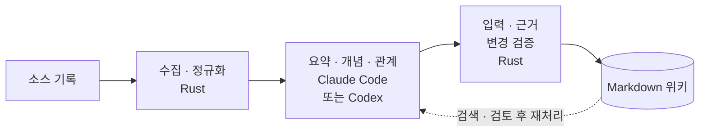
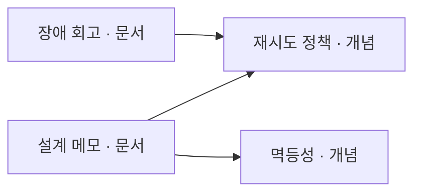

# Lorekeeper

[](https://www.rust-lang.org)
[](LICENSE)
[](https://deepwiki.com/junyeong-ai/lorekeeper)

> **한국어** | **[English](README.en.md)**

**흩어진 업무 기록을, 출처를 확인하며 다시 쓸 수 있는 지식으로.**

Lorekeeper는 메일·Slack·이슈·문서·개인 메모를 모아 서로 연결된 Markdown 위키로 만듭니다.
Claude Code 또는 Codex가 요약과 개념·관계를 판단하고, Rust CLI가 입력과 근거·변경 여부를 검증해 게시합니다.
Obsidian에서 읽거나, 에이전트에게 질문하거나, Markdown 파일을 직접 활용할 수 있습니다.

[빠른 시작](#빠른-시작) · [활용 방법](#지식을-찾고-활용하기) · [지원 소스](#소스) · [실행 설정](#에이전트와-실행-설정) · [운영](#운영과-완료-확인)

## 왜 Lorekeeper인가?

| 반복되는 문제 | Lorekeeper로 하는 일 |
|---|---|
| 결정의 배경이 메일·채팅·문서에 흩어짐 | 소스별 기록을 모으고, 해석에서 원문 근거로 돌아가기 |
| 같은 주제를 매번 새로 조사함 | 기존 개념의 이름·별칭·범위를 확인해 근거를 한곳에 축적하기 |
| 요약만 남아 조건과 불확실성을 잃음 | 관찰·주장·미해결 질문을 구분하고, 근거가 바뀌면 다시 검토하기 |
| 기록은 쌓이지만 업무에 재사용하지 못함 | 검색 → 본문 → 출처·관계 순서로 필요한 지식 찾기 |

업무 소스를 연결해 팀의 기록을 모으거나, 로컬 메모만으로 개인 지식 저장소를 시작할 수 있습니다.
할 일 보드와 개인 업무 리뷰는 선택 사항입니다.

## 어떻게 지식이 되나요?



| 저장되는 것 | 쓰임 |
|---|---|
| 소스 기록·문서 (`daily/`, `wiki/documents/`) | 수집한 내용과 그 요약을 함께 읽기 |
| 개념 (`wiki/concepts/`) | 여러 기록이 다루는 같은 주제의 근거·설명·관계 모으기 |
| 탐구·검토 (`wiki/explorations/`) | 비교, 충돌하는 주장, 미해결 질문과 판단 이력 남기기 |

경로는 기본값이며 설정으로 바꿀 수 있습니다. **지식 페이지의 기준은 Markdown**이며,
SQLite는 다시 만들 수 있는 검색·탐색용 인덱스입니다. 임베딩 대신 이름·본문 검색과 명시적 링크를 활용합니다.
소스 본문과 개념명은 원래 언어를 보존하고, 생성 문장과 제목에는 볼트의 언어 정책을 적용합니다.

### 기록이 달라도 같은 주제라면

예를 들어 장애 회고와 설계 메모가 같은 재시도 정책을 다룬다면 다음처럼 연결할 수 있습니다.



이름이 비슷하다고 자동으로 합치지는 않습니다. 기존 이름·별칭을 찾고 실제 범위가 맞는지 판단한 뒤 재사용합니다.
근거가 새 주제를 뒷받침하면 새 개념을 제안하고, 추출할 개념이 없으면 빈 결과도 허용합니다.
충돌하는 주장은 날짜나 인용 수만으로 결론 내리지 않고 검토 대상으로 남깁니다.

> 수집 성공, 작업 게시, 의미 검토 완료는 서로 다른 상태입니다. 구조 검사를 통과했다고 모든 주장이 사실이거나 전체 지식 검토가 끝난 것은 아닙니다.

## 빠른 시작

먼저 **로컬 메모 한 개**로 수집부터 검색까지 확인하세요. 이 경로는 소스 서비스의 자격증명이 필요 없습니다.

- **macOS(Apple Silicon) 또는 Linux(x86_64/ARM64)**와 로그인된 **Claude Code 또는 Codex**가 필요합니다. Lorekeeper는 해당 CLI의 인증을 사용합니다.
- **Obsidian은 선택 사항**입니다. 결과는 일반 Markdown 파일로 읽을 수 있습니다.
- Windows 설치본도 제공하지만, 네이티브 에이전트 작업과 `workflow`는 Unix에서 지원합니다.

### 1. 설치

```bash
curl -fsSL https://raw.githubusercontent.com/junyeong-ai/lorekeeper/main/scripts/install.sh | bash
```

바이너리·템플릿·에이전트 스킬을 설치합니다. Windows와 소스 빌드는 [설치 안내](skills/lore-ingest/references/installation.md#install)를 참고하세요.
이미 설치했다면 재설치 대신 [업데이트 절차](skills/lore-ingest/references/installation.md#update-and-repair)를 따르세요.

### 2. 저장 위치와 에이전트 선택

```bash
LORE_CONFIG_DIR="${XDG_CONFIG_HOME:-$HOME/.config}/lorekeeper"
cp -n "$LORE_CONFIG_DIR/config.starter.yaml" "$LORE_CONFIG_DIR/config.yaml"
${EDITOR:-vi} "$LORE_CONFIG_DIR/config.yaml"
```

기존 `config.yaml`은 보존됩니다. 다음 항목을 자신의 환경에 맞게 설정하세요.

| 설정 | 선택할 내용 |
|---|---|
| `vault.root` | 지식을 저장할 폴더(볼트) |
| `vault.timezone`, `vault.locale` | 날짜 기준 시간대, 생성 언어(`ko` 또는 `en`) |
| `identity` | 자신의 이름·이메일 |
| `execution.profiles.primary.engine` | 로그인한 `claude-code` 또는 `codex` |

```bash
lore validate
lore schema
mkdir -p "$(lore config vault-root)/inbox"
```

`validate`는 로컬 설정을 검사하고, `schema`는 위키의 작성 규칙인 `AGENTS.md`를 생성합니다.
설정 위치와 초기 인증은 [초기 설정 안내](skills/lore-setup/references/config.md#initial-setup)에 정리되어 있습니다.

### 3. 메모를 넣고 실행

선택한 볼트의 `inbox/`에 Markdown 메모 하나를 넣으세요. 스타터의 `inbox_dir: inbox`는 `vault.root`를 따릅니다.

```bash
lore ingest --dry-run   # 입력을 읽을 수 있는지 확인, 페이지는 쓰지 않음
lore run daily         # 수집 → 의미 처리 → 게시와 최종 검사
```

수집만 하려면 `lore ingest`, 이미 모은 기록의 남은 작업만 처리하려면 `lore run process`를 사용합니다.
큰 입력은 여러 호출과 실행에 걸쳐 처리될 수 있으며, 예산 소진이나 보류 작업은 미완료로 보고됩니다.

### 4. 결과와 근거 확인

```bash
lore queue check
lore wiki reviews --check
lore wiki search "메모의 핵심 주제" --json
```

검색 결과의 문서와 개념을 읽고 연결된 출처를 확인하세요. `queue check`의 미완료 작업과
`reviews --check`의 재검토 요구를 구분해 살펴보면 됩니다.
검색 방법은 아래에, 상태별 진단은 [운영과 완료 확인](#운영과-완료-확인)에 이어집니다.

## 지식을 찾고 활용하기

### 에이전트에게 요청

Claude Code에서는 `/lore-wiki query 재시도 정책을 정한 근거는?`처럼 요청할 수 있습니다.
Codex에서는 `$lore-wiki`를 선택하고 질문하세요.

| 하고 싶은 일 | 사용할 스킬 |
|---|---|
| 근거를 찾아 답변받기, 관계·충돌 검토 | `lore-wiki` |
| 현재 작업에서 배운 점을 위키에 기록 | `lore-wiki`의 `capture` |
| 저장소의 문서·코드에서 지식 추출 | `lore-extract`의 `scan → run → audit` |
| 소스 추가와 설정 | `lore-setup` |
| 수집·스케줄·운영 | `lore-ingest` |
| 남은 요약·개념·종합 작업 처리 | `lore-process` |
| 오늘 할 일, 지식 브리핑, 완료 기록 | `lore-day` |

개인 보드를 켰다면 `lore agenda`, `lore task add`, `lore task done --note`로 업무와 배움을 기록할 수 있습니다.
완료 기록은 설정된 tasks 소스의 수집·의미 처리를 거쳐 지식으로 연결됩니다.
주간 지식 종합과 개인 성과 리뷰는 별도 기능입니다.

### CLI로 직접 탐색

```bash
lore wiki search "재시도" --json
lore wiki read wiki/concepts/retry-policy.md
lore wiki prepare
```

`wiki read`에는 실제 검색 결과의 경로를 넣으세요. `wiki prepare`가 반환한 스냅샷 ID를 사용하면
같은 검색 시점에서 관계와 출처를 이어서 볼 수 있습니다.

```bash
lore wiki context wiki/concepts/retry-policy.md --snapshot SNAPSHOT_ID --limit 10
lore wiki citations wiki/concepts/retry-policy.md --snapshot SNAPSHOT_ID --limit 20
```

`SNAPSHOT_ID`와 경로를 실제 값으로 바꾸세요. 본문·별칭·출처 소유권·날짜·태그로 검색 범위를 좁힐 수 있습니다.
전체 목록이 필요하면 `next_offset`을 따라가세요. 스냅샷은 재사용하되, 새 내용을 게시한 뒤에는 갱신합니다.
자세한 절차는 [검색·관계·원본 조회](skills/lore-wiki/references/query.md)에 있습니다.

## 소스

| 타입 | 모으는 기록 | 인증·준비 |
|---|---|---|
| `gmail` | 라벨·발신자 등으로 선택한 메일 | Google OAuth |
| `slack-channel` | 채널 메시지와 스레드 | Slack 토큰 |
| `slack-search` | 검색 조건에 맞는 메시지 | Slack 사용자 토큰 |
| `jira` | JQL로 선택한 이슈 | Jira API 인증 |
| `confluence` | CQL로 선택한 스페이스·페이지 | Atlassian OAuth 또는 API 토큰 |
| `google-calendar` | 일정과 지원되는 Drive 회의록 | Google OAuth |
| `google-drive` | 선택한 폴더의 문서 | Google OAuth |
| `rss` | 피드와 선택적 기사 본문 | 인증 불필요 |
| `nodex` | 프로젝트 저장소의 결정·학습 기록 | `nodex.toml`, nodex `>=0.63,<0.64` |
| `manual` | 로컬 Markdown·텍스트·HTML과 지원되는 바이너리 문서 | 기본 입력은 인증 불필요 |
| `tasks` | Lorekeeper에서 완료한 할 일과 메모 | 인증 불필요 |

[`config.example.yaml`](config.example.yaml)은 모든 소스가 비활성화된 전체 옵션 모음입니다.
필요한 블록만 실제 설정으로 복사하고 범위·계정을 채운 뒤 활성화하세요. 같은 타입의 소스를 여러 개 둘 수 있습니다.
서비스 인증은 `lore init credentials`, 접근 확인은 `lore ingest --dry-run SOURCE_ID`로 진행합니다.

- **DOCX·XLSX·PDF·이미지**: 선택적 디코더·OCR이 필요합니다. [전처리 설정](skills/lore-setup/references/config.md#document-preprocessing)을 따르세요.
- **개념 수집 범위**: 소스의 `focus`와 `concept_policy`로 설정합니다. 정책을 생략하면 개념 추출은 꺼집니다. [전체 설정](config.example.yaml)을 참고하세요.
- **과거 날짜·대용량 inbox**: [수집 범위와 재개](skills/lore-ingest/references/ingestion.md)를 확인하세요. 과거 날짜 재조회는 그 당시의 원본 복원이 아닙니다.

## 에이전트와 실행 설정

소스 수집 설정과 LLM 실행 설정은 분리되어 있습니다. 작업별로 프로필을 선택할 수 있습니다.

```yaml
llm:
  provider: queue
execution:
  default_profile: primary
  profiles:
    primary:
      engine: claude-code
      timeout_seconds: 3600
    reviewer:
      engine: codex
      timeout_seconds: 3600
  operations:
    knowledge: reviewer
```

선택 순서는 `--profile` → 작업별 `operations` → `default_profile`입니다.
실패했다고 다른 호스트로 자동 전환하지 않습니다. 선택적 모델과 effort는 각 호스트 설정을 따릅니다.
지원 CLI는 Claude Code `>=2.1.303,<3`, Codex `>=0.163.0,<1`입니다.

아래 예산은 `execution.work`에 설정하고, 프로필별 `work`로 필요한 항목만 덮어쓸 수 있습니다.

| 조정할 대상 | 설정과 의미 |
|---|---|
| 한 실행의 호출 수 | `execution.work.max_calls` — 기본 64회 |
| 준비된 근거 읽기·서로 다른 문서의 후보 선별 동시 실행 | `max_parallel` — 기본 1, 기록·게시·최종화는 직렬 |
| 한 Work 또는 선별 단계의 연속 호출 | `max_consecutive_calls` — 기본 4, 전체 호출 예산 내에서 공정하게 순환 |
| 요청·결과 크기 | `max_input_bytes` / `max_result_bytes` — 기본 262144 / 32768바이트의 JSON 제한 |

큰 근거는 나누어 읽고 합치며, 검증된 관측을 보존해 재개합니다. 기본 `progressive` 모드는
전체 검색 후보의 카드를 검토한 뒤 선택한 본문을 읽습니다. 보류는 완료로 간주하지 않으며,
카드로 제외한 문서를 본문까지 검증했다고 보고하지 않습니다.

이 설정은 토큰·요금 상한이나 처리 속도 보장이 아닙니다. 먼저 `lore work cost --task-id ID`와
`lore run process --json`의 실제 결과로 범위·호출·준비·검증 시간을 확인하세요.
자세한 조정·재개 조건은 [실행 프로필](skills/lore-setup/references/config.md#execution-profiles),
[대용량 작업](skills/lore-process/references/bounded-work.md), [계측 정의](skills/lore-process/references/bounded-work.md#native-run-measurements)에 있습니다.

## 운영과 완료 확인

| 실행할 작업 | 명령과 범위 |
|---|---|
| 수집부터 처리까지 | `lore run daily` — 소스를 수집하고 큐 처리·게시·최종 검사 |
| 이미 수집한 작업 처리 | `lore run process` — 새 수집이나 의미 감사 없이 큐 처리 |
| 지식의 의미 검토 | `lore run knowledge` — 구조 검사 후 준비된 감사 한 배치, 이어서 큐 처리와 선택한 평가의 현재성 확인 |

`knowledge --batches N`은 실행할 감사 배치 수의 상한입니다. 각 배치의 호출 예산과
남은 작업은 별도로 확인해야 하며, 지정한 배치를 실행했다고 전체 감사가 끝나는 것은 아닙니다.

### 상태에 맞는 명령 선택

| 확인할 것 | 명령 | 결과가 뜻하는 범위 |
|---|---|---|
| 다음에 할 조치 | `lore status` | 설치·소스·큐 등 하위 기능별 안내 |
| 수집 시점 | `lore health --json` | 소스의 최신 수집 여부 |
| 남은 의미 작업 | `lore queue status --json` / `lore queue check` | 작업 상태, 미게시 결과, 중단된 게시 |
| 구조 | `lore graph lint` | 링크·페이지 계약 위반 |
| 판단의 재검토 | `lore wiki reviews --check` | 잘못된 검토 기록·근거 변경 |
| 의미 감사 범위 | `lore wiki audit-plan --ready` | 현재 평가 현황과 선택 범위의 준비 상태 |

호출 예산이 끝나도 일부 작업은 이미 게시되었을 수 있습니다. 전체 결과와 남은 상태를 확인한 뒤 재개하세요.
인증·저장소·검증 오류는 원인을 확인하기 전 같은 입력으로 반복하지 않습니다.
설정은 실행 중 고정되며, 입력이 달라지면 기존 답변에 새 해시만 붙여 채택할 수 없습니다.

### 자동화와 정기 검토

```bash
lore schedule > lorekeeper.cron                              # Linux: 검토 후 crontab에 병합
lore schedule --format launchd --bin "$(command -v lore)"     # macOS: plist 정의 출력
```

스케줄 출력은 OS 등록이 아닙니다. 정의를 검토·등록한 뒤 실제 실행과 로그를 확인하세요.
macOS의 보호 폴더는 예약 작업에도 별도 접근 허용이 필요할 수 있습니다.
Unix workflow lease가 협력하는 에이전트 세션을 조정하고, 게시 시 현재 입력을 다시 검사합니다.
수동 쓰기 세션은 근거를 읽기 전에 `lore workflow -- claude` 또는 `lore workflow -- codex`로 시작합니다.
워크플로는 설정과 물리적 볼트 선택을 고정합니다. 다른 볼트의 작업은 새 세션에서 시작하세요.

| 운영 작업 | 안내 |
|---|---|
| 스케줄 등록·중단·환경 변경 | [스케줄링](skills/lore-ingest/references/scheduling.md) |
| 전체 지식의 초기 검토·반복 감사·완료 범위 확인 | [의미 유지관리](skills/lore-wiki/references/maintenance.md) |
| 업데이트·복구·백업·기기 이전 | [설치와 데이터 보존](skills/lore-ingest/references/installation.md) |
| 잘못된 근거·개념·관계 수정 | [큐 복구](skills/lore-process/references/recovery.md), [큐레이션](skills/lore-wiki/references/curation.md) |
| 목적지가 확인된 깨진 개념 링크 수정 | [주소 복구](skills/lore-wiki/references/curation.md#repair-a-broken-concept-address) — 본문·완료 표시를 보존하는 리비전 검증 |

업데이트에는 `lore self update`를 사용하세요. 진행 중인 설치 사용자는 덮어쓸 수 없고,
미완료 작업도 기본적으로 업데이트를 막습니다. 백업은 숨김 상태를 포함한 전체 볼트가 대상입니다.
원본·유료 관측·큐·검토 이력은 다시 만들 수 있는 캐시와 다릅니다.

## 더 알아보기와 개발

| 목적 | 시작점 |
|---|---|
| 최소 설정 / 전체 옵션 | [스타터](config.starter.yaml) / [설정 예제](config.example.yaml) |
| 명령과 플래그 | `lore --help`, `lore COMMAND --help`, [운영 명령](skills/lore-ingest/references/commands.md) |
| 에이전트 절차 | [공유 스킬](skills/), [스킬 작성 기준](https://platform.claude.com/docs/en/agents-and-tools/agent-skills/best-practices) |
| 페이지 형식·근거 계약 | `lore schema`로 생성하는 볼트의 `AGENTS.md` |
| 코드 구조·변경 규칙 | [개발 규칙](AGENTS.md), [DeepWiki](https://deepwiki.com/junyeong-ai/lorekeeper) |

Rust 2024 edition, 빌드 도구체인·MSRV **1.99.1**을 사용합니다.
비동기 수집은 Tokio/reqwest, 날짜는 Jiff, YAML은 serde-saphyr, 템플릿은 MiniJinja,
그래프는 petgraph, 탐색 인덱스는 SQLite를 사용합니다.

```bash
cargo build --release --locked
./target/release/lore --help
./scripts/check.sh                 # 전체 CI 검사; 변경 작업은 관련 집중 검사부터
```

소스·파생 위키·작성 규칙을 분리하는 [LLM Wiki 구상](https://gist.github.com/karpathy/442a6bf555914893e9891c11519de94f)에서 영감을 받았습니다. 라이선스: [MIT](LICENSE).
