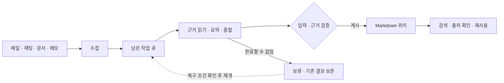

# Lorekeeper

[](https://www.rust-lang.org)
[](LICENSE)
[](https://deepwiki.com/junyeong-ai/lorekeeper)

> **한국어** | **[English](README.en.md)**

**흩어진 업무 기록을, 출처를 확인하며 다시 쓸 수 있는 지식으로.**

메일·채팅·문서·메모를 모아 서로 연결된 Markdown 위키로 만듭니다.
Claude Code 또는 Codex가 요약·개념·관계를 판단하고, Rust CLI가 입력과 근거의 변경을 검증해 게시합니다.
Obsidian으로 읽거나, 에이전트에게 근거를 질문하거나, 일반 Markdown 파일로 활용하세요.

[빠른 시작](#빠른-시작) · [활용 방법](#지식을-찾고-활용하기) · [지원 소스](#소스) · [실행 설정](#에이전트와-실행-설정) · [운영](#운영과-완료-확인)



수집 성공, 작업 게시, 의미 검토 완료는 서로 다른 상태입니다. 구조 검사를 통과해도 모든 주장이 사실이거나 전체 검토가 끝났다는 뜻은 아닙니다.
Markdown이 지식의 기준이며, SQLite는 다시 만들 수 있는 검색 인덱스입니다.

## 빠른 시작

먼저 로컬 메모 한 개로 시작하세요. 외부 소스의 자격증명은 필요 없습니다.
macOS Apple Silicon 또는 Linux x86_64/ARM64와 로그인한 **Claude Code 또는 Codex**가 필요합니다.
Obsidian은 선택 사항입니다. Windows 설치본은 제공하지만 네이티브 에이전트 실행과 `workflow`는 Unix 전용입니다.

### 1. 설치

```bash
curl -fsSL https://raw.githubusercontent.com/junyeong-ai/lorekeeper/main/scripts/install.sh | bash
```

바이너리·템플릿·스킬을 설치합니다. 기존 사용자라면 `lore self update`를 사용하세요.
Windows·설치 경로·복구는 [설치 안내](skills/lore-ingest/references/installation.md)에 있습니다.

### 2. 저장 위치와 에이전트 선택

```bash
LORE_CONFIG_DIR="${XDG_CONFIG_HOME:-$HOME/.config}/lorekeeper"
cp -n "$LORE_CONFIG_DIR/config.starter.yaml" "$LORE_CONFIG_DIR/config.yaml"
${EDITOR:-vi} "$LORE_CONFIG_DIR/config.yaml"
```

기존 설정은 보존됩니다. `vault.root`, `vault.timezone`, `vault.locale`, `identity`와
`execution.profiles.primary.engine`(`claude-code` 또는 `codex`)을 맞추세요.

```bash
lore validate
lore schema
mkdir -p "$(lore config vault-root)/inbox"
```

`validate`는 로컬 설정을 확인하고, `schema`는 볼트의 작성 규칙 `AGENTS.md`를 생성합니다.
설정·인증의 상세 절차는 [초기 설정](skills/lore-setup/references/config.md#initial-setup)을 따르세요.

### 3. 메모를 넣고 실행

볼트의 `inbox/`에 Markdown 메모 하나를 넣고 실행하세요.

```bash
lore ingest --dry-run   # 입력 확인; 페이지는 쓰지 않음
lore run daily         # 수집 → 의미 처리 → 게시와 최종 검사
```

수집만 하려면 `lore ingest`, 수집된 기록의 남은 작업만 처리하려면 `lore run process`를 사용합니다.
큰 작업은 여러 호출과 실행에 걸칠 수 있습니다.

### 4. 결과와 근거 확인

```bash
lore queue check
lore wiki reviews --check
lore wiki search "메모의 핵심 주제" --json
```

검색된 페이지에서 설명과 연결된 출처를 함께 확인하세요. 기본 저장 위치는
`daily/`, `wiki/documents/`, `wiki/concepts/`, `wiki/explorations/`이며 설정할 수 있습니다.
Obsidian에서는 상대 경로 Markdown 링크를 사용하세요. `lore validate`가 관련 설정을 확인합니다.

## 지식을 찾고 활용하기

Claude Code에서는 `/lore-wiki query 재시도 정책을 정한 근거는?`, Codex에서는 `$lore-wiki`와 질문을 사용하세요.

| 하고 싶은 일 | 스킬 |
|---|---|
| 근거 검색·관계 검토·현재 작업의 배움 기록 | `lore-wiki` (`query`, `capture`) |
| 저장소 문서·코드에서 지식 추출 | `lore-extract` (`scan → run → audit`) |
| 소스 설정 / 수집·스케줄 / 남은 의미 작업 | `lore-setup` / `lore-ingest` / `lore-process` |
| 오늘 할 일·지식 브리핑·완료 기록 | `lore-day` — 개인 보드는 선택 사항 |

CLI 검색도 가능합니다. 아래 경로는 실제 검색 결과로 바꾸세요.

```bash
lore wiki search "재시도" --json
lore wiki read wiki/concepts/retry-policy.md
```

관계·인용·원본을 함께 확인하는 절차는 [검색 안내](skills/lore-wiki/references/query.md)에 있습니다.
이름이 비슷하다는 이유만으로 개념을 합치지 않으며, 출처의 조건·귀속·미해결 질문을 구분합니다.
추출할 개념이 없으면 빈 결과도 정상입니다.

## 소스

| 타입 | 모으는 기록 | 인증·준비 |
|---|---|---|
| `gmail` | 선택한 메일 | Google OAuth |
| `slack-channel` | 채널 메시지·스레드 | Slack 토큰 |
| `slack-search` | 검색 조건에 맞는 메시지 | Slack 사용자 토큰 |
| `jira` | JQL로 선택한 이슈 | Jira API 인증 |
| `confluence` | CQL로 선택한 페이지 | Atlassian OAuth 또는 API 토큰 |
| `google-calendar` | 일정·지원되는 Drive 회의록 | Google OAuth |
| `google-drive` | 선택한 폴더의 문서 | Google OAuth |
| `rss` | 피드·선택적 기사 본문 | 인증 불필요 |
| `nodex` | 저장소의 결정·학습 기록 | `nodex.toml`, nodex `>=0.66` |
| `manual` | 로컬 텍스트·지원되는 바이너리 문서 | 기본 입력은 인증 불필요 |
| `tasks` | 완료한 할 일·메모 | 인증 불필요 |

필요한 소스만 [전체 설정 예제](config.example.yaml)에서 복사해 활성화하세요. 같은 타입을 여러 개 둘 수 있습니다.
인증은 `lore init credentials`, 소스 접근 확인은 `lore ingest --dry-run SOURCE_ID`를 사용합니다.
DOCX·XLSX·PDF·이미지는 [전처리 설정](skills/lore-setup/references/config.md#document-preprocessing)이 필요할 수 있습니다.
개념 추출은 소스의 `concept_policy`로 켜며, 생략하면 꺼집니다.

## 에이전트와 실행 설정

최소 설정은 [스타터](config.starter.yaml)를 사용하세요. 프로필 선택 순서는
`--profile` → 작업별 `execution.operations` → `execution.default_profile`입니다.
[단계별 프로필](skills/lore-setup/references/config.md#optional-stage-profiles)은 필요한 단계만 설정할 수 있고,
생략한 단계는 선택된 기본 프로필을 그대로 사용합니다. 실패 시 호스트를 자동 전환하지 않습니다.
지원 CLI는 Claude Code `>=2.1.303,<3`, Codex `>=0.163.0,<1`입니다.

기본 배치 예산은 **64회 호출·동시 실행 1개·입력 262144B·결과 32768B**입니다.
`execution.work`와 프로필별 선택적 덮어쓰기로 조정하며, 단계가 바뀌어도 예산은 공유합니다.
이는 토큰·요금 상한이나 품질 보장이 아닙니다. [실행 설정](skills/lore-setup/references/config.md#execution-profiles)을 참고하세요.

새 읽기 계획은 전송 바이트와 별도로 **노드당 최대 8만 Unicode 문자**를 배정합니다.
원래 읽기 노드가 명시적으로 더 작은 단위를 요청하면 같은 예산 안에서 한 번 분할할 수 있습니다.
기존 유료 계획·관측과 일반 보류는 유지하며, 자식을 자동으로 계속 나누지 않습니다.
취합·최종화는 별도 크기 제한을 따릅니다. 작은 단위가 충실한 완독이나 최종 완료를 보장하지는 않습니다.
상태·명시적 복구 절차는 [대용량 작업](skills/lore-process/references/bounded-work.md)에 있습니다.

## 운영과 완료 확인

| 목적 | 명령 |
|---|---|
| 수집부터 처리·게시까지 | `lore run daily` |
| 수집된 기록의 남은 큐 작업 | `lore run process` |
| 준비된 지식 감사 한 배치와 후속 큐 처리 | `lore run knowledge` |
| 남은 작업·미게시 결과·중단된 게시 | `lore queue status --json`, `lore queue check` |
| 링크 구조 / 판단 재검토 / 감사 준비 상태 | `lore graph lint`, `lore wiki reviews --check`, `lore wiki audit-plan --ready` |

`process --batches N`과 `knowledge --batches N`은 명시적 배치 상한입니다.
`process`는 호출 예산 소진 뒤 새로 저장한 진척이 있을 때 다음 배치로 진행합니다.
`knowledge`는 감사 완료가 검증되어야 이어갑니다. 중간 관측 저장만으로는 다음 배치를 보장하지 않습니다.
치명적·알 수 없는 오류, 취소나 진행 조건을 충족하지 못한 보류에서는 멈춥니다.
일부 게시가 성공해도 전체 작업은 미완료일 수 있습니다. 결과와 남은 상태를 확인하고,
같은 보류를 원인 확인 없이 반복 호출하거나 기존 답변의 리비전만 바꾸어 채택하지 마세요.

분할 감사 중 검토 문서 생성이나 수정으로 입력이 바뀌면, 같은 호출 예산 안에서 한 번 새로 계획하고 읽습니다.
다시 바뀌면 해당 주제를 보류합니다. 이전 관측은 보존하며, 오래된 평가를 새 입력의 완료로 인정하지 않습니다.

정기 실행은 `lore schedule`로 정의를 출력한 뒤 [스케줄링 절차](skills/lore-ingest/references/scheduling.md)에 따라 OS에 등록합니다.
수동 쓰기 에이전트는 근거를 읽기 **전에** `lore workflow -- claude` 또는 `lore workflow -- codex`로 시작하세요.
네이티브 실행은 같은 보호를 직접 소유하며, 실행 중에는 설정과 볼트 선택이 고정됩니다.
`--wait`로 대기 중 차례를 확보한 실행은 현재 배치가 끝난 뒤 다음 배치보다 먼저 잠금을 얻습니다.

업데이트는 `lore self update`, 설치 상태 확인은 `lore self status`를 사용합니다.
백업은 숨김 상태를 포함한 전체 볼트를 보존해야 합니다. 유료 관측·큐·검토 이력은 캐시가 아닙니다.
Unix의 `lore self snapshot -- 백업명령 인수...`는 백업 동안 협력 쓰기를 차단합니다.
백업 명령 안에서 Lore를 호출하지 말고, 외부 편집기를 중지한 뒤 백업 내용도 검증하세요.
[설치·백업·복구](skills/lore-ingest/references/installation.md), [큐 복구](skills/lore-process/references/recovery.md),
[의미 유지관리](skills/lore-wiki/references/maintenance.md)에서 상태별 절차를 확인할 수 있습니다.

## 더 알아보기와 개발

명령은 `lore --help`와 `lore COMMAND --help`, 전체 옵션은 [설정 예제](config.example.yaml),
코드 구조와 기여 규칙은 [AGENTS.md](AGENTS.md)를 참고하세요.
Rust 2024 edition, 빌드 도구체인·MSRV **1.99.1**을 사용합니다.

```bash
cargo build --release --locked
./target/release/lore --help
./scripts/check.sh                 # 전체 CI 검사; 변경 시 관련 집중 검사부터
```

[LLM Wiki 구상](https://gist.github.com/karpathy/442a6bf555914893e9891c11519de94f)에서 영감을 받았습니다. 라이선스: [MIT](LICENSE).
