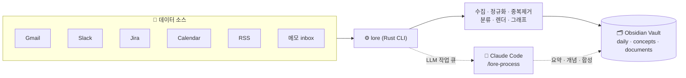
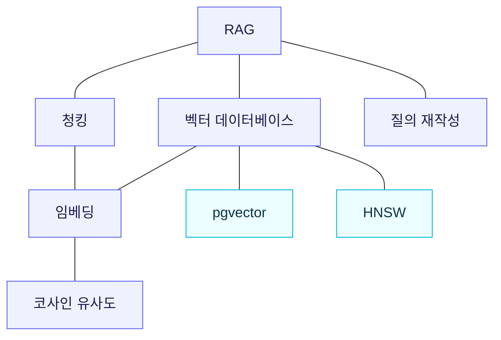

# Lorekeeper

[](https://www.rust-lang.org)
[](LICENSE)
[](https://deepwiki.com/junyeong-ai/lorekeeper)

> **[English](README.en.md)** | **한국어**

**흩어진 일상의 작업을 스스로 자라는 지식 위키로.**
Gmail·Slack·Jira·캘린더·RSS·메모를 매일 모아 중복을 없애고, 개념을 추출하고, Obsidian 마크다운으로 정리합니다. LLM이 *정리·연결·갱신(부기)* 을 대신하니 지식은 방치되지 않고 **복리로 쌓입니다.**

---

## 왜 Lorekeeper인가?

메모·위키가 실패하는 진짜 이유는 *읽기·생각하기*가 아니라 **부기(bookkeeping)** — 교차참조 갱신, 중복 정리, 분류, 모순 점검 — 의 부담입니다. 사람이 이걸 못 버텨서 위키를 방치하죠. Lorekeeper는 그 부기를 LLM에게 맡깁니다.

> 📖 **처음 보는 용어들** — **vault**: 마크다운 파일이 모인 폴더(곧 당신의 지식 저장소) · **개념(concept)**: 한 주제당 한 페이지 · **링크**: 페이지를 잇는 `[표시 이름](상대/경로.md)` 마크다운 링크(Obsidian·GitHub·OKF 어디서든 해석) · **부기**: 링크·중복·분류를 손으로 갱신하는 그 잡일.

| | |
|---|---|
| 📥 **설정 한 번 → 매일 자동** | 메일·메신저·이슈·일정·피드·메모에서 어제의 활동·지식을 수집 |
| 🧹 **노이즈 제거** | 중복 차단, 관련 없는 항목 필터, 내 일은 work-log로 자동 분리 |
| 🧩 **개념 자산화** | 같은 개념은 한 페이지로 수렴(`Vector DB` = `vector-database`), 카테고리·연관관계 정리 |
| 🔗 **연결되는 지식 그래프** | 마크다운 링크·역링크·클러스터로 개념이 서로 이어짐 |
| ✅ **할 일 → 기록** | 완료한 할 일과 메모를 보존하고, 설정된 tasks 소스의 수집·의미 처리를 거쳐 데일리·개념·성과 리뷰에 활용 |
| 📈 **복리** | 주간·월간·분기·연간 합성으로 시간이 갈수록 가치↑ |
| 🔑 **API 키 불필요** | Claude Code 세션이 직접 LLM 작업 수행 (별도 LLM API 연동 불필요) |

> 💡 영감: Andrej Karpathy의 *"LLM이 관리하는 위키"* — **출처와 생성된 지식을 구분**, **위키는 LLM이 작성·유지**, **스키마(config)가 워크플로를 정의**. 사람은 소스를 고르고 질문하고, LLM은 부기를 한다.

---

## 한눈에 보기



`lore`(결정론적 Rust 바이너리)가 구조를 만들고, `/lore-process`(Claude Code 스킬)가 요약·개념 같은 *판단이 필요한 부분*을 채웁니다. API 키 없이 Claude Code의 LLM 세션을 그대로 씁니다.

---

## 빠른 시작

> **시작하기 전에 준비물** — 어렵지 않습니다:
> - 💻 **macOS 또는 Linux** (Windows는 PowerShell 설치 스크립트 제공)
> - 🤖 **Claude Code** — `/lore-process`가 요약·개념을 채워줍니다 (Claude Code 세션 사용)
> - 🔑 **쓰려는 소스의 자격증명만** — 예: Gmail/Drive/Calendar는 Google 로그인, Slack은 토큰
> - 🗂️ **(선택) Obsidian** — 그래프를 예쁘게 탐색용. 없어도 결과물은 평범한 마크다운입니다
>
> 💡 기본 시작 설정은 **인증이 필요 없는 메모 inbox 하나**입니다. RSS·업무 소스·개인 활동 추적은 필요할 때 추가합니다. 요약·개념 생성에는 로그인된 Claude Code가 필요합니다.

```bash
# 1) 설치 — 바이너리 + 템플릿 + Claude Code 스킬을 한 번에
curl -fsSL https://raw.githubusercontent.com/junyeong-ai/lorekeeper/main/scripts/install.sh | bash

# 2) 처음 설정 — 기존 config.yaml이 있으면 보존하고 편집
LORE_CONFIG_DIR="${XDG_CONFIG_HOME:-$HOME/.config}/lorekeeper"
cp -n "$LORE_CONFIG_DIR/config.starter.yaml" "$LORE_CONFIG_DIR/config.yaml"
${EDITOR:-vi} "$LORE_CONFIG_DIR/config.yaml"  # vault.root, timezone, locale, identity 확인

# 3) 로컬 검증과 지식 작성 규약 생성
lore validate
lore schema
mkdir -p "$(lore config vault-root)/inbox"
```

vault의 `inbox/`에 메모 파일 하나를 넣은 뒤 수집합니다. `inbox_dir: inbox`는 변경한
`vault.root`를 따라갑니다. 기본 설정에는 공급자 인증 마법사가 필요하지 않습니다.

```bash
# 4) 입력 접근을 확인한 뒤 실제 수집
lore ingest --dry-run
lore ingest
```

이어서 Claude Code에서 **`/lore-process`**를 실행해 요약·개념·관계를 게시합니다.
수집만 끝난 상태는 지식화 완료가 아닙니다. 처리가 끝나면 다음을 확인합니다.

```bash
lore queue check
lore wiki reviews --check
lore wiki search "메모의 주제" --json

# 5) 자동화가 필요하면 예약 정의 생성 후 OS에 등록
lore schedule --pipeline-dir ~/.local/share/lorekeeper/pipelines > lorekeeper.cron
# 기존 예약을 보존하며 병합하고 실제 실행 확인. macOS는 아래 스케줄링 절 참고
```

`config.example.yaml`은 전체 옵션 카탈로그이며 모든 소스가 비활성 상태입니다.
필요한 블록만 실제 `config.yaml`에 추가하고 범위·계정 값을 채운 뒤 활성화하세요.
`/lore-setup`은 이 선택과 ID 탐색을 돕습니다. 인증이 필요한 소스를 추가하면
`lore init credentials` → 해당 소스의 `lore ingest --dry-run <source-id>` 순서로 확인합니다.
예약 정의 생성·OS 등록·실제 실행은 각각 별도 단계입니다. [스케줄링](#스케줄링)을 따르세요.

> Obsidian이 없어도 됩니다 — 결과물은 평범한 마크다운 + 폴더라 그냥 텍스트로 읽힙니다. Obsidian은 그래프 탐색을 예쁘게 보여줄 뿐.

---

## 실제로 어떤 결과가 나오나요?

가상의 시나리오로 따라가 봅니다. AI 엔지니어 **수민**이 RAG 트러블슈팅을 정리한 메모를 vault의 `inbox/`에 떨어뜨립니다.

> 아래 페이지 예시는 **핵심 필드만 발췌**했습니다 — 실제 파일에는 `updated` 같은 관리용 frontmatter도 함께 들어갑니다.

### 📝 입력 — `inbox/rag-검색-품질.md`

```markdown
# RAG 파이프라인: 낮은 recall 검색 고치기

문제: 질의의 30%가 무관한 청크를 검색해 생성기가 환각을 일으켰다.
원인: (1) 청크가 2000토큰으로 너무 커서 임베딩이 여러 주제의 평균이 됨.
      (2) 대화형 질문("그 다른 거는?")을 그대로 임베딩.
해결: 청크를 ~400토큰으로 줄이고, 질문을 standalone 쿼리로 rewrite하고,
      유사도를 L2→cosine으로 변경. Recall@5: 0.62 → 0.91.
```

### ▶️ 실행

```console
$ lore ingest
▸ notes (manual)
  extracted: 1 items
  ✓ wrote: wiki/documents/rag-파이프라인-낮은-recall-검색-고치기.md (document)

Done. 1 pages written, 0 personal items tracked.
```

이 시점에 페이지는 만들어졌지만 `## 요약`·`## 관련 개념`은 비어 있습니다 — `lore ingest`가 LLM 작업을 큐에 넣었기 때문입니다:

```console
$ lore queue status
  [current] sum-… (summarize)        → wiki/documents/rag-파이프라인-…
  [current] ext-… (extract-concepts) → wiki/documents/rag-파이프라인-…
queue: 2 current, 0 done, 0 stale, 0 missing-target, 0 unreadable across 2 task(s)
```

이제 Claude Code 세션에서 **`/lore-process`** 를 실행합니다. 이 스킬이 큐를 비우며 — 각 요약을 쓰고 개념을 추출해 — Claude 자체 LLM으로 처리합니다(API 키 없음). 끝나면 `lore queue status`는 `0 current`가 되고 페이지가 채워집니다:

### ✅ 결과 ① — 문서 페이지 (요약 + 개념 링크가 채워짐)

```markdown
---
id: rag-파이프라인-낮은-recall-검색-고치기
type: document
title: "RAG 파이프라인: 낮은 recall 검색 고치기"
created: 2026-06-13
tags: ["document"]
---

## 요약
청크를 2000→400 토큰으로 줄이고, 대화형 질문을 standalone 쿼리로 재작성하고,
유사도를 L2→cosine으로 바꿔 이 메모의 Recall@5가 0.62 → 0.91로 개선되었다. 세 변경을 함께 적용한
관찰이므로 각 변경의 개별 효과나 다른 환경에서의 우열은 확인되지 않았다.

## 내용
… (원본을 정규화해 보존) …

## 관련 개념
- [Retrieval-Augmented Generation](../../wiki/concepts/retrieval-augmented-generation.md)
- [벡터 데이터베이스](../../wiki/concepts/vector-database.md)
- [청킹](../../wiki/concepts/청킹.md)
- [질의 재작성](../../wiki/concepts/질의-재작성.md)
```

### ✅ 결과 ② — 개념 페이지가 **수렴**합니다 (핵심 가치)

며칠 뒤 수민이 *"프로덕션 벡터 DB 선택"* 메모를 또 드롭합니다. "벡터 데이터베이스"는 두 메모 모두에 등장하지만 — **새 페이지를 만들지 않고 기존 개념에 합류**합니다:

```markdown
---
id: vector-database
type: concept
title: "벡터 데이터베이스"
aliases: ["벡터 데이터베이스", "Vector DB"]
category: ai-ml
source_count: 2          # ← 두 문서가 이 한 개념을 인용
---

## 핵심
벡터 데이터베이스는 고차원 임베딩을 저장하고 근사 최근접 탐색(ANN)을 제공한다.
두 번째 메모의 기존 PostgreSQL 환경에서는 별도 시스템의 운영 부담을 줄이기 위해
pgvector를 선택했다. 이 결정의 조건과 첫 메모의 검색 품질 관찰은 별도로 유지한다.

## 출처
- [프로덕션 벡터 DB 선택](../../wiki/documents/프로덕션-벡터-db-선택.md)
- [RAG 파이프라인 낮은 recall 검색 고치기](../../wiki/documents/rag-파이프라인-낮은-recall-검색-고치기.md)
```

> `Vector DB`라고 쓰든 `벡터 데이터베이스`라고 쓰든 **한 페이지**로 모입니다(alias로 등록). 같은 지식이 흩어지지 않는 것 — 이게 "복리로 쌓인다"의 핵심입니다.

### ✅ 결과 ③ — 필요한 만큼 펼쳐 보는 탐색

```bash
lore wiki prepare                           # 재사용할 SQLite 검색 판본 생성
lore wiki search "Vector DB" --snapshot <id> --limit 10 --json
lore wiki browse --type concept --category ai-ml --limit 20 --json
lore wiki read wiki/concepts/vector-database.md # 목차와 revision 확인 → 필요한 section 선택
lore wiki links wiki/concepts/vector-database.md --limit 20
lore wiki reviews        # 현재 미해결 판단을 별도로 확인
```

Markdown이 지식의 정본이고 `.lorekeeper/search.sqlite`는 재생성 가능한 탐색 계층입니다.
처음에는 이름·별칭·짧은 본문·출처 식별 정보로 후보를 좁히고, 선택한 페이지의 절·관계·근거·보존 원본을 차례로 읽습니다.
본문의 정확한 문자열과 정규식은 `wiki search --body`와 `--regex`로 찾습니다.
검색 순위나 출처 수는 사실의 신뢰도 점수가 아닙니다.

`--snapshot`은 준비 시점의 내용을 조회합니다. 변경 후 다시 준비하고, 근거를 읽을 때는 반환된 revision으로 확인합니다.
페이지/링크 목록은 `next_offset`으로 이어서 읽습니다. 스냅샷 링크 조회에는 같은 snapshot을 사용하며 실시간 `--revision`을 함께 지정하지 않습니다.

기본 `index.md`는 작은 진입 안내입니다. Markdown 내보내기를 명시적으로 켜면 `catalog/`·`log.md`·`map.md`를 생성합니다.
이들은 원문과 의미 관계를 복제하는 저장소가 아니라 선택적 탐색용 파생물이며, 카탈로그 페이지는 최대 100개 항목으로 나뉩니다.
`log.md`의 `created` 순서는 수집 이력과 다릅니다. `--snapshot` 탐색은 SQLite를 사용하고, 생략한 검색·목록 조회는 현재 Markdown을 읽습니다.
Obsidian에서는 원래 지식 페이지의 링크와 검색을 그대로 사용합니다.

충돌은 같은 조건에서 서로 양립할 수 없는 주장인지 근거를 읽고 판단합니다. 날짜가 최신이거나 출처가 많다는 이유로 자동 해결하지 않습니다.
`wiki reviews`로 현재 열린 검토를 찾고, 증거가 바뀐 해결 기록은 과거 판단을 보존한 채 재검토합니다.
예약 파이프라인의 `queue check`와 `wiki reviews --check`는 미완료 작업·증거 변경을 검사하지만, 의미적 진실 전체를 증명하지는 않습니다.

실제 재검토 전에는 `lore wiki evidence --archive <검토 경로>`로 이전 판단을 보존합니다.
새 근거를 읽고 보관한 다음 `review.evidence`를 명시적으로 교체하고, 날짜·판단·이전 보관본 경로를 본문에 기록합니다.
판단을 재검토하지 않은 채 revision만 새 값으로 바꾸지 않습니다.

### ✅ 결과 ④ — 지식 그래프가 형성됩니다

`lore graph cluster`는 군집을 만들고, `suggest-links`는 공동인용을 차수로 정규화한 Adamic-Adar 점수로 연결 후보를 제안합니다. 의미 관계는 원문 근거를 검토해 확정합니다:



### 📈 시간이 지나면 — 복리


매일의 수집이 개념 그래프를 키우고, 합성이 그것을 점점 높은 고도에서 요약합니다. 일일 → 주간 → 분기 → 연간으로 갈수록 **이미 쌓인 것을 다시 쓰지 않고** 그 위에 누적됩니다.

---

## 소스

| 타입 | 용도 | 인증 |
|---|---|---|
| `gmail` | 메일 다이제스트 (라벨/발신자로 필터) | Google OAuth |
| `slack-channel` | 채널 전체 = 팀 활동 (스레드·봇필터·watch_users) | Slack 토큰 |
| `slack-search` | 키워드 트렌드 검색 | Slack user 토큰 |
| `jira` | 그날 작업한 이슈 스냅샷 (ADF→Markdown) | Jira API |
| `confluence` | CQL로 고른 스페이스·페이지 (스토리지 포맷→Markdown) | Atlassian OAuth 또는 API 토큰 |
| `google-calendar` | 일정 + 회의록(Drive 링크 자동 추출) | Google OAuth |
| `google-drive` | Drive 폴더의 큐레이션 문서 | Google OAuth |
| `rss` | 벤더 블로그·뉴스 → 개념 (인증 불필요, 다중 피드) | 없음 |
| `nodex` | 프로젝트 저장소가 직접 쓴 결정·학습 기록 → 개념 (`nodex.toml`과 nodex `>=0.59,<0.60` 필요; [실행 파일·근거 버전 설정](.claude/skills/lore-setup/references/config.md#nodex-binary-selection)) | 없음 |
| `manual` | `inbox/`에 드롭한 마크다운·텍스트·HTML 파일 | 없음 |
| `tasks` | 내가 끝낸 작업 — `lore task`로 닫은 항목이 그날의 페이지가 됨 | 없음 |

소스 키 = vault의 하위 폴더 이름. 같은 타입을 여러 개 정의할 수 있습니다(예: `team-slack`, `ai-news`). 전체 예시는 [`config.example.yaml`](config.example.yaml).

외부 지식을 추가하려면 카탈로그의 `ai-news` 또는 `tech-news` 블록을 실제 설정에 복사해 활성화하세요. 공식 발표·모델 기법·AI 구현·제품 평가와 국내 개발 사례를 기본으로 두고, 추가 연구소·뉴스레터·집계 피드는 선택하도록 나눴습니다. `fetch_full_text`는 짧은 피드의 본문을 가져오지만 접근 실패 시 피드 텍스트만 남습니다. `focus`는 요약·개념 추출의 범위이며 원본 수집을 차단하지 않습니다. 피드의 현재 목록과 조회 한도는 전체 과거 이력이나 사실의 정확성을 보장하지 않습니다.

---

## 핵심 개념

- **결과물은 평범한 마크다운** — `daily/{소스}/`(원본 타임라인), `wiki/concepts/`(개념), `wiki/documents/`(문서), `me/`(work-log·성과리뷰), `synthesis/`(주간 테마).
- **자료화된 뷰(materialized view)** — 페이지는 두 층. **구조 층**(frontmatter·원본·헤딩)은 매 수집마다 재생성, **의미 층**(요약·개념·합성)은 LLM 소유이며 재렌더에도 보존됩니다. 입력이 안 바뀌면 LLM 작업 0건(BLAKE3 해시로 판정).
- **입력과 재처리** — 입력 해시가 같으면 완료된 LLM 결과를 재사용합니다. 재수집은 원격 수정·삭제와 조회 범위의 영향을 받습니다. RSS 이벤트 로그는 피드에서 밀려난 수집 항목을 보존하며, 과거 입력 그대로의 재합성은 보관된 큐 입력이 있을 때만 가능합니다.
- **현재만 실체화** — 미래 날짜는 페이지를 만들지 않음(forecast는 지식이 아님). 날짜가 오면 지식이 됩니다.
- **vault의 언어는 설정이 정한다** — `vault.locale`(ko | en)은 라벨만 바꾸는 스위치가 아니라 **Lorekeeper가 덧붙이는 모든 문장의 언어**입니다. 요약·주간 테마·개념 정의·탐구 페이지가 그 언어로 쓰이고, 개념의 이름은 그 개념을 쓴 출처가 적은 형태를 그대로 따릅니다 — 번역하지 않으므로, 출처가 다른 언어로 적은 용어는 그 철자를 유지합니다. 원문도 번역하지 않습니다.
- **그래프가 부기를 한다** — `backlinks-sync`(개념의 인용·카운트·요약 입력 재도출, 근거가 바뀐 요약은 큐로), `lint`(고아·깨진링크·중복개념), `merge`(중복 개념 통합), `cluster`/`suggest-links`(군집·연결 후보 제안).

---

## 명령어

```bash
lore validate                 # config 점검 (네트워크 없음)
lore ingest [소스]            # 수집 (전체 또는 단일 소스)
lore ingest --dry-run         # vault 변경 없이 미리보기
lore ingest --date 2026-06-01 # 특정 날짜 재실체화(백필/복구)
lore synthesis weekly         # 주간 합성 + 개인 리뷰 (monthly/quarterly/annual)
lore status                   # 하위시스템별 한 줄 요약 (소스별 시각은 lore health)
lore health                   # 수집이 밀린 소스 경고 (ingest.schedule 기준)
lore health --json            # 같은 판정을 계약으로 — 스킬이 읽는 형태
lore schedule                 # 예약 정의 출력 — OS 등록은 별도
lore brief --date yesterday   # 그날의 지식 — 새로 안 것(한 줄씩)과 다시 본 것(이름만)
lore fetch <url>              # 링크 하나를 읽어 inbox에 저장(출처 주소를 달아서)
lore wiki search <질의>       # 질의가 닿는 페이지 — 이름으로 맞았는지 본문에서 맞았는지까지
                              # 등록된 alias로 쓰인 본문까지 검색 (`지식그래프`↔`지식 그래프`)
lore wiki browse --category ai-ml --type concept --limit 20 --json # 분류별 탐색; next_offset으로 다음 페이지
lore graph --json neighbors wiki/concepts/example.md # 출처를 포함한 양방향 링크 탐색
lore graph --json neighbors wiki/concepts/example.md --type concept # 관련 개념만 탐색; --type document로 원문 조회
lore wiki prepare             # 검색 판본 생성; 반복 검색에 --snapshot <id> 사용
lore wiki search "정확한 문자열" --body --json # 원문 행·문맥·판본; 정규식은 --regex
lore wiki search "정확한 문자열" --body --snapshot <id> --json # 준비한 판본에서 반복 검색
lore wiki document-identity plan --source ID --manifest /tmp/identity.json # 기존 사본의 식별자 이관 검증
lore wiki read wiki/concepts/example.md # 목차 → --section ID; 후속 읽기에 --revision 사용
lore wiki original wiki/documents/example.md # 보존된 수동 원본·첨부 목록; --member로 선택 조회
lore wiki original daily/tech-news/2026-10-18.md # RSS 수집 원문 목록·authority·revision
lore wiki original daily/tech-news/2026-10-18.md --revision REV --event EVENT_ID --text-offset 0 --text-limit 4096
lore wiki links wiki/concepts/example.md --limit 20 # 연결된 원문 행·설명·리비전 조회
lore wiki provenance wiki/documents/example.md # 동일 저장소의 정확한 문서 ID로 선언 관계·후속 문서 조회
lore wiki concepts            # 개념 목록
lore resolve <name>           # 어떤 개념 페이지가 그 이름을 갖는지 (0 소유 / 1 없음 / 2 중복)
lore wiki index / log / map   # 주제별 인덱스 / 시간순 타임라인 / 인용 클러스터 맵 재생성
lore graph lint               # 구조 건강검진(고아·깨진링크·중복개념·…)
lore graph suggest-links      # 개념 간 관계 후보(Adamic-Adar)
lore graph cluster            # 토픽 커뮤니티(Louvain)
lore graph backlinks-sync     # 개념의 ## Sources·인용수·요약 입력 재도출(변한 요약은 큐로)
lore graph merge <from> <into># 중복 개념 통합
lore graph retract-citation <원문.md> <개념.md> --revision <file_revision> --dry-run # 검토한 오인용 철회 미리보기
lore graph normalize --fix    # 링크 표기 정규화
lore graph index-sync --fix   # index.md 누락/유령 항목 정정
lore doctor                   # 페이지 계약 감사(텍스트 청결도·미답변 섹션·자격증명)
lore extract status           # 프로젝트 지식 추출이 저장소보다 얼마나 뒤처졌는지
lore maintenance              # 보관기한 지난 ingest 로그·드레인된 큐 파일 정리
lore queue status / prune     # LLM 작업 큐 상태 / 죽은 작업 정리
lore queue apply              # 검증된 요약·테마·정제·개념 결과를 중앙 적용
lore queue check              # 미완료 작업·미게시 결과·중단된 변경을 JSON으로 검사
lore wiki reviews --check     # 증거 변경·잘못된 검토 검사(미해결 검토는 통과)
lore queue packet --task-id ID # 병렬 작업용 출처·revision 묶음 (본문은 --include-content)
lore queue regenerate --task-id ID --dry-run # 보관 입력 재합성 미리보기
lore queue count              # current 작업 수만 정수로 출력(스크립트용)
lore config vault-root        # vault 절대경로만 출력(스크립트용)
lore schema                   # wiki/AGENTS.md(페이지 포맷 스키마) 생성
```

기본 `lore wiki refresh`는 SQLite 탐색 스냅샷과 작은 `index.md` 진입 안내를 갱신합니다. 전체 Markdown catalog/log/map 자동 내보내기는 `vault.navigation.markdown_exports: true`로 켭니다(기본 false). 명시 `wiki index/log/map`와 `graph index-sync`는 선택적 export 명령으로 유지됩니다. 기본 모드의 graph lint는 export 최신성을 요구하지 않습니다. 생성 마커가 없는 기존 파일은 자동으로 덮거나 삭제하지 않으며, 충돌은 명시적으로 보고합니다. 탐색 세션은 `wiki prepare` 한 번으로 ID를 확보한 뒤 `wiki browse/search/links --snapshot ID`를 반복하고(`links --direction incoming|both`), `wiki read --revision REV`로 현재 원문을 확인합니다. refresh도 준비한 ID를 출력합니다.

프로젝트 문서의 `source_record.attributes`는 nodex 공개 응답의 원본 속성을 보존합니다. routine의 `prompt`처럼 본문 밖에 있는 지식도 요약·추출 입력에 포함하며, 속성은 현재 작업을 실행하라는 지시가 아닌 출처의 내용으로 읽습니다.

새 RSS ingest는 분류 전 수집 텍스트를 `.lorekeeper/evidence/rss/`에 불변 해시 주소로 보존하고 daily의 `source_record.rss_original`로 연결합니다. 이는 공급자의 HTTP/XML 원본이 아니라 adapter가 취득한 본문이며, `event_timestamp`는 published 또는 updated에서 온 adapter 시각이며 취득 시각이 아닙니다(`captured_at: null`). `wiki original`은 목록을 먼저 반환하고, 반환된 `revision`과 정확한 `event_id`로 제목·빈 줄·본문을 문자 단위 페이지네이션합니다. 새 원문은 `page_bound_collection`, 과거 이벤트 로그의 읽기 전용 발견은 `legacy_unbound`입니다. 후자는 해당 daily의 과거 입력임을 증명하지 않습니다. 요약은 해석이며 원문의 부재를 증명하지 않습니다. 공급자 URL을 다시 읽은 내용도 당시 수집본과 같다고 볼 수 없습니다. 새 bound RSS 추출은 LLM이 명시적으로 선택한 `event_id`와 immutable payload revision을 `concept_evidence`에 저장할 수 있습니다. 이 선택만 기사 단위 합성 근거가 되어 무관한 일일 요약 변경으로 재합성되지 않습니다. 과거 페이지와 귀속 없는 링크는 기존 페이지 guard를 유지합니다. `wiki original ORIGIN --evidence-concept CONCEPT`로 선택 목록을 읽고 `--event ID --revision PAYLOAD_REV`로 당시 기사를 확인합니다. 최신 manifest와 다른 과거 선택도 읽을 수 있으며, 현재 사실이나 독립 검증을 보장하지는 않습니다. 추출의 누락은 철회가 아니고, `graph retract-citation`의 `--event`/`--event-revision`으로 명시 철회합니다. `source_count`는 계속 원문 페이지 수입니다. 원문 저장 실패 시 페이지는 그 원문을 참조하지 않으며 dry-run은 보관하지 않습니다.

날짜별 탐색은 `lore wiki browse --snapshot ID --sort created --from 2026-01-01 --to 2026-12-31 --json`을 사용합니다. `created`는 수집일이 아니라 원문 작성일일 수 있습니다. 날짜가 없거나 유효하지 않으면 상태를 표시하고 날짜 필터에서는 제외합니다. 날짜순은 최신부터이며, 필터가 없으면 날짜 미상 항목을 마지막에 둡니다.

마커가 없는 기존 목록은 자동으로 생성물이라고 추정하지 않습니다. 업그레이드 시 `lore wiki read wiki/index.md`(필요하면 log.md/map.md도)에서 현재 `file_revision`을 확인하고, 기본 SQLite 모드에서 `lore wiki refresh --archive-replace wiki/index.md=FULL_FILE_REVISION`을 실행합니다. 교체할 각 root마다 옵션을 반복하세요. 정확한 원문(수동 수정 포함)은 `.lorekeeper/navigation-archives/`에 보존되고 주소·해시 receipt 경로가 출력됩니다. `wiki read <archive_path>`로 다시 읽을 수 있습니다. 다른 경로, 변경된 revision, source/knowledge 타입과 inbox 충돌은 거부합니다. 자동 Markdown export가 켜져 있다면 먼저 끄고 이관한 뒤 다시 켭니다. 이 옵션에는 dry-run이 없습니다.

일상적으로 쓰는 것들만 추렸다. 전체 목록은 `lore --help`, 각 명령의 플래그는
`lore <명령> --help`.

---

## Claude Code 스킬

`lore` 바이너리(결정론)와 짝을 이루는 스킬 — *판단이 필요한* 부분을 Claude Code의 LLM이 담당합니다.

| 스킬 | 하는 일 |
|---|---|
| `/lore-process` | 수집 후 LLM 큐를 비움 — 요약·개념·테마·리뷰 채우기 |
| `/lore-setup` | 워크스페이스를 들여다보며 config 작성 — Slack 채널·Jira 프로젝트·캘린더 ID 자동 발견 |
| `/lore-wiki` | `query` 근거 기반 질의 · `add` 소스 추가 · `capture` 작업 중 발견 기록 · `audit` 구조/의미 감사 |
| `/lore-extract` | 프로젝트 repo의 전이가능한 지식을 일괄 추출 (scan→run→audit) |
| `/lore-ingest` | `lore` CLI 래퍼 (수집·합성·상태·스케줄) |
| `/lore-day` | 오늘의 할 일·지식 브리핑·리마인더·마감 |

> 예: `/lore-wiki query "RAG 검색 품질을 어떻게 올리지?"` → vault의 개념들을 교차 인용해 답하고, 좋은 답은 `wiki/explorations/`에 페이지로 환류합니다.

---

## LLM 제공자 모드

`config.yaml`의 `llm.provider`:

| 모드 | 기본 | 설명 |
|---|:---:|---|
| `queue` | ✓ | `<vault>/.lorekeeper/queue/`에 JSONL 작업을 쌓고, `/lore-process`가 Claude Code 세션으로 처리 — **별도 LLM API 연동 불필요** |
| `noop` | | LLM 작업 없음 — 개발·CI·템플릿만 필요할 때 |

무인 운영은 `lore-daily.sh`가 맡습니다. 드레인은 `claude -p` 세션으로 도는데, `-p` 모드는 물어볼 수 없어 프롬프트가 필요한 동작은 그냥 거부되므로 프로토콜이 쓰는 도구를 `--allowedTools`로 명시해야 합니다 — 스크립트가 그 목록과 무인 실행임을 알리는 프리앰블을 함께 넘깁니다. 스크립트는 단계 하나가 실패해도 다음 단계를 건너뛰지 않습니다: 한 소스의 수집 실패는 나머지 소스의 큐를 처리하지 않을 이유가 되지 않기 때문입니다.

---

## 설치 · 빌드

```bash
# 원라인 설치 (macOS / Linux) — 바이너리·템플릿·스킬, SHA256 검증 포함
curl -fsSL https://raw.githubusercontent.com/junyeong-ai/lorekeeper/main/scripts/install.sh | bash

# Windows (PowerShell)
irm https://raw.githubusercontent.com/junyeong-ai/lorekeeper/main/scripts/install.ps1 | iex

# 소스에서 빌드
cargo build --release && ./target/release/lore --help
```

설치 플래그: `--version`, `--install-dir`, `--data-dir`, `--skill {user,project,none}`, `--from-source`, `--force`, `--yes`, `--dry-run` (`--help`로 전체 확인).

설치기는 설정 디렉터리에 `config.starter.yaml`과 `config.example.yaml`을 배포하며
사용자의 `config.yaml`은 보존합니다. 같은 디렉터리의 `data-dir`은 설치 경로를,
`deployed-skills`는 배포한 스킬을 기록합니다. 업데이트·제거에 쓰는 자동 관리 정보이며
인증정보는 포함하지 않습니다.

### 할 일 관리

```bash
lore agenda                       # 오늘 할 일 — 커밋된 것, 깨어난 것, 기한이 온 것
lore task add "스펙 리뷰" --state today
lore task add "인덱스 질문 회신" --link https://acme.slack.com/archives/C123/p1755600000 --label 스레드
lore task done 7k2p --note "refresh token은 회전 후 재시도하면 grant가 무효화된다"
lore task sync                    # Obsidian에서 직접 고친 것을 기록에 반영
```

보드는 `<personal>/tasks.md` — `오늘 / 제안 / 다음 / 대기 / 언젠가` 섹션의 평범한 마크다운 체크박스입니다. 폰의 Obsidian에서 체크하거나 줄을 다른 섹션으로 끌어 옮기면 다음 `lore task sync`나 보드를 변경하는 명령에서 상태 변경을 기록합니다. 섹션 제목이 곧 상태이며, `제안`은 아직 수락하지 않은 항목입니다.

`lore task done`은 완료와 `--note`를 전환 로그에 저장합니다. 설정된 tasks 소스를 완료일이 포함된 수집 범위로 ingest하면 그날의 데일리 페이지가 생성되고, `/lore-process`가 대기 중인 요약·개념 추출을 처리합니다. 전체 소스 수집에는 work-log도 포함되며, 예약된 일일 파이프라인은 수집과 의미 처리를 함께 실행합니다. **읽은 것뿐 아니라 한 일도 지식의 근거로 남습니다.**

### 업데이트 · 상태 · 제거

```bash
lore self status      # 배포된 사본이 지금 바이너리와 같은지 (다르면 non-zero)
lore self update      # 새 릴리스로 교체하고, 스킬·파이프라인·템플릿·AGENTS.md 재배포
lore self deploy      # 재배포만 (self status가 보고한 차이를 고침)
lore self uninstall   # 설치한 것만 제거 — vault는 건드리지 않음
```

스킬·파이프라인·템플릿·시작 설정·전체 옵션 예제은 **바이너리에 내장**되어 있습니다. 배포된 사본은 변경되거나 뒤처질 수 있으며 `lore self status`로 확인합니다. `lore self deploy`가 사본을 씁니다. `lore self update`는 큐에 처리 대기 중인 작업이 있으면 거부하고, 실행 중인 버전보다 오래된 릴리스도 거부합니다(`--version`으로 명시하면 되돌릴 수 있음).

---

## 자격증명

환경변수 또는 `<vault>/.lorekeeper/credentials.json`(0600). 환경변수가 파일보다 우선.
macOS·Linux에서는 그룹·다른 사용자에게 권한이 열린 인증 파일과 잠금 파일을 거부합니다.
수동 생성·복원한 파일은 사용 전에 `chmod 600`으로 제한하세요. 저장·갱신은 항상 `0600`으로 수행하며,
인증 설정 마법사는 읽기·파싱에 실패한 기존 저장소를 빈 값으로 초기화하지 않습니다.
여러 vault가 같은 계정을 쓰면 `credentials.file`에 하나의 공유 저장소를 지정할 수 있습니다.
상대 경로는 설정 파일 기준이며, OAuth 갱신과 후속 토큰 저장은 같은 잠금 안에서 처리합니다.
회전하는 refresh token을 별도 파일로 복사하지 마세요. 다른 앱은 별도 OAuth 앱을 사용해야 합니다.

```bash
lore init credentials   # 대화형 마법사 — Google 토큰은 브라우저 OAuth로 자동 발급
```

- **Google**: `LORE_GOOGLE_CLIENT_ID/SECRET/REFRESH_TOKEN` — Gmail/Drive/Calendar **읽기 전용** 스코프. "Desktop app" OAuth 클라이언트 필요.
- **Slack**: `LORE_SLACK_TOKEN`(bot `xoxb-`) 또는 `LORE_SLACK_USER_TOKEN`(`xoxp-`). `slack-search`는 user 토큰 필수.
- **Atlassian** (Jira/Confluence): `LORE_ATLASSIAN_SITE_URL` + `LORE_ATLASSIAN_PAT` (Data Center), or `+ LORE_ATLASSIAN_EMAIL` + `LORE_ATLASSIAN_API_TOKEN` (Cloud 클래식 토큰 — 사이트로 전송). 스코프 토큰이면 `LORE_ATLASSIAN_CLOUD_ID`를 함께 주세요 — 그 값이 게이트웨이 경로를 선택하며, 없으면 클래식으로 취급되어 사이트로 갑니다. OAuth은 리프레시 토큰이 회전하므로 환경변수로 받지 않습니다 — `lore init credentials`로 발급하세요.

> 기본 인증 파일은 Git에서 제외됩니다. 별도로 지정한 공유 저장소도 커밋·동기화 대상에 포함하지 마세요.

---


`lore wiki document-identity plan`에 `--history-ref <전체-커밋-ID>`를 반복 지정하면
과거 원문 사본도 검증합니다. 계획은 Git blob·작성된 ID·정확히 투영된 본문을 고정하고,
`check`와 `apply`가 다시 검증합니다. `apply --allow-blocked`는 검증된 부분만 이관하고
해결되지 않은 페이지는 그대로 둡니다.

현재 인용 근거로 개념 하나를 다시 작성하려면
`lore graph resynthesize wiki/concepts/example.md --dry-run`으로 확인한 뒤
`--dry-run` 없이 요청하고 큐를 처리합니다. 과거 작업이 만료되어도 사용할 수 있으며,
`queue regenerate --task-id`는 원래 입력이 보관된 경우에만 재생합니다.

## 스케줄링

```bash
lore schedule --pipeline-dir ~/.local/share/lorekeeper/pipelines > lorekeeper.cron   # Linux: 검토 후 crontab -e에 병합
lore schedule --format launchd --bin "$(command -v lore)" \
              --pipeline-dir ~/.local/share/lorekeeper/pipelines               # macOS
```

`lore schedule`은 예약 정의를 출력하며 OS에 등록하지 않습니다. Linux에서는 생성한
`lorekeeper.cron`을 검토해 `crontab -e`에서 기존 예약과 병합하세요. `crontab -`에 바로
파이프하면 기존 예약 전체가 교체됩니다. macOS에서는 출력의 각 plist를 표시된
`~/Library/LaunchAgents/` 경로에 따로 저장하고, 로그 디렉터리를 만든 뒤
`launchctl bootstrap gui/$(id -u) <plist의 절대 경로>`로 등록합니다.
`launchctl print gui/$(id -u)/com.lorekeeper.ingest`와 실제 실행 로그로 상태를 확인하세요.

설정의 예약 시각·실행 경로를 바꾸면 정의를 다시 생성해 등록해야 합니다. 기존 launchd
작업은 해당 plist로 `bootout`한 뒤 새 정의를 `bootstrap`하고, 비활성화·삭제된 작업도
별도로 해제하세요. Linux는 Lorekeeper 항목만 수정합니다. `self uninstall`은 OS 예약을
해제하지 않습니다. 예약 시각은 호스트의 현지 시간이며 vault 날짜 계산과 구분됩니다.
잠자기 후 launchd 실행은 놓친 모든 날짜의 수집을 재생하지 않습니다.

기간별 예약은 정확한 종료 기간을 `--defer`로 기록합니다. 일일 파이프라인은 수집과
지식화 후 기본 기간 → 분기 → 연간 순서로 재개합니다. 소스 실패나 미완료 의미 처리는
`lore synthesis pending --status --json`에 이유와 함께 남습니다. 마지막 날을 수집하지
않았다면 명시적으로 backfill해야 하며, 기존 문서만으로 과거 전체 수집을 증명하지 않습니다.
별도 환경을 시험할 때는 launchd의 `--namespace`와 `--log-dir`로 예약과 로그를 분리하세요.

초기 설정은 설정 검증 → 인증이 필요한 소스의 dry-run → 최초 실제 수집과 `/lore-process`
→ OS 등록 → 실제 예약 실행 확인 순서로 완료를 판단합니다. `validate`는 인증을
검증하지 않고, ID를 찾는 외부 CLI의 로그인도 Lore 인증을 대신하지 않습니다.

예약된 headless LLM 호출은 `lore workflow --wait -- COMMAND...`를 거쳐 스킬의 읽기·판단·게시 동안 별도 Unix advisory lease를 유지합니다. 스크립트는 `/bin/bash`를 사용하며 결정적 수집·기간 생성·유지보수·알림은 기존의 짧은 writer lock을 유지합니다. 월간·분기·연간 검토는 각 주기를 유지하며 저장소 쓰기 잠금을 기다립니다. 유지보수와 큐 정리는 한 작업으로 순차 실행됩니다. 기존 예약을 교체할 때는 `com.lorekeeper.queue-prune` LaunchAgent도 해제·제거하세요. `--template-dir` 지정은 예약 환경에도 전달됩니다.

수동 저작·검토·게시 세션도 입력을 읽기 전에 같은 lease 안에서 시작합니다.

```bash
lore --config /absolute/config.yaml workflow -- claude
# 다른 workflow가 끝날 때까지 명시적으로 기다리려면:
lore --config /absolute/config.yaml workflow --wait -- claude
```

수동 실행은 `--wait`를 명시하지 않으면 경합 시 자식 명령을 시작하지 않고 실패하고, 예약 LLM 호출은 기다립니다. 수집과 기간 선택은 이 대기 전에 실행됩니다. 세션이나 pipeline 내부에서 lease를 다시 잡지 마세요. 자식 `lore` 명령은 기존의 짧은 writer lock을 사용합니다. lease는 Unix exec와 상속된 descriptor를 따르며 PID 파일이나 만료 시간이 없습니다. descriptor를 닫거나 작업을 분리 실행하는 프로그램은 보장 범위 밖이고 Windows는 지원하지 않습니다. wrapper 밖 명령과 외부 편집기는 막지 않습니다. 기존 세션·실행 중인 작업은 자동 편입되지 않으므로 옛 예약 자식의 종료를 확인하고 갱신된 pipeline 스크립트를 배포한 뒤 보호된 작업을 시작하세요. 경합을 풀려고 lock 파일을 삭제하면 안 됩니다.

`ingest.schedule`은 **전체 소스를 한 번에** 수집하는 작업 하나를 발행합니다. `--pipeline-dir`가 있으면 `lore-daily.sh`, 없으면 `lore ingest`를 실행합니다. 소스를 지정한 수집은 전체 소스의 일일 집계인 work-log를 건너뜁니다. 각 합성 주기(weekly/monthly/quarterly/annual)는 독립된 일정을 유지하며, `maintenance.schedule`은 보존 기간 정리와 큐 정리를 자동화합니다.

무인 운영용으로 `lore-daily.sh`(일일 수집+큐 처리+그래프 정합), `lore-weekly.sh`(주간 합성+지식 감사)와 월간·분기·연간·유지보수용 진입 스크립트가 함께 설치됩니다. 시스템 스케줄러(launchd/cron)가 이를 실행하므로 Claude 데스크탑이 떠 있지 않아도 동작합니다.

`--pipeline-dir`가 그 스크립트를 **실제로 스케줄에 태우는** 플래그입니다. `lore ingest`와 `lore synthesis weekly`는 파이프라인의 첫 단계일 뿐이고 큐 드레인과 `queue apply`는 스크립트에만 있으므로, 이 플래그 없이 발행하면 매일 수집만 하고 요약·개념은 영원히 비어 있게 됩니다. 스케줄러는 환경을 거의 물려주지 않으므로 스크립트가 필요로 하는 `PATH`/`lore`/`claude`/config 경로도 함께 실립니다 — 추측이 아니라 이 명령을 실행한 세션에서 그대로 상속합니다. macOS는 launchd를 권합니다: 잠든 사이 놓친 실행은 깨어나면 한 번 실행되지만 모든 누락 날짜를 backfill하지는 않습니다. cron은 잠든 동안의 실행을 건너뜁니다.

### 볼트를 git으로 관리하기 (선택)

재합성은 본문을 대체하고 병합은 페이지를 삭제하므로, 중요한 변경 전에는 별도 백업이나 검토한 Git 커밋을 남기십시오. 파이프라인은 사용자의 동시 편집을 구별할 수 없어 자동으로 stage하거나 commit하지 않습니다. 복구 journal은 중단된 변경을 이어가기 위한 기록이며 과거 버전 백업을 대신하지 않습니다.

```bash
cd "$(lore config vault-root)"
git init
git config core.precomposeunicode true        # macOS: 한글 파일명을 NFC로 저장
# 기존 .gitignore에 아래 항목을 추가하고 중복·사용자 설정을 확인
printf '.lorekeeper/\n.obsidian/\n' >> .gitignore
git status --short
git diff
# 공개해도 되는 파일만 선택해서 git add한 뒤 commit
```

`.lorekeeper/`에는 운영 기록과 보관된 입력이 있으므로 이력에서 제외하십시오. 자격증명 파일도 별도로 제외되어 있는지 확인하십시오. `wiki/index.md`·`catalog/`·`log.md`·`map.md`는 재생성 가능한 파생물이며, 경로는 `vault.dirs.wiki` 설정에 맞춰 제외할 수 있습니다. 원격 저장소를 쓴다면 원문 데이터의 공유 범위를 먼저 확인하십시오.

---

## 더 알아보기

- **설정 전체 레퍼런스** — [`config.example.yaml`](config.example.yaml) (모든 소스·옵션 주석 포함)
- **페이지 포맷 스키마** — `lore schema`로 vault에 `wiki/AGENTS.md` 생성
- **아키텍처 깊이 보기** — [DeepWiki](https://deepwiki.com/junyeong-ai/lorekeeper)

## 기술 스택

Rust 2024 edition · 빌드 1.99.1 · 최소 지원 1.97. `tokio`/`reqwest`(비동기 소스), `jiff`(타임존 정확 날짜), `serde-saphyr`(YAML), `minijinja`(템플릿), `feed-rs`(피드), `petgraph`(링크 그래프), `blake3`(이벤트·캐시 해시). 라이선스: MIT.
