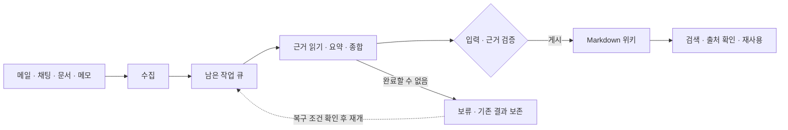

# Lorekeeper

[](https://www.rust-lang.org)
[](LICENSE)
[](https://deepwiki.com/junyeong-ai/lorekeeper)

> **한국어** | **[English](README.en.md)**

**흩어진 업무 기록을, 출처를 확인하며 다시 쓸 수 있는 지식으로.**

메일·채팅·문서·메모를 모아 서로 연결된 Markdown 위키로 만듭니다.
Claude Code 또는 Codex가 요약·개념·관계를 판단하고, Rust CLI가 입력과 근거의 변경을 검증해 게시합니다.
Obsidian으로 읽거나, 에이전트에게 근거를 질문하거나, 일반 Markdown 파일로 활용하세요.

[빠른 시작](#빠른-시작) · [활용 방법](#지식을-찾고-활용하기) · [지원 소스](#소스) · [실행 설정](#에이전트와-실행-설정) · [운영](#운영과-완료-확인)



수집 성공, 작업 게시, 의미 검토 완료는 서로 다른 상태입니다. 구조 검사를 통과해도 모든 주장이 사실이거나 전체 검토가 끝났다는 뜻은 아닙니다.
Markdown이 지식의 기준이며, SQLite는 다시 만들 수 있는 검색 인덱스입니다.

## 빠른 시작

먼저 로컬 메모 한 개로 시작하세요. 외부 소스의 자격증명은 필요 없습니다.
macOS Apple Silicon 또는 Linux x86_64/ARM64와 로그인한 **Claude Code**(`>=2.1.303,<3`) **또는 Codex**(`>=0.163.0,<1`) CLI가 필요합니다.
Obsidian은 선택 사항입니다. Windows 설치본은 제공하지만 네이티브 에이전트 실행과 `workflow`는 Unix 전용입니다.

### 1. 설치

```bash
curl -fsSL https://raw.githubusercontent.com/junyeong-ai/lorekeeper/main/scripts/install.sh | bash
```

바이너리·템플릿·스킬을 설치합니다. 기존 사용자라면 `lore self update`를 사용하세요.
Windows·설치 경로·복구는 [설치 안내](skills/lore-ingest/references/installation.md)에 있습니다.

### 2. 저장 위치와 에이전트 선택

```bash
LORE_CONFIG_DIR="${XDG_CONFIG_HOME:-$HOME/.config}/lorekeeper"
cp -n "$LORE_CONFIG_DIR/config.starter.yaml" "$LORE_CONFIG_DIR/config.yaml"
${EDITOR:-vi} "$LORE_CONFIG_DIR/config.yaml"
```

기존 설정은 보존됩니다. `vault.root`, `vault.timezone`, `vault.locale`(`ko` 또는 `en`, 스타터는 `ko`),
`identity`와 `execution.profiles.primary.engine`(`claude-code` 또는 `codex`)을 맞추세요.
Lore는 이 파일보다 작업 디렉터리의 `./config.yaml`을 먼저 읽습니다. 다른 설정은 `--config`나 `LORE_CONFIG`로 지정합니다.

```bash
lore validate
lore schema
mkdir -p "$(lore config vault-root)/inbox"
```

`validate`는 로컬 설정을 확인하고, `schema`는 볼트의 페이지 작성 규칙을 `wiki/AGENTS.md`에 씁니다.
설정·인증의 상세 절차는 [초기 설정](skills/lore-setup/references/config.md#initial-setup)을 따르세요.

### 3. 메모를 넣고 실행

볼트의 `inbox/`에 Markdown 메모 하나를 넣고 실행하세요.

```bash
lore ingest --dry-run   # 입력 확인; 페이지는 쓰지 않음
lore run daily         # 수집 → 의미 처리 → 게시와 최종 검사
```

게시가 끝나면 스타터의 inbox 설정이 메모를 `inbox/archived/`로 옮깁니다.
수집만 하려면 `lore ingest`, 수집된 기록의 남은 작업만 처리하려면 `lore run process`를 사용합니다.
`lore run`은 `--batches N`으로 늘리지 않으면 한 배치만 실행하므로, 큰 작업은 여러 번의 실행에 걸칠 수 있습니다.

### 4. 결과와 근거 확인

```bash
lore queue check
lore wiki reviews --check
lore wiki search "메모의 핵심 주제"
```

검색된 페이지에서 설명과 연결된 출처를 함께 확인하세요. 기본 저장 위치는
`daily/`, `wiki/documents/`, `wiki/concepts/`, `wiki/explorations/`이며, `vault.dirs`로 `daily/`와 `wiki/` 최상위 디렉터리 이름을 바꿀 수 있습니다.
Obsidian에서는 Settings → Files and links에서 Use [[Wikilinks]]를 끄고 New link format을 Relative path to file로 지정하세요.
볼트의 Obsidian 설정이 다르면 `lore validate`가 경고합니다.

## 지식을 찾고 활용하기

Claude Code에서는 `/lore-wiki query 재시도 정책을 정한 근거는?`, Codex에서는 `$lore-wiki`와 질문을 사용하세요.
볼트에 쓰는 세션(기록, 소스 추가, 추출, 큐 처리)은 `lore workflow -- claude` 또는 `lore workflow -- codex`로 시작하세요.
다른 방식으로 시작한 세션이면 스킬이 세션을 다시 시작하도록 안내합니다.

| 하고 싶은 일 | 스킬 |
|---|---|
| 근거 검색·소스 추가·현재 작업의 배움 기록·관계 감사 | `lore-wiki` (`query`, `add`, `capture`, `audit`) |
| 저장소 문서·코드에서 지식 추출 | `lore-extract` (`scan → run → audit`) |
| 소스 설정 / 수집·스케줄 / 남은 의미 작업 | `lore-setup` / `lore-ingest` / `lore-process` |
| 오늘 할 일·지식 브리핑·완료 기록 | `lore-day` — 개인 보드는 선택 사항 |

`lore wiki search --body`는 페이지의 Markdown 본문을 줄 단위로 그대로 검색합니다.
아래 경로는 실제 검색 결과로 바꾸세요.

```bash
lore wiki search "재시도"
lore wiki read wiki/concepts/retry-policy.md
```

관계·인용·원본을 함께 확인하는 절차는 [검색 안내](skills/lore-wiki/references/query.md)에 있습니다.
이름이 비슷하다는 이유만으로 개념을 합치지 않으며, 출처의 조건·귀속·미해결 질문을 구분합니다.
추출할 개념이 없으면 빈 결과도 정상입니다.

## 소스

| 타입 | 모으는 기록 | 인증·준비 |
|---|---|---|
| `gmail` | 선택한 메일 | Google OAuth |
| `slack-channel` | 채널 메시지·스레드 | Slack 토큰 |
| `slack-search` | 검색 조건에 맞는 메시지 | Slack 사용자 토큰 |
| `jira` | JQL로 선택한 이슈 | Jira API 인증 |
| `confluence` | CQL로 선택한 페이지 | Atlassian OAuth 또는 API 토큰 |
| `google-calendar` | 일정·지원되는 Drive 회의록 | Google OAuth |
| `google-drive` | 선택한 폴더의 문서 | Google OAuth |
| `rss` | 피드·선택적 기사 본문 | 인증 불필요 |
| `nodex` | 저장소의 결정·학습 기록 | `nodex.toml`, nodex `>=0.69` |
| `manual` | 로컬 텍스트·지원되는 바이너리 문서 | 기본 입력은 인증 불필요 |
| `tasks` | 완료한 할 일·메모 | 인증 불필요 |

필요한 소스만 `$LORE_CONFIG_DIR`에 설치된 `config.example.yaml`에서 복사해 활성화하세요. 설치된 예제는 바이너리 버전과 일치합니다
([저장소 사본](config.example.yaml)). 같은 타입을 여러 개 둘 수 있습니다.
인증은 `lore init credentials`, 소스 접근 확인은 `lore ingest --dry-run SOURCE_ID`를 사용합니다.
자격증명은 `credentials.file`로 다른 경로를 지정하지 않으면 `<vault>/.lorekeeper/credentials.json`에 저장됩니다. `.lorekeeper/`는 Git과 공유 동기화에서 제외하세요.
DOCX·XLSX·PDF·이미지는 [전처리 설정](skills/lore-setup/references/config.md#document-preprocessing)이 필요할 수 있습니다.
개념 추출은 소스의 `concept_policy`로 켜며, 생략하면 꺼집니다.

## 에이전트와 실행 설정

에이전트는 두 방식으로 동작합니다. 스킬은 사용자가 시작한 Claude Code나 Codex 세션 안에서 질문·기록·추출을 수행합니다.
`lore run`과 예약 작업은 `execution.profiles`가 고른 `claude` 또는 `codex` CLI를 직접 실행합니다.
이 호출은 해당 CLI 계정의 사용량을 쓰며, 예산은 토큰이 아니라 에이전트 호출 횟수로 셉니다.

최소 설정은 [스타터](config.starter.yaml)를 사용하세요. 프로필 선택 순서는
`--profile` → 작업별 `execution.operations` → `execution.default_profile`입니다.
[단계별 프로필](skills/lore-setup/references/config.md#optional-stage-profiles)은 필요한 단계만 설정할 수 있고,
생략한 단계는 선택된 기본 프로필을 그대로 사용합니다. 실패 시 호스트를 자동 전환하지 않습니다.

기본 배치 예산은 **64회 호출·동시 실행 1개·입력 262144B·결과 32768B**입니다.
`execution.work`와 프로필별 선택적 덮어쓰기로 조정하며, 단계가 바뀌어도 예산은 공유합니다.
이는 토큰·요금 상한이나 품질 보장이 아닙니다. [실행 설정](skills/lore-setup/references/config.md#execution-profiles)을 참고하세요.

큰 입력은 제한된 크기로 나누어 읽고, 끝난 호출의 결과는 돌아오는 즉시 저장합니다.
그래서 예산에 걸려 멈춘 실행도 이미 끝난 호출을 반복하지 않고 이어서 진행합니다. [대용량 작업](skills/lore-process/references/bounded-work.md)을 참고하세요.
개념 추출은 소스마다 질의별로 검색 순위가 높은 기존 페이지 최대 `execution.work.max_query_candidates`개(기본 50개)와
이름·별칭이 정확히 일치하는 페이지를 비교합니다. 개념 합성은 인용 페이지와 직접 링크한 개념을 모두 읽고,
탐색 일치 페이지는 질의별 상위 50개와 이름 일치 페이지만 읽습니다. [탐색 안내](skills/lore-process/references/discovery.md)를 참고하세요.

자동 감사는 `graph.audit.subjects`에 지정한 유형(기본값은 개념)만 계획합니다. 변경된 주제와 아직 평가하지 않은 주제를 번갈아 고르고,
각 묶음 안에서는 검토 의무, 후속 조치 기록, 인용 페이지 수, 이미 시작한 탐색 순으로 진행합니다. `lore status`의 audit 행은
현재 평가가 유효한 주제의 비율을 보여 줍니다. 위험이 낮은 주제는 뒤로 밀릴 수 있으며 전체 감사를 약속하지 않습니다.
`graph.audit.min_sources`를 지정하면 서로 다른 페이지 그만큼에서 인용된 개념만 필수 범위로 셉니다. 나머지 개념은
`below_min_sources`로 따로 세고, 필수 범위의 주제를 모두 계획한 뒤에 평가합니다.

## 운영과 완료 확인

| 목적 | 명령 |
|---|---|
| 전체 상태·중지된 작업과 다음 명령 | `lore status` |
| 수집부터 처리·게시까지 | `lore run daily` |
| 수집된 기록의 남은 큐 작업 | `lore run process` |
| 준비된 지식 감사 한 배치와 후속 큐 처리 | `lore run knowledge` |
| 남은 작업·미게시 결과·중단된 게시 | `lore queue status --json`, `lore queue check` |
| 링크 구조 / 판단 재검토 / 감사 준비 상태 | `lore graph lint`, `lore wiki reviews --check`, `lore wiki audit-plan --ready` |
| 마지막 수집 성공과 최근 부분 수집·실패 구분 | `lore health --json` |
| 저장소 탐색 변경 / 보존된 추출 입력 검증 | `lore extract status --json`, `lore extract verify --json` |

일부 결과를 게시하고도 작업 전체는 미완료로 끝날 수 있습니다. 다시 실행하기 전에 `lore status`와 작업 보고를 확인하세요.

정기 실행은 `lore schedule`로 정의를 출력한 뒤 [스케줄링 절차](skills/lore-ingest/references/scheduling.md)에 따라 OS에 등록합니다.
launchd 작업은 `~/Library/Logs/lorekeeper`에 기록하므로 등록하기 전에 이 디렉터리를 만드세요. cron 출력은 crontab의 메일·리다이렉션 설정을 따릅니다.
`execution.automation`을 설정하면 큐 처리를 별도로 예약하고, 모든 예약 작업이 하나의 UTC 일일 호출 한도와 실행별 시간 제한을 공유합니다.
이 설정에는 `process_schedule`, `max_run_seconds`, `max_calls_per_day`가 필수이며, `max_calls_per_day`를 `null`로 지정하면 일일 한도가 없습니다.

신호에 의한 종료나 알 수 없는 호스트 오류처럼 입력 하나로 한정할 수 없는 실패가 나면 해당 작업의 예약 실행이 일시 중지됩니다.
`lore status`가 중지를 일으킨 단계를 보여 줍니다. 원인을 해결한 뒤 `lore run OPERATION --scheduled --resume`으로 재개하세요.
업데이트는 이전 버전이 기록한 중지를 지우지 않습니다(`host environment` 단계의 중지만 예외입니다). 단계 이름만으로는 호스트 실패와 무결성 실패를 구분할 수 없기 때문입니다.
업데이트한 뒤 남아 있는 각 중지의 단계와 상세 내용을 `lore status`에서 확인하고, 원인을 해결한 다음 그 작업만 `--resume`으로 재개하세요.
한 입력에서 시간 초과가 반복되거나 호출이 오류 코드로 끝나면 그 입력만 보류됩니다.
끝난 결과는 저장된 채로 남고 다른 작업은 계속 진행되며, 보류된 입력은 해제하거나 입력이 바뀔 때까지 다시 호출되지 않습니다.
마찬가지로 백링크 정합화가 갱신하지 못하는 개념 페이지나 `lore graph lint` 위반은 고칠 페이지를 알려 줄 뿐, 다른 작업은 계속 진행되고 작업은 미완료로 남습니다. 읽을 수 없는 페이지는 여전히 해당 작업을 일시 중지합니다.
`/lore-process`에 진단과 해제를 맡기거나, 정확한 `lore work retry` 명령은 [계획과 재개](skills/lore-process/references/bounded-work.md#plan-and-resume)를 따르세요. 각 명령은 `--dry-run`으로 먼저 확인할 수 있습니다.

업데이트는 `lore self update`, 설치 상태 확인은 `lore self status`를 사용합니다. 큐 작업이나 중단된 게시가 남아 있으면 업데이트를 거부하며,
`--force`를 쓸 조건은 [설치 안내](skills/lore-ingest/references/installation.md#update-and-repair)에 있습니다.
macOS에서는 업데이트 뒤 launchd 작업을 다시 등록해야 실행될 수 있습니다. [등록과 확인](skills/lore-ingest/references/scheduling.md#registration-and-verification) 절차를 따르세요.
백업은 숨김 상태를 포함한 전체 볼트와 `config.yaml`을 함께 보존해야 합니다. 에이전트 호출 결과·큐·검토 이력은 캐시가 아닙니다.
백업에는 자격증명이 들어 있으므로 백업 자체를 보호하세요.
Unix의 `lore self snapshot -- 백업명령 인수...`는 백업 동안 협력 쓰기를 차단합니다.
백업 명령 안에서 Lore를 호출하지 말고, 외부 편집기를 중지한 뒤 백업 내용도 검증하세요.
[설치·백업·복구](skills/lore-ingest/references/installation.md), [큐 복구](skills/lore-process/references/recovery.md),
[의미 유지관리](skills/lore-wiki/references/maintenance.md)에서 상태별 절차를 확인할 수 있습니다.

## 더 알아보기와 개발

명령은 `lore --help`와 `lore COMMAND --help`, 전체 옵션은 [설정 예제](config.example.yaml),
코드 구조와 기여 규칙은 [AGENTS.md](AGENTS.md)를 참고하세요.
Rust 2024 edition, 빌드 도구체인·MSRV **1.100.0**을 사용합니다.

```bash
cargo build --release --locked
./target/release/lore --help
./scripts/check.sh                 # 전체 CI 검사; 변경 시 관련 집중 검사부터
```

[LLM Wiki 구상](https://gist.github.com/karpathy/442a6bf555914893e9891c11519de94f)에서 영감을 받았습니다. 라이선스: [MIT](LICENSE).
